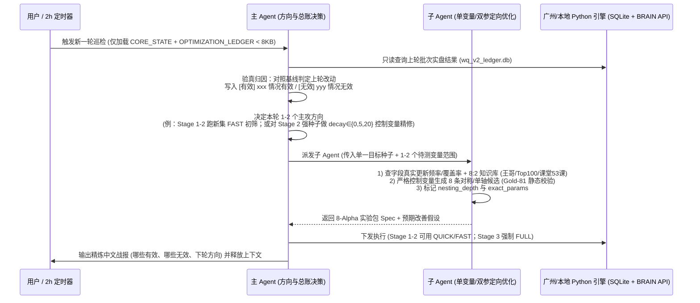

# 跨 AI 工具无缝切换与「主 Agent + 子 Agent」自动清空上下文闭环指南

> [!IMPORTANT]
> 本指南参考 `/setup-matt-pocock-skills` 的**仓库级契约化配置思想**，将我们的研究记忆、当前进度、经验法则与控制变量归因**100% 剥离出冗长的聊天记录**，固化为本地轻量 JSON/Markdown 真源。无论您随时切换到 **Claude Code、Cursor、Codex CLI、还是开启全新的 Antigravity 对话**，或是使用 `/compact` 清空上下文，只需 **1 句话启动指令** 即可在 `< 8 KB` 核心上下文内无缝接续运行！

---

## 1. 为什么不会上下文爆炸？（三级轻量状态架构）

传统长对话之所以上下文爆炸，是因为把几千条回测日志和历史讨论都留在对话窗口里。我们现在采用 **「只留核心状态 + 归因闭环账本 + 底层 SQLite 全量落盘」** 三级解耦：

| 层级 | 文件路径 | 体积上限 | 作用与更新机制 |
| :-: | --- | :-: | --- |
| **L1 核心脉搏**（每次必读） | [docs/agents/CORE_STATE.json](file:///c:/Wq/WorldQuant%20Brain/docs/agents/CORE_STATE.json) | `< 4 KB` | 仅保存：硬红线、当前专注的 1–2 个地区/数据集、现役 `Useful` 冠军（含嵌套层数标记与精确参数）、阶段 1–4 开关契约、Baseline v1.0 回退指针。 |
| **L2 经验归因账本**（主从闭环必读） | [docs/agents/OPTIMIZATION_LEDGER.json](file:///c:/Wq/WorldQuant%20Brain/docs/agents/OPTIMIZATION_LEDGER.json) | `< 6 KB` | 仅保存结构化的 **`[有效] xxx 的情况是有效的（ΔSh/ΔMgn/ΔPC）`** 与 **`[无效] yyy 的情况是无效的（根因与禁令）`**，杜绝重复踩坑。 |
| **L3 流程与规则真源**（按需抽读） | [AGENTS.md](file:///c:/Wq/WorldQuant%20Brain/AGENTS.md)<br>[d1_ra_baseline_v1_frozen.json](file:///c:/Wq/WorldQuant%20Brain/docs/整理与研究/workflow/d1_ra_baseline_v1_frozen.json)<br>[reusable_experience_rules.json](file:///c:/Wq/WorldQuant%20Brain/wq_research_v2/config/reusable_experience_rules.json) | 静态文件 | 冻结版 Baseline v1.0 完整参数、华子哥+顾问课堂 53 课种子筛选规则、81 个 Gold 算子白名单。 |

> **自动清空上下文建议**：
> - 在 **Antigravity / Claude Code** 中：每运行 3–4 轮（或每 2–4 小时），您只需输入 `/compact`（或直接新开一个聊天窗口），因为所有核心进度均已实时写回 `CORE_STATE.json` 与 `OPTIMIZATION_LEDGER.json`，清空聊天窗口**零信息损失**！

---

## 2. 换任何 AI 工具（或新开窗口）时如何一键启动？

我们已在仓库内内置了通用跨平台 Skill：[`.agents/skills/wq-d1-closed-loop/SKILL.md`](file:///c:/Wq/WorldQuant%20Brain/.agents/skills/wq-d1-closed-loop/SKILL.md)（同时同步至全局 `~/.gemini/antigravity/skills/wq-d1-closed-loop/SKILL.md`）并在 `AGENTS.md` 写入了标准 `## Agent skills` 入口。

### 启动口令（复制这一句话给任何 AI 工具即可）：

```text
请读取 AGENTS.md、docs/agents/CORE_STATE.json 和 docs/agents/OPTIMIZATION_LEDGER.json，按 wq-d1-closed-loop 技能启动「主Agent方向决策 + 子Agent控制变量优化」闭环，先检查上轮结果哪些有效、哪些无效，再决定下一轮优化方向。
```

---

## 3. 「主 Agent + 子 Agent」控制变量闭环是如何运作的？



### 主从闭环的四大硬纪律：
1. **每次必先验真归因**：启动第一件事不是盲发新批次，而是检查上一批相对母版基线（Parent Baseline Alpha ID）是**正向改善**还是**负向劣化**，明确给出：
   - **`[有效] xxx 的情况是有效的`**：例如“`USA/analyst_revision_horizons` 免额字段用 `SUBINDUSTRY/RAM + decay_linear(10)` 初筛直出 `Sh=1.21` 有效”；
   - **`[无效] xxx 的情况是无效的`**：例如“`tail(..., newval=0)` 外层套 `hump(0.01)` 导致 `Sh 1.83 → 0.83` 无效，永久禁止该组合”。
2. **Stage 1–2 极简标准化 + `FAST/QUICK` 快筛**：
   - 种子来自**华子哥 WDS 蓝海四差距 + 顾问课堂 53 课规则**（新集/`Alphas=0`/`cov>=0.75`/`dateCov>=0.60`/明确经济假设）；
   - 阶段 1–2 默认固定 **`decay = 0`、`neutralization = SUBINDUSTRY`**，支持开启 **`simulationMode = "QUICK"`（Fast 模式，`testPeriod = "P0Y0M"`）** 快速过滤无意义字段，满 48 条正向命中率 `<2%` 自动早停，通过 `seed_pruner.py`（`jaccard=0.78`）剪去同质克隆。
3. **Stage 3 强制 `FULL` + 严格控制变量（每次只动 1–2 个参数）**：
   - 进入阶段 3 后**严禁使用 `FAST/QUICK`**，一律用 `FULL`；
   - 第一轮固定表达式轮询 **`decay ∈ {0, 5, 20}`**（默认基线为 `0`）；第二轮固定最优 `decay` 轮询中性化（`SUBINDUSTRY` / `RAM` / `CROWDING` / `STATISTICAL`）；第三轮针对唯一未过项（`2Y` / `Sub-Uni` / `PC`）做单步算子手术。
4. **嵌套层数标记与两周后（`2026-12-10`）进阶开关**：
   - 推荐 `op_count <= 6`、`nesting_depth <= 4`；若因降 PC 暂时用到 `>= 5` 层嵌套，自动标记 `OVER_NESTED_TEMP_PC_FIX` 并完整记录每层参数；
   - `2Y Test`（`testPeriod="P2Y0M0D"`）与全局 `maxTrade="ON"` 当前保持关闭，定于 **`2026-12-10`（两周后）** 开启测试。
