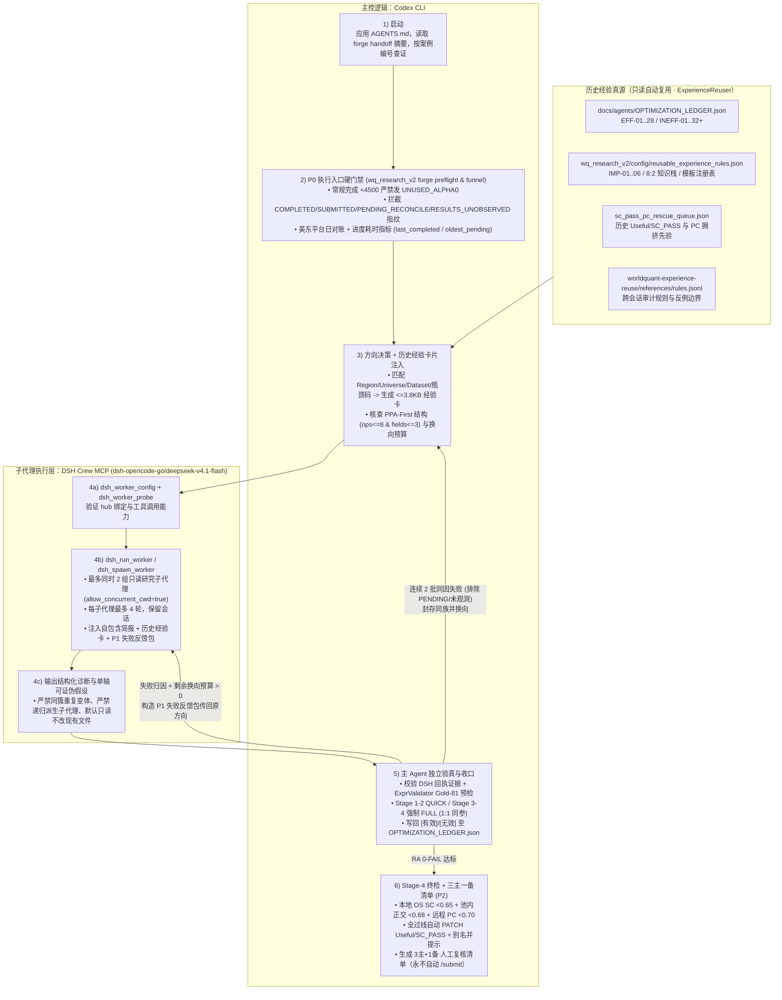

# 路线 ④：锻造闭环路径（AlphaForge v4.0）

> **路线标识**：`alphaforge_agy_dsh_v4` · 日志前缀 `[TRACK:alphaforge_agy_dsh_v4]`  
> **构建基座**：基于冻结基线 **路线 ①（`baseline_v1`）** 与 `wq_research_v2` D1-Only 引擎扩展，完整落地 [doc/ALPHAFORGE_WORKFLOW_REVIEW_20261128.md](../../doc/ALPHAFORGE_WORKFLOW_REVIEW_20261128.md) 中的 P0 / P1 / P2 工程闭环。  
> **主从编排**：Codex CLI 主控，`dsh_crew` MCP 子代理只读核验，`ExperienceReuser` 按本轮坐标检索历史经验。
> **配置文件**：[alphaforge_v4_config.json](alphaforge_v4_config.json) · **专属运行日志**：[alphaforge_v4_log.md](alphaforge_v4_log.md) · **四条路线总手册**：[TRACKS_AND_LOGS_GUIDE.md](../TRACKS_AND_LOGS_GUIDE.md)

---

## 一、Codex CLI 主控与 DSH 子代理



---

## 二、与基础路线（Baseline v1.0）的继承与增量对照

| 维度 | 路线 ① 基础优化路径 (`baseline_v1`) | 路线 ④ 锻造闭环路径 (`alphaforge_agy_dsh_v4`) |
| --- | --- | --- |
| **硬红线与核心引擎** | `delay=1`、禁 `+`/`*`/`trade_when`、Gold-81、零 `/submit`、`GLB<=3`/他区`<=4`、512M RAM、WAL | **100% 继承**，零突破、零自动提交 |
| **主从编排方式** | 人工/通用对话 + 后台守护 | Codex CLI 主控与 `dsh_crew` MCP 子代理（先 probe，最多 2 组只读并发，每组 ≤4 轮） |
| **历史经验复用** | 人工翻阅文档与台账 | `ExperienceReuser` 按坐标和瓶颈检索历史真源，生成经验卡供 Codex CLI 与 DSH 简报使用 |
| **P0 执行入口门禁** | 依赖调度器常规顺序 | `forge preflight` 入口硬拦截：**`NORMAL < 4500` 拒绝 `UNUSED_ALPHA0`**；拦截已终结/未观测指纹重发；美东日漏斗去重对账 |
| **P1 失败回传与换向** | 人工复盘决定是否止损 | **结构化失败反馈包回传原方向**（含低 localSC+高 PC 归因、屏蔽同族变体、单轴可证伪假设）+ **连续 2 批同因失败强制换向**（待判/未观测不计入失败预算） |
| **P1 PPA-First 归因** | 靠人工识别 UI 报错 | `forge ppa-check` 自动统计非豁免算子/字段数，独立保留 403、原始 checks 与 UI `Prod Correlation FAIL` 假象来源 |
| **P2 复核清单与单位产出** | 按 Margin 排序打标 | `forge roster` 编排 **三主一备（3+1）金字塔正交复核清单**（仅人工复核清单，非提交配额）+ 统计每百条 FULL 有效产出与透明拥挤先验 |

---

## 三、标准执行步骤（四步闭环）

### Step 0 · 环境与 P0 入口预检（零回测成本）
```powershell
$env:PYTHONPATH="wq_research_v2\src"

# 1. 查看针对当前坐标与瓶颈的历史经验复用卡
python -m wq_research_v2 forge experience --region USA --universe TOP3000 --dataset ai_equity_alpha --failure HIGH_PC

# 2. P0 执行入口门禁预检（例如核验 NORMAL<4500 拦截 UNUSED_ALPHA0 与表达式 AST/指纹去重）
python -m wq_research_v2 forge preflight --region USA --queue NORMAL --normal-completed 1200 --stage STAGE_3 --mode FULL --expr "group_rank(ts_decay_linear(ts_backfill(x, 21), 10), subindustry)"

# 3. P0/P1/P2 美东平台日漏斗、进度与单位产出审计
python -m wq_research_v2 forge funnel --db data/wq_v2_ledger.db
```

### Step 1 · 启动 Codex CLI 主控

使用启动器调用 `codex exec`。默认只输出一行摘要，`--show-prompt` 可查看完整提示。正式启动时，启动器设置 Python 模块路径并保留独立的 CLI 日志。
```powershell
# 预览默认启动
python scripts/ops/launch_alphaforge_v4.py

# 只读验收默认路线和 Codex CLI
python scripts/ops/launch_alphaforge_v4.py --verify
# 验收 Codex CLI 内的 DSH 探测和派单
python scripts/ops/launch_alphaforge_v4.py --verify-dsh

# 正式运行一轮
python scripts/ops/launch_alphaforge_v4.py --region USA --universe TOP3000 --dataset ai_equity_alpha --effort high --execute
```

启动器优先使用 Codex 桌面提供的 CLI，终端可用 `--codex-bin` 显式选择安装路径。每次实际启动的 CLI 日志保存在 `data/alphaforge_v4_runs/`，路线回执追加到 [alphaforge_v4_log.md](alphaforge_v4_log.md)。广州台账或配额只取得旧快照时，记录观测时间，等待当日证据再下发回测。

`--verify-dsh` 和 `--execute` 在本次 CLI 进程中授权 DSH 的绑定、探测和单任务派单。交互会话可审批工具调用，无交互 `codex exec` 需要这三项工具级配置。验收通过时退出码为 0，并输出工具事件中的 job ID、实际模型、状态和 token 用量。失败时输出失败步骤，完整事件保存在日志中。

### Step 2 · Codex CLI 调用 DSH 子代理
1. **绑定并探测**：调用 `dsh_worker_config(enabled=true, mode="hub", escalate_on_failure=false)` 核实 `flash` 绑定为 `dsh-opencode-go/deepseek-v4.1-flash`，再调用 `dsh_worker_probe(tier="flash", provider="dsh-opencode-go", model="deepseek-v4.1-flash")` 确认 `tool_call_verified=true`。
2. **生成带历史经验与失败反馈的自包含简报**：
   ```powershell
   python -m wq_research_v2 forge dsh-brief --region USA --universe TOP3000 --dataset ai_equity_alpha --failure HIGH_PC --goal "只读复核 S3-r34 候选 PC 分布与单轴修复可行性" --evidence "C:\Wq\WorldQuant Brain\docs\agents\CORE_STATE.json,C:\Wq\WorldQuant Brain\docs\agents\OPTIMIZATION_LEDGER.json"
   ```
3. **派单与并发边界**：
   - 启动器用 `dsh_run_worker(tier="flash", effort="high", task=...)` 做单任务阻塞核验，由主控写入台账。
   - 交互会话并发派单最多 **2 组只读研究子代理**（`dsh_spawn_worker(..., allow_concurrent_cwd=true)`）。
   - 每个 DSH 子代理最多 **4 轮对话**，达上限停止派发并保留会话与 job ID / provider / model / token 回执。

### Step 3 · 主控独立验真、Stage-4 自动打标与三主一备清单
1. 主控独立核验 DSH 返回的证据位置、指标与表达式（绝不轻信未验证摘要），用 `ExprValidator` 与 `forge ppa-check` 过关后再推进回测（Stage 1–2 允许 `QUICK`，Stage 3–4 强制 `FULL` 且首轮 1:1 保持 QUICK 参数对齐 `EFF-28`）。
2. 若同一方向连续 **2 批**卡在同一策略瓶颈（排除 `PENDING` / `RESULTS_UNOBSERVED` / 429 / 5xx），立即封存同族候选并写入 `OPTIMIZATION_LEDGER.json` 的 `ineffective_cases`，切换正交数据集。
3. 对通过全部 RA 硬检 + 本地 OS `SC < 0.65` + 池内正交 `< 0.68` + 远程数值 `PC < 0.70` 的候选：
   - 按 `Margin (bp)` 降序自动 `PATCH` 标签 **`Useful`** + 别名 `SC 0.xxx PC 0.xxx`（仅 PC 未过或同簇次优打 **`SC_PASS`**）并在回复中向用户提示；
   - 调用 `python -m wq_research_v2 forge roster --input <today_passed.json>` 编排 **三主一备（3 Primary + 1 Backup）** 人工复核清单供用户网页端手工提交（**严禁自动 `/submit`**）；
   - 将本轮 `[有效]/[无效]` 结论追加至 `docs/agents/OPTIMIZATION_LEDGER.json` 与本路线专属日志 [alphaforge_v4_log.md](alphaforge_v4_log.md)。

---

## 四、严禁事项（与工作区红线一致）

1. **严禁**任何形式的自动 `/alphas/{id}/submit` 或绕过人工复核的自动提交。
2. **严禁**把「三主一备」人工复核清单误当作每日强制定额、PPA/SA 槽位或并发线程数。
3. **严禁**在 `NORMAL < 4,500` 完成前混发 `UNUSED_ALPHA0`，严禁重发已记录为 `COMPLETED_*` / `PENDING_RECONCILE` / `RESULTS_UNOBSERVED` 的指纹。
4. **严禁** DSH 子代理递归派生子代理、修改 `reference/` / `legacy_core/Core/runtime_data/` / `Password/config.yaml` 或覆盖 `COMPLETED_FULL` 行。
5. **严禁** 60 秒高频空转轮询；沿用 3–24 小时任务窗口与最长 4 小时一次的轻量巡检节奏。
