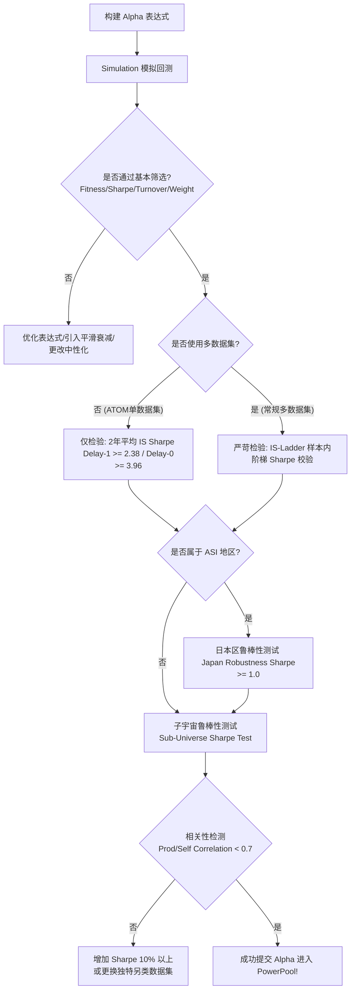

# WorldQuant BRAIN: 官方文档通关与黄金顾问实战完全手册

本手册基于 WorldQuant BRAIN 官方文档中心（Documentation）的 11 大核心主题深度梳理，专门针对您当前的 **Gold Advisor（黄金顾问）** 级别进行量身定制。手册重点提炼了能直接提升因子（Alpha）提交通过率、降低相关性、规避过拟合校验的**底层数理规则与通关策略**。

---

## 目录
1. [黄金顾问特权与 Genius 晋级蓝图](#1-黄金顾问特权与-genius-晋级蓝图)
2. [因子提交通关测试与底层指标汇总](#2-因子提交通关测试与底层指标汇总)
3. [黄金级研究利器：三大进阶开发策略](#3-黄金级研究利器三大进阶开发策略)
4. [官方文档 11 大主题核心要点总结](#4-官方文档-11-大主题核心要点总结)
5. [高价值二级有用链接与开发工具汇总](#5-高价值二级有用链接与开发工具汇总)
6. [量化研究红绿线：顾问 Dos & Don'ts 准则](#6-量化研究红绿线顾问-dos--donts-准则)

---

## 1. 黄金顾问特权与 Genius 晋级蓝图

作为 **Gold Advisor（黄金顾问）**，您已迈出了 BRAIN 专业量化生涯的第一步。了解自身的权益边界和后续 Expert ➔ Master ➔ Grandmaster 的晋级路径，有利于您合理规划算子与数据集资源。

### 1.1 顾问级别权益对照表

| 权益维度         | GOLD (黄金 - 您当前级别)     | EXPERT (专家)         | MASTER (大师)                    | GRANDMASTER (特级大师)                  |
| :--------------- | :--------------------------- | :-------------------- | :------------------------------- | :-------------------------------------- |
| **可研究区域**   | USA, ASI, EUR, GLB, IND, CHN | 相同                  | + **AMR (美洲其他), JPN (日本)** | + **HKG (香港), KOR (韩国), TW (台湾)** |
| **数据访问权限** | **50%** 平台可用数据集       | **61%** 可用数据集    | **78%** 可用数据集               | **100%** 可用数据集                     |
| **算子访问权限** | **45%** 平台可用算子         | **63%** 可用算子      | **78%** 可用算子                 | **100%** 可用算子                       |
| **SuperAlpha**   | 仅使用个人 Alpha 进行组合    | 可融合本校顾问 Alpha  | 可融合本国顾问 Alpha             | **可融合全球顾问 Alpha**                |
| **人脸验证频率** | **每 4 小时**                | 每 6 小时             | 每 12 小时                       | **每 24 小时**                          |
| **季度保障津贴** | **$100 - $200 USD**          | **$200 - $2,000 USD** | **$2,000 - $8,000 USD**          | **$8,000 - $25,000 USD**                |

> [!TIP]
> **黄金顾问的核心破局点**：目前您拥有 **50% 的数据权限** 和 **45% 的算子权限**。这对于开发高质量的 **ATOM 另类单数据集因子** 以及在 **USA TOPSP500** 宇宙中复刻因子已开发逻辑完全足够。在积累满 100+ 个已提交因子后，建议积极尝试 **SuperAlpha** 个人组合，获取每日最高 **$60 USD** 的现金加成！

---

## 2. 因子提交通关测试与底层指标汇总

提交 Alpha 前，BRAIN 平台会对因子的回测报告进行极其严苛的多重过滤。以下是通关测试的完整指标底线与数理逻辑。

### 2.1 常规地区 vs 中国地区 (CHN) 通关指标对比

中国市场（CHN）因高印花税、高交易佣金等摩擦成本，平台设置了**极高的通过门槛**，以确保因子的实际可投性。

| 指标维度                  | 常规地区 (Delay-1)  | 常规地区 (Delay-0)  | 中国 CHN (Delay-1)           | 中国 CHN (Delay-0)           |
| :------------------------ | :------------------ | :------------------ | :--------------------------- | :--------------------------- |
| **Fitness (拟合度)**      | >= 1.0              | >= 1.5              | **>= 1.0**                   | **>= 1.5**                   |
| **Sharpe (夏普比)**       | >= 1.58             | >= 2.69             | **>= 2.08**                  | **>= 3.50**                  |
| **Returns (年化收益)**    | -                   | -                   | **>= 8.0%**                  | **>= 12.0%**                 |
| **Turnover (换手率)**     | 1.0% - 70.0%        | 1.0% - 70.0%        | **1.0% - 70.0%**             | **1.0% - 70.0%**             |
| **Max Weight (持仓上限)** | < 10.0%             | < 10.0%             | **< 10.0%**                  | **< 10.0%**                  |
| **宇宙强壮性测试**        | Sub-Universe Sharpe | Sub-Universe Sharpe | **Retain >= 40% Ret/Sharpe** | **Retain >= 40% Ret/Sharpe** |

### 2.2 核心三大鲁棒性数理检验

除了基本的 Sharpe 和 Fitness，因子还必须通过以下数学检验以排除“过拟合”嫌疑：

#### ① 子宇宙夏普比检验 (Sub-Universe Sharpe Test)
该测试旨在防止因子在流动性极差的小市值股票中表现优异，但在大市值主力股票中失效。平台会自动在更具流动性的子宇宙（如从 TOP3000 抽离的 TOP1000/TOP500）中重新运行因子，要求子宇宙的夏普比必须满足以下硬性公式：

$$\text{SubUniverse\_Sharpe} \ge 0.75 \times \sqrt{\frac{N_{\text{sub}}}{N_{\text{all}}}} \times \text{Alpha\_Sharpe}$$

> [!IMPORTANT]
> 如果您的因子在小市值股票中回测出的 Sharpe 很高，但大部分大盘股不适用，就会在此关被卡死。建议在开发时，频繁切换 `TOP3000` / `TOP2000` / `TOP1000` 甚至 `TOPSP500` 检验因子稳定性。

#### ② 亚太区日本鲁棒性测试 (Japan Robustness Sharpe Test)
* **适用范围**：所有属于 **ASI（亚洲地区）** 的因子。
* **规则**：因子在日本市场的模拟夏普比（Japan Robustness Sharpe）必须 **$\ge 1.0$**。
* **目的**：防止顾问利用某些发展中地区（如印尼、泰国等）高噪声或非流动性的个股强行拟合信号。必须在日本这样流动性极佳的发达市场同样展现出微弱但稳定的预测能力。

#### ③ 阶梯样本内检验 (IS-Ladder Sharpe Test)
常规因子在历史回测的 2 年、5 年、8 年至 10 年的不同时间切片中，夏普比不能出现断崖式下跌，必须展现出跨越牛熊的平稳性能。

### 2.3 完整因子提交通关决策流



---

## 3. 黄金级研究利器：三大进阶开发策略

针对黄金顾问现有的数据与区域权限，官方文档中隐藏了三大极高价值的进阶研究路径：

### 策略 A：ATOM (另类/单数据集) 因子开发 —— 黄金降维通道 🚀

* **核心定义**：整个 Alpha 表达式中，**只调用了一个数据集**（Dataset）中的数据字段。
* **数据豁免原则**：为了支持数据多样性，以下 6 个分组/地理中性化字段**不计入**数据集计数：
  `country`、`exchange`、`market`、`sector`、`industry`、`subindustry`。
  *(注：`inst_pnl` 算子算作使用了 `pv1` 量价数据集；`convert()` 转换也算作 pv1 数据集。)*
* **核心优势（极高通过率）**：
  * 🌟 **免检权**：ATOM 因子**完全豁免**极为繁琐的 **IS-Ladder Sharpe（样本内阶梯夏普比）测试**。
  * **替代规则**：仅需通过最近 2 年的平均样本内夏普比（Last 2Y Avg IS Sharpe）阈值即可：
    * **Delay-1** 通关夏普比：**2.38**
    * **Delay-0** 通关夏普比：**3.96**
  * **换手率宽限**：若因子换手率（Turnover） **< 30%**，上述 Sharpe 阈值将自动**乘以 0.85 折扣**（即 Delay-1 仅需 2.02 夏普即可通过！）。

> [!TIP]
> **黄金顾问实战秘籍**：寻找平台里未被充分挖掘的另类数据集（Alternative Dataset），例如舆情、内部人交易或供应链数据。只使用该另类数据集中的字段进行简单变换，不仅能极大避开与其他顾问的 Product Correlation（产品相关性），还能享受 ATOM 专属的超低通过门槛！

### 策略 B：全球因子 (GLB Alphas) —— 双重中性化对冲 🌍

* **特性**：合并了全球主要国家和地区的所有股票进行截面模拟（股票数达 ~9000 只）。由于跨国时区差异，**仅支持 Delay-1 回测**。
* **致命陷阱**：直接对全球股票进行截面 `neutralize(alpha, sector)` 会面临**国家Beta风险**。因为不同国家的宏观经济与政策不同，全球混合截面均值会稀释真实的超额收益。
* **官方推荐解法（双重中性化 - Double Neutralization）**：
  在公式中手动执行**国家维度中性化**，排除国别差异，然后再进行细分行业中性化。
  * **第一步**：使用 `group_neutralize(alpha, country)` 去除国家风险。
  * **第二步**：在 Simulation Settings 中，将 `neutralization` 设为 `SUBINDUSTRY`。
  * **三阶优化**：在使用 `SLOW/FAST/SLOW_AND_FAST` 统计中性化时，若想剔除地区偏见，可以结合 `group_neutralize` 算子并以 `country` 作为分组字段。

### 策略 C：美股 SP500 宇宙 (USA TOPSP500) —— 因子平移与高频交易 🇺🇸

* **宇宙构成**：涵盖约 650 只极高流动性的美股（包括标普500成分股及部分高流动性股票）。
* **开发策略**：
  1. **因子库一键平移**：将您之前在 `USA TOP3000` 或 `TOP1000` 宇宙下跑出的、由于子宇宙 Sharpe 不合格而折戟的优质因子，**直接平移**到 `USA TOPSP500` 下进行回测。由于成分股流动性极强，子宇宙检验极易通关。
  2. **高 Turnover 容忍度**：由于大盘蓝筹股的滑点极低，平台在此宇宙中对 **Turnover（换手率）的容忍度极高**。您可以尝试开发一些高换手（接近 60%）但预测力极强的中短期信号。

---

## 4. 官方文档 11 大主题核心要点总结

以下为平台文档中心（Documentation） 11 大主题的简明中文总结，并着重标注了对您提交因子的实际指导意义：

### ① Discover BRAIN (初识 BRAIN)
* **核心内容**：平台愿景、量化顾问 (RC) 的角色、核心术语（Alpha, Simulation, Universe）。
* **因子提交增益**：明确平台的核心收益来源是寻找“未被市场完全消化的超额收益 (Alpha)”，而非单纯的行业或大盘复制信号。

### ② Create Alphas (创建 Alpha)
* **核心内容**：介绍表达式编写语法、数据字段输入规范、常用算子（如 `rank`, `ts_delay`）。
* **因子提交增益**：指导新顾问如何将投资逻辑转化为规范的代码公式，奠定了因子的数学表达基础。

### ③ Examples (范例参考)
* **核心内容**：提供经典的动量因子（Momentum）、均值回归（Reversal）、价值因子（Value）的表达式模板。
* **因子提交增益**：**实战第一步**。新手可基于这些能跑通的模板进行参数调优、算子替换（如使用 `ts_regression` 替代 `ts_mean`），快速上手。

### ④ Interpret Results (结果解读)
* **核心内容**：深度剖析 Sharpe Ratio、Fitness、Turnover、PnL 曲线、Drawdown 及相关性的计算方式。
* **因子提交增益**：**提效核心**。教您如何看懂报错或低分报告。如 Turnover 偏高（>30%），指导您在表达式最外层包裹 `decay(alpha, n)` 进行平滑处理。

### ⑤ Understanding Data (理解数据)
* **核心内容**：数据字典分类（PV1 量价、ATOM 另类、FND 基本面等）及 Dataset Value Scores（数据集价值评分）。
* **因子提交增益**：**相关性破局点**。指导您避开拥挤的 PV1 量价数据，多使用 Value Scores 较高的另类或分析师数据集。特别地，我们针对 **Model77 财务质量数据** 和 **Sentiment1 实时舆情数据** 的核心字段、以及多维向量降维转换（`vec_` 算子）编写了深度实战分析，请立即阅读关联专稿：[BRAIN-Alpha表达式与高价值数据集核心指引.md](BRAIN-Alpha表达式与高价值数据集核心指引.md)。

### ⑥ Advanced Topics (高阶课题)
* **核心内容**：风险中性化（Neutralization）、多因子组合优化、风格暴露对冲。
* **因子提交增益**：**极度重要**。目前 PowerPool 仅收录完全风险中性化的因子。此章节指导顾问在 Settings 中将 Neutralization 设为 `SUBINDUSTRY`，并利用 `bucket`、`densify` 对特征数据做非线性标准化处理。关于 **FASTEXPR 引擎编译优化**、**防过拟合 "Second Best" 次优参数法则**、以及 **自定义 bucketing + densify() 横截面算子实战**，已在 [BRAIN-Alpha表达式与高价值数据集核心指引.md](BRAIN-Alpha表达式与高价值数据集核心指引.md) 中完整收录，可供您直接复制模版代码进行回测。

### ⑦ Regions and Universes (地区与股票宇宙)
* **核心内容**：各地区市场（USA, ASI, EUR, GLB, CHN）特点、股票池（TOP3000, TOP1000, TOPSP500）的差异。
* **因子提交增益**：教您合理利用“地区平移法”，将在 USA 表现优异的逻辑，平移至 EUR 或 ASI 区域回测，使因子产出量翻倍。

### ⑧ Consultant Information (顾问指南)
* **核心内容**：Genius 评级机制、月度 Base Payment 结算公式、合规及避坑红线。
* **因子提交增益**：让黄金顾问明确升级到 Expert/Master 的硬性指标与收益倍增路径，指明了长线研究的方向。

### ⑨ BRAIN API (平台 API 接口)
* **核心内容**：使用 Python SDK 远程连接服务器，进行批量因子生成、自动仿真与相关性排查。
* **因子提交增益**：**量化高手的必杀技**。彻底摆脱网页端一个个手动输入因子的低效模式，实现自动流水线式调参和因子提交。

### ⑩ SuperAlpha (超级 Alpha 组合)
* **核心内容**：允许顾问将自己已通过的多个常规因子，按科学权重融合成一个 SuperAlpha 信号。
* **因子提交增益**：SuperAlpha 拥有**每日独立提交配额 (1个)**，且能带来每日高达 **$1 - $60 USD** 的 Base Payment 额外加成。

### ⑪ Themes (研究主题)
* **核心内容**：官方定期发布的特定数据或策略主题（如：低换手另类主题月、Delay-0 专题等）。
* **因子提交增益**：严格紧跟 Theme 日历提交相符的 Alpha，可获得高额的结算乘数加成，直接翻倍您的单月津贴收益。

---

## 5. 高价值二级有用链接与开发工具汇总

为了帮助黄金顾问高效配置工作流，我们从官方文档中提炼出了最实用的 **4 大二级有用链接**，并直接在下方嵌入了**完整的 API 开发模板与脚本**：

### 1️⃣ [【代码模板】BRAIN Python SDK 快速上手样板](https://support.worldquantbrain.com/hc/zh-cn/community/posts/26228114442135)
* **内容深度**：1 层级（官方技术社区直接链接）。
* **核心总结**：提供了通过 API 自动化执行因子提交与检索的完整骨架代码。

#### 💻 黄金顾问专用 API 批量开发实战指南：

##### A. 凭证配置
首先，在您的系统 Home 目录（Windows 下通常是 `C:\Users\YourUsername\`，Linux/Mac 下是 `~`）下创建一个名为 **`.brain_credentials`** 的无后缀文件，写入如下 JSON 数组（替换为您的 BRAIN 账号密码）：
```json
["YOUR_EMAIL", "YOUR_PASSWORD"]
```

##### B. 完整的 Python API/SDK 自动化回测脚本
您可以直接将以下 Python 脚本保存为 `run_simulation.py` 并运行，即可实现远程安全登录、因子 JSON 构建、异步回测提交、自动进度追踪轮询及最终 PnL 数据拉取：

```python
import requests
import json
from os.path import expanduser
from time import sleep

# 1. 创建会话并读取凭证进行登录验证
s = requests.Session()
credentials_path = expanduser('~/.brain_credentials')
try:
    with open(credentials_path, 'r') as f:
        s.auth = tuple(json.load(f))
except FileNotFoundError:
    print(f"ERROR: 找不到凭证文件 {credentials_path}，请创建它！")
    exit(1)

auth_response = s.post('https://api.worldquantbrain.com/authentication')
auth_response.raise_for_status()
print("Success: 已成功通过 WorldQuant BRAIN API 安全认证登录。")

# 2. 定义回测仿真配置（以美国 TOP3000 SUBINDUSTRY 中性化为例）并提交
simulation_data = {
    'type': 'REGULAR',
    'settings': {
        'instrumentType': 'EQUITY',
        'region': 'USA',
        'universe': 'TOP3000',
        'delay': 1,
        'decay': 15,
        'neutralization': 'SUBINDUSTRY',
        'truncation': 0.08,
        'maxTrade': 'ON',
        'pasteurization': 'ON',
        'testPeriod': 'P1Y6M',
        'unitHandling': 'VERIFY',
        'nanHandling': 'OFF',
        'language': 'FASTEXPR',
        'visualization': False,
    },
    'regular': 'close' # 填入您的 Alpha 表达式，例如：close
}

print("正在向 BRAIN 云端提交 Alpha 回测任务...")
simulation_response = s.post('https://api.worldquantbrain.com/simulations', json=simulation_data)
simulation_response.raise_for_status()

# 3. 异步追踪回测进度 (Polling Loop)
simulation_progress_url = simulation_response.headers['Location']
print(f"已创建异步任务，追踪链接为: {simulation_progress_url}")

while True:
    simulation_progress = s.get(simulation_progress_url)
    retry_after = simulation_progress.headers.get("Retry-After")
    if retry_after is None or float(retry_after) == 0:
        break
    print(f"回测进行中... 系统提示等待 {retry_after} 秒后重试。")
    sleep(float(retry_after))

print("恭喜！Alpha 模拟回测已在云端计算完成！")
simulation_result = simulation_progress.json()
alpha_id = simulation_result["alpha"]
print(f"生成的 Alpha ID (唯一标识码): {alpha_id}")

# 4. 拉取因子的 Sharpe, Fitness 等详细性能指标
alpha_details = s.get(f"https://api.worldquantbrain.com/alphas/{alpha_id}")
print("====== 因子性能指标明细 ======")
print(json.dumps(alpha_details.json(), indent=4))

# 5. 拉取因子详细 PnL 收益曲线序列 (需等待数据准备就绪)
print("正在拉取底层 PnL 日度收益曲线数据...")
while True:
    pnl_response = s.get(f"https://api.worldquantbrain.com/alphas/{alpha_id}/recordsets/pnl")
    retry_after = pnl_response.headers.get("Retry-After")
    if retry_after is None or float(retry_after) == 0:
        break
    sleep(float(pnl_response.headers["Retry-After"]))

pnl_data = pnl_response.json()
print("Success: PnL 日度数据拉取成功！您可以将其导入 Pandas 进行本地自相关性扫描。")
```

---

### 2️⃣ [【一键部署】Google Colab 环境 API 一键配置教程](https://support.worldquantbrain.com/hc/zh-cn/community/posts/26228383818647)
* **内容深度**：2 层级（跳转至 Colab 交互式脚本）。
* **核心总结**：专为本地电脑配置低、不想折腾 Python 依赖库环境的顾问设计。通过此链接可以一键复制 Google 提供的云端 Jupyter Notebook 镜像，自动拉取 BRAIN 官方 SDK 依赖包，实现**云端一键回测与分析**。

### 3️⃣ [【免费算力】Kaggle Notebook 容器调用 API 回测实战](https://support.worldquantbrain.com/hc/zh-cn/community/posts/26228492819863)
* **内容深度**：2 层级（跳转至 Kaggle 工作区）。
* **核心总结**：详细指导如何在 Kaggle（免费提供 GPU/CPU 算力）中存储并调用您的 API 密钥，绕过网络限制，实现海量因子的**并行化自动模拟回测与去噪筛选**，极大提升黄金顾问的开发效率。

### 4️⃣ [【官方教程】BRAIN API 视频培训教程](https://support.worldquantbrain.com/hc/zh-cn/community/posts/26227663363095)
* **内容深度**：1 层级（视频多媒体学习资源）。
* **核心总结**：由 WorldQuant 官方量化研究员录制录屏，深入浅出地演示了如何使用 Python API 进行多进程因子挖掘，并详细演示了如何提取因子回测的详细特征字典，是量化直觉转化为自动化脚本的必看视频。

---

## 6. 量化研究红绿线：顾问 Dos & Don'ts 准则

遵循正确的策略，比盲目提交一万个垃圾因子要有效得多。以下是官方提炼的**优秀顾问行为守则**：

### 🟩 推荐做法 (Dos)

1. **坚持经济学与市场直觉优先**：在构建公式前，确保您能用一句话清晰解释其背后的经济学直觉（例如：“分析师一致调高盈利预测的个股，在未来一段时间内具有超额动量溢价”）。
2. **表达式极简化**：去除多余的常数和不必要的嵌套，用最简单的算子传达最清晰的信号。给变量赋予清晰、有意义的名字。
3. **拥抱另类数据（Alternative Data）**：另类数据是降维打击。使用人少，天然具备极低的产品相关性（Product Correlation）。
4. **多级鲁棒性验证**：在调参时，限制参数在合理区间（如使用 `5`, `20`, `60`, `120`, `252` 等代表周、月、季、半年的周期，而非 `17`, `43` 等奇怪的拟合数字）。
5. **善用空值回补**：利用 `ts_backfill`、`group_backfill` 等算子，防止因为个股某天数据缺失导致整条公式计算中断，以此提升个股覆盖度（Coverage）。

### 🟥 严厉禁止做法 (Don'ts)

1. **严禁噪音填充以降低相关性**：切勿在表达式尾部加上类似 `+ 0.00001 * random_noise` 或 `+ 0.0001 * low_corr_unrelated_field` 试图蒙混过关。平台算法拥有极强的去噪识别能力，此类因子一旦被识破，将面临 **Value Factor 归零或直接下架惩罚**。
2. **严禁单因子过度调优 (Over-optimization)**：不要在一个普通的量价因子上浪费数周时间，只为将 Sharpe 从 1.55 磨到 1.58。低相关性的新因子（即使 Sharpe 稍低）对投资组合的边际贡献远超老因子的微幅提升。
3. **严禁过度拟合 (Overfitting)**：
   * 避免使用多达数十层的复杂 `if-else` (如 `?:`) 嵌套逻辑。
   * 严禁为了刷高夏普比而随意缩短 In-Sample (IS) 仿真时间。
   * 严禁使用自动化生成工具产出无逻辑的“垃圾公式堆砌”。

---

> [!NOTE]
> **黄金顾问跟进提示**：本手册的数据与规则已全面同步截至 2026 年 WorldQuant BRAIN 的官方最新准则。建议您在日常进行 Simulation 回测或编写 Python API 脚本时，将其作为核心工具文档，随时锚点定位查阅。
