# WorldQuant BRAIN D1-Only RA 基础版/通用版全链路说明书（Baseline v1.0 冻结归档 & v1.1 闭环升级对照）

> [!IMPORTANT]
> - **归档目的**：本手册与同目录机读真源 [d1_ra_baseline_v1_frozen.json](file:///c:/Wq/WorldQuant%20Brain/docs/整理与研究/workflow/d1_ra_baseline_v1_frozen.json) 完整冻结了我们已跑通 **`4,893 FULL/天`（0 次 `429`）** 并成功产出 **3 条官方 `/check` `0-FAIL` 全绿 `Useful` 冠军**（`e71w5Qrl 18.58bp`、`RR5QjWYz 14.10bp`、`E5mWLW0J Sh=1.83/SC=0.344`）的 **基础版/通用版（Baseline v1.0）**。
> - **安全回退保障**：后续任何流程修改（如 Stage 1–2 切换 `FAST/QUICK`、固定 `SUBINDUSTRY + decay=0`、控制变量子 Agent 闭环）若实盘转化率下降，均可直接按本手册与 `d1_ra_baseline_v1_frozen.json` 一键恢复至 Baseline v1.0（基准 Commit：`50939d6`）。

---

## 1. 全链路可视化总图（Mermaid 流程图 · 含阶段门槛、剪枝、SC/PC 与主从 Agent 闭环）

```mermaid
flowchart TD
    subgraph S0["第 0 步：种子因子（Seed Factor）采集与固定数据筛选"]
        A1["数据源输入：WebDataScope 蓝海四差距 + 实时 API 新集/Alphas=0 免额集"] --> A2["华子哥 + 顾问课堂 53 课固定筛选闸门<br/>1) 新集/低拥挤：aCnt<=10 或 产率 osis/info<10% & Sh>区域均值<br/>2) 经济含义明确 + 高倍率空白塔 (Value Factor > $1.5)<br/>3) 覆盖率：cov>=0.75, dateCov>=0.60 (>=5-8年), 剔除元数据陷阱/黑名单<br/>4) 纯 MATRIX 优先；伪单值 VECTOR 只测 vec_avg"]
        A2 --> A3["陌生/异常字段可选：6 步数据探查 (Neut=NONE, Decay=0, P0Y0M)<br/>查真实非零覆盖、更新频率 (N=5/22/66)、值域与头部集中度"]
    end

    subgraph S1["第 1 步：一阶段初筛找苗子（Stage 1 · POOL_B）"]
        A3 --> B1["1-2 阶段标准化快筛设置<br/>Delay=1 | 默认 Decay=0 | 默认 Neutralization=SUBINDUSTRY<br/>Truncation=0.04 | testPeriod=P0Y0M | maxTrade=OFF (两周后 12-10 再试开启)<br/>支持开启 FAST/QUICK 模式 (simulationMode='QUICK', visualization=false)"]
        B1 --> B2["4 组正负对称极简模板 (8-Alpha Multi-Sim)<br/>1) 1算子 raw industry zscore (+/-)<br/>2) 10d decay subindustry rank (+/-)<br/>3) 22d mean subindustry zscore (+/-)<br/>4) 66d ts_zscore(5d) subindustry rank (+/-)"]
        B2 --> B3{"正向早停守卫 (满 48 条)<br/>Sh>=0.80 命中率 < 2% 且无 >=1.25?"}
        B3 -- "是 (死集/弱集)" --> B4["自动早停该数据集 (EARLY-STOP)<br/>切入下一数据集 (免疫 A 股双负假象)"]
        B3 -- "否 (有效矿脉)" --> B5{"单条正向 IS Sharpe >= 0.80<br/>且有效年份 >= 8 年 (非厂字型)?"}
    end

    subgraph S2["第 2 步：相似种子剪枝（Pruning）与二阶段爬坡（Stage 2 · POOL_A）"]
        B5 -- "晋级 POOL_B" --> C1["非破坏性相似种子剪枝 (seed_pruner.py)<br/>排序：(Sharpe, 2Y_Sharpe, Fitness, Margin) DESC<br/>1) 结构 Token Jaccard >= 0.78 剪枝<br/>2) 同字段数值克隆 (|ΔSh|<=0.06 & |ΔTO|<=0.02) 剪枝<br/>3) 限流上限：同字段 max_per_field=2，同数据集 max_per_dataset=6<br/>(注：SQLite 原始 COMPLETED 记录永久保留不删)"]
        C1 --> C2["并行本地 95-OS SC 初筛 (os_pnl_cache.db)<br/>优先保留本地 SC < 0.68 的低自相关种子"]
        C2 --> C3["二阶段确定性结构补强 (仍可用 FAST/QUICK)<br/>同集双强字段 min(rank(A), rank(B)) 或对齐真实更新窗口"]
        C3 --> C4{"IS Sharpe >= 1.25 (目标 1.3-1.45+)<br/>且 2Y Sharpe > 1.0?"}
    end

    subgraph S3["第 3 步：控制变量法（每次 1-2 参数）定向精修（Stage 3 · 强制 FULL 模式）"]
        C4 -- "晋级 POOL_A" --> D1["强制切换 simulationMode='FULL' (严禁再用 FAST/QUICK)<br/>主 Agent 读取 CORE_STATE.json 派发子 Agent 定向优化"]
        D1 --> D2["控制变量单轴/双参轮询 (每次只动 1-2 个参数)<br/>• Decay 标准三档轮询：{0, 5, 20} (或胜出点邻域 {2, 4, 6})<br/>• 中性化轮询：SUBINDUSTRY -> RAM / CROWDING / STATISTICAL<br/>• 缺 2Y：后置 ts_decay_linear(min(rank,rank), 22)<br/>• 缺 Sub-Uni：adv20 软门控 (0.35-0.45) 或连续流动性倾斜 + country*industry<br/>• 降 PC：王哥 L6 tail(0.25,0.75,0.5) / 跨集双支 / vector_neut(returns)<br/>• 嵌套治理：算子数 <=6、嵌套 <=4 层；若 >=5 层标 OVER_NESTED_TEMP_PC_FIX"]
        D2 --> D3["归因闭环写入 OPTIMIZATION_LEDGER.json<br/>记录 [有效] xxx 提升 ΔSh/ΔMgn vs [无效] yyy 劣化根因"]
        D3 --> D4{"平台基础硬检 0 FAIL?<br/>(Sh>1.58, Fit>1.0, 2Y/Ladder PASS, SubUni PASS)"}
    end

    subgraph S4["第 4 步：四重相关性终检 + Margin 优先打标（Stage 4 · 零自动提交）"]
        D4 -- "晋级 POOL_S (0-FAIL)" --> E1["1) 同步最新全量 OS (95+ OS) 算本地 SC < 0.65"]
        E1 --> E2["2) 凡 RA 0-FAIL + SC < 0.65<br/>必写平台别名：SC 0.xxx PC 0.xxx"]
        E2 --> E3["3) 池内 N×N 两两正交剪枝 (< 0.68)<br/>严格按 Margin (bp) 降序优先保留最高 Margin 代表！"]
        E3 --> E4["4) 逐条串行查远程 PC (/correlations/prod) + 官方 /check<br/>(严防 HTTP 200 空体假通过)"]
        E4 --> E5{"官方 PC < 0.70 (或 +10% Sh 豁免)<br/>且为同簇最高 Margin 正交代表?"}
        E5 -- "全部通过!" --> E6["打平台标签：Useful<br/>+ 别名：SC 0.xxx PC 0.xxx<br/>(严禁调 /submit，由用户网页端手工提交)"]
        E5 -- "仅 PC 未过 或 同簇低 Margin 备胎" --> E7["打平台标签：SC_PASS<br/>+ 别名：SC 0.xxx PC 0.xxx<br/>入 sc_pass_pc_rescue_queue.json 专项降 PC"]
    end
```

---

## 2. 各阶段详细操作、参数与二次审查清单

### 2.1 第 0 步：种子因子（Seed Factor）是怎么来的？（华子哥四差距 + 顾问课堂 53 课固定规则）

已将 [worldquant-classroom-reference](file:///c:/Wq/WorldQuant%20Brain/docs/顾问课堂视频总结/worldquant-classroom-reference/SKILL.md)（53 课蒸馏）与华子哥 WebDataScope 方法固化为 **`field_screener.py` 的四大硬筛选规则**：

1. **选新数据集与低拥挤蓝海集（防 PC 撞车第一源头）**：
   - **免费/零拥挤优先**：优先筛 `Alphas = 0`（`2026-12-06` 前免每日 5,000 额度）或 `alphaCount <= 10`、`userCount <= 8` 的新上架数据集；
   - **华子哥 WDS 四重差距**：
     - `OS/IS Sharpe 差距`：数据集社区平均 Sharpe `> 区域平均 Sharpe`（`GREEN` 级）；
     - `Sweet-Spot 甜区`：`100 <= info_count <= 3000` 且 `sharpe >= 1.1 × region_mean`；
     - `产率差距（Blue-Ocean Gap）`：`production_rate = osis_count / info_count < 10%`（高夏普但极少人交出 OS 的蓝海矿脉）；
     - `非垄断中性化差距`：提取样本数 `n >= 20` 且社区 Sharpe 最高的 Top-2 非垄断中性化。
2. **选有明确经济含义与高金字塔价值的数据集（课堂第 01 / 09 / 12 课）**：
   - **先写假设再选字段**：必须能回答“该字段衡量什么基本面/预期/资金流？在什么时点可见？数值变大时预期收益方向是正还是负？”；
   - **高 Value Factor 与空白金字塔优先**：瞄准 `Value Factor > \$1.5`（第 01 课 `01:15:00`）及本账号 `0 OS` 或 `2→3` 高倍率金字塔（如 `USA/EUR model 1.3×`、`EUR other 1.5×`、`USA other 1.4×`）。
3. **覆盖率、数据类型与黑名单硬门槛（课堂第 01 / 06 / 36 / 46 课 + `JX14975`）**：
   - **覆盖率硬线**：字段 `coverage >= 0.75`（主力优选 `>= 0.80`），MATRIX 字段 `dateCoverage >= 0.60`（保证至少 5–8 年有效非零历史，防厂字型）；
   - **纯 `MATRIX` 优先、伪 `VECTOR` 省额**：4 线程高吞吐主线优先跑纯 `MATRIX`（零后端停滞）；对 `VECTOR` 字段必须先明确向量元素含义，若属单值伪向量（`vec_avg` 与 `vec_max` 差异 `<2%`）强制只测 `vec_avg`（省 80% 额度）；
   - **元数据陷阱与黑名单秒杀**：正则自动拦截 `*_det_excflag`、`*_anntime`、`*_currency`、`*_id` 等非数值陷阱字段，自动剔除 `JX79797` 全局黑名单与 `JX14975` 近 2 年断更黑名单。
4. **字段详细数据查询（课堂第 04 / 06 / 46 课 & `brain-datafield-exploration-general` 6 步探查法）**：
   - 对未摸清规律的新数据集或回测异常字段，开启 **`Neutralization = NONE, Decay = 0, testPeriod = P0Y0M`** 跑 6 步探针（只看 `Long Count + Short Count` 与分布）：
     1. **基础覆盖**：`x` → `(Long + Short) / Universe`；
     2. **真实非零覆盖**：`if_else(x != 0, 1, 0)` → 区分“真实数值 `0`”与“缺失 `NaN`”（第 12 课 `01:24:30`）；
     3. **真实更新频率**：`if_else(ts_std_dev(x, N) != 0, 1, 0)`（分别取 `N = 5` 周、`22` 月、`66` 季）→ **用真实更新周期决定时序窗口**（防止对季度更新字段用 `5` 日窗口产生大量 0 变化持平，第 02 课 & 第 07 课 `00:08:00`）；
     4. **值域与量纲**：`if_else(abs(x) > X, 1, 0)`（`X ∈ {1, 10, 100}`）；
     5. **中枢趋势**：长窗口均值/分位检查；
     6. **分位分布与头部重复集中度**：`if_else(ts_scale(x, 252) > 0.8, 1, 0)` 区间检查（用 Gold-81 真实可用 `ts_scale` 替代旧教材不可用的 `scale_down`，防少数妖股跨日霸占多空头部，第 46 课 `01:05:30`）。

---

### 2.2 第 1–2 步：`FAST / QUICK` 模式用法、初筛标准与相似种子剪枝（Pruning）

#### A. `FAST / QUICK` 模式是如何使用的？
在 WorldQuant BRAIN 平台与 API 中，阶段 1 和阶段 2 的快速回测由两项参数共同控制：
1. **`settings.simulationMode = "QUICK"` + `settings.visualization = False`**：跳过耗时的风险暴露拆解与前端可视化曲线生成，直接返回核心 IS 指标（`Sharpe`、`Fitness`、`Turnover`、`Margin`、`Returns`、`2Y Sharpe`）；
2. **`settings.testPeriod = "P0Y0M"`（或 `"P0Y0M0D"`）**：不切分独立 Holdout 测试期，单次跑完 IS 全期。
- **阶段绑定铁律**：
  - **阶段 1（初筛 `Sh >= 0.80`）与阶段 2（二阶爬坡 `Sh >= 1.25`）**：**允许使用 `FAST / QUICK` 模式**（配合默认 **`decay = 0`、默认 `neutralization = SUBINDUSTRY`**），快速筛掉 80%+ 无效字段与错误方向；
  - **阶段 3（冲刺 `0-FAIL`）与阶段 4（终检打标）**：**严禁使用 `FAST / QUICK` 模式，强制切换为 `simulationMode = "FULL"`**，确保 `rn_sharpe` 与全套 `is.checks` 100% 完整且生成可直接提交的正式 Alpha。

#### B. 阶段 1–2 的 SC 筛查与相似种子剪枝（`seed_pruner.py`）是如何做的？
| 环节 | 是否查 SC？ | 剪枝与过滤具体逻辑 | 当前精确参数 |
| --- | :-: | --- | --- |
| **Stage 1 初筛** | 异步初筛（不阻塞发包） | 1) 正向 **`IS Sharpe >= 0.80`** 且有效非零年份 `>= 8` 年（秒杀厂字型）入 `POOL_B`； 2) **48 条正向早停**：跑满 `48` 条若 `Sh >= 0.80` 命中率 `< 2%` 且无 `>= 1.25`，立刻早停该数据集（防 A 股融券双负假象）。 | `min_pos_sharpe = 0.80` `early_stop_sims = 48` `min_hit_rate = 0.02` |
| **Stage 1.5 剪枝** (`seed_pruner.py`) | 剪枝后对保留代表查本地 95-OS SC | **非破坏性剪枝**（SQLite 原记录永久保留，仅对晋级队列去重）： 先按 `(Sharpe, 2Y_Sharpe, Fitness, Margin)` 降序排列，依次剔除： ① **结构克隆**：去数字窗口与 `ts_backfill`/分组键后，算子+字段 Token 集合的 **Jaccard 相似度 `|A∩B|/|A∪B| >= 0.78`**； ② **同字段数值克隆**：同一主字段下 **`|ΔSharpe| <= 0.06` 且 `|ΔTurnover| <= 0.02`**； ③ **单字段/单集限流**：同一主字段最多保留 **`2` 条**，同一数据集每轮最多晋级 **`6` 条**。 | `jaccard_max = 0.78` `metric_sharpe_eps = 0.06` `metric_to_eps = 0.02` `max_per_field = 2` `max_per_dataset = 6` |
| **Stage 2 爬坡** | 晋级 `POOL_A` 必查本地 SC `< 0.68` | 在保留的干净种子上做轻量单步增强（同集互补字段 `min(rank(A), rank(B))` 或对齐更新频率窗口），达到 **`Sharpe >= 1.25`（目标 `1.30–1.45+`）且 `2Y > 1.0`** 即晋级 Stage 3。 | `pool_a_min_sharpe = 1.25` `local_sc_safe_lt = 0.68` |

---

### 2.3 第 3 步：控制变量法（每次 1–2 个参数）与嵌套层数治理

> [!WARNING]
> **实盘血泪教训（刚在 `S3-r13` 验证）**：
> - 对 7 层嵌套冠军 `E5mWLW0J`（`Sh=1.83, Mgn=7.99bp`），**单变量**将 `ret22` 改为 `ret66`（`YPlKe9MR`）或 `d22 → d33`（`9qG1n2EV`）稳健把 Margin 推升至 `8.71–9.56bp`（`2Y = 2.50–2.63`）；
> - 但**在 `tail(..., newval=0)` 外层再套第 8 层 `hump(0.01)`**（`WjYQ5xOQ`）却因 `newval=0` 锁死中间仓位导致 **Sharpe 从 `1.83` 暴跌至 `0.83`**！

因此，阶段 3 严格执行以下 **控制变量（Controlled-Variable）三原则**：
1. **每轮只改 1–2 个参数，固定其余全部作为对照基线（课堂第 02 / 03 课对照表）**：
   - **第 1 步（定中性化与分组）**：固定 `decay = 0`，对比 `SUBINDUSTRY` vs `INDUSTRY` / `REVERSION_AND_MOMENTUM` / `CROWDING` / `STATISTICAL`（多国市场测 `group_cartesian_product(country, industry)`）；
   - **第 2 步（标准 Decay 三档轮询）**：固定最优中性化，轮询 **`decay ∈ {0, 5, 20}`**（若 `5` 最优，再细扫 `{2, 4, 6}`）观察 Turnover 与 Margin 改善及是否存在断崖；
   - **第 3 步（针对性修单一短板）**：缺 `Sub-Universe` 只加 `adv20` 门控/连续倾斜；缺 `PC` 只加王哥 `L6 tail(0.25, 0.75, 0.5)` 或跨集第二字段 `min(rank(A), rank(B))`。
2. **嵌套层数与算子数标记治理（防过度嵌套）**：
   - **黄金标准**：优先追求 **`operator_count <= 6`、`nesting_depth <= 4`** 的高确定性极简因子（前段种子选得好，后段无需复杂嵌套即可过 PC！）；
   - **过渡期显式标记**：当前通过 5–7 层嵌套成功打穿 PC 的因子（如 `E5mWLW0J`），在台账与 `sc_pass_pc_rescue_queue.json` 中统一打上元数据标记 **`nesting_tag: "OVER_NESTED_TEMP_PC_FIX"`**，并完整保存每一层算子与参数，待新蓝海集极简种子放量后逐步替换。
3. **两周后（`2026-12-10`）再开启的两项严苛开关（当前保持关闭）**：
   - `settings.testPeriod = "P2Y0M0D"`（`2Y Test` 独立测试期）与全局 `settings.maxTrade = "ON"` **当前暂不开启**，已写入日程表于 **`2026-12-10`（两周后）** 启动对照实验。
