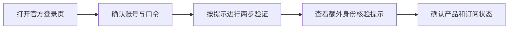

# 37｜Gemini 登录中的两步验证

录屏展示 Google 账号登录后可能出现的两步验证、额外身份核验和界面语言变化。它可用来识别故障阶段，遇到账号状态变化时，操作以本人账号的官方页面所显示的选项为准。

## 看提示属于哪个阶段

| 页面提示 | 先核对 | 下一步 |
| --- | --- | --- |
| 要求账号或口令 | 打开的是否是官方入口，是否选了本人意图使用的账号 | 按页面登录或使用官方恢复入口 |
| 要求两步验证 | 当前提示所列的验证方式是否可用 | 使用本人已启用的方式并等待确认 |
| 需要额外身份核验 | 页面状态、当前设备及官方提示 | 按官方步骤完成核验，再看是否能进入产品 |
| 已登录但界面是英文 | 当前选中的账号、产品语言和输入框 | 用普通中文问一句确认对话功能，需要时再调界面语言 |

图 1 是按课程内容整理的核对路径，供复习时定位卡在哪一步。

## 实际核对

**课堂说法**　即使界面显示英文，课程示例仍可使用中文对话。末尾提到从订阅页面核对服务期限。

**复习练习**　出现两步验证错误时，先读完整的提示类型。把「已通过账号口令」「正在等待验证」「仍需额外核验」分别记录，避免把不同状态混在一起。成功后检查页面账号与预期一致、产品可打开、是否正确显示服务状态。纪要中只记录状态和操作结果，账号截图、验证材料和联系方式留在个人环境。

## 回看和待核对

- **00:01:23、00:02:34**　登录身份验证及错误提示。
- **00:06:52–00:07:18**　界面语言与中文对话。
- **00:07:28**　查看订阅期限的讨论。
- 语言切换时限、页面名称和额外验证方式，请按实际账号页面核对。

[原始转录](../原始转录/37-2faGemini登录教程.txt)
