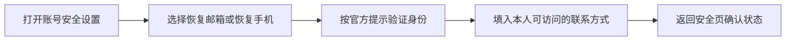

# 40｜更新账号恢复邮箱与恢复手机

这段短视频定位了 Google 账号中的两个恢复渠道，并演示了在修改前可能出现的身份确认。适合在处理自己的账号时用作页面定位参考。

## 将两项分别核对

| 项目 | 修改前确认 | 修改后观察 |
| --- | --- | --- |
| 恢复邮箱 | 能访问并接收官方验证消息 | 安全页确认该渠道对应的状态 |
| 恢复手机 | 号码由本人长期掌握，当前可接收验证 | 检查是否保存，以及是否仍需确认 |
| 额外身份验证 | 当前提示的账号及验证方式 | 完成后再提交新的恢复方式 |

图 1 表达录屏中的基本处理顺序。具体按钮要以本人账号显示为准。

**复习练习**　一次核对一个渠道，状态记录用「已验证」「待确认」等描述。记录动作和结果，以便以后需要恢复时知道哪些方法已经确认可用。个人联系方式与验证材料留在账户页面。

## 回看和待核对

- **00:00:00**　进入账号管理和查找恢复邮箱。
- **00:00:40**　恢复方式页面和两类入口。
- **00:01:41**　修改后的确认画面。
- 尾段语音转录较碎，按钮名称、确认方式和页面状态按原片或实际页面核对。

[原始转录](../原始转录/40-辅助邮箱跟📱号修改教程.txt)
