# WorldQuant BRAIN D1-Only 动态演进研究流程图 (`goal/PIPELINE_FLOWCHART.md`)

> **核心理念**：流程不是僵化一成不变的，而是遵循 **「严进（Stage 0 数据源头严筛） → 宽中（Stage 1-2 `QUICK` 快筛 + 模板放松管理做好指标筛选 + 管理员模板持续验证 `5:5 → 8:2`） → 专终（Stage 3-4 王哥/Top100 专一控制变量优化 + PC 范围分布表判据 + 2-3 轮无果止损打标休眠）」** 的动态闭环。

---

## 1. 全链路动态闭环流程图

```mermaid
flowchart TD
    subgraph INIT["启动层：goal/run_config.json 方向与子代理配置"]
        G0["用户可指定（或取默认值）：<br/>• Region (默认 USA, EUR) | Universe (TOP3000 / TOP2500)<br/>• Category (model / analyst / fundamental / other...)<br/>• 研究方式 (全闭环 / 仅 Stage1-2 快筛 / 仅 Stage3 专一优化 / 管理员模板评测)<br/>• 子代理：dsh-opencode-go/deepseek-v4.1-flash（先 probe，最多 4 轮，保留会话，默认只回传结果）"]
    end

    subgraph S0["第一环【严进】：Stage 0 种子因子（Seed Factor）严格把关"]
        G0 --> A1["华子哥 WDS 四差距 + 顾问课堂 53 课硬门槛 (field_screener.py)<br/>1) 选新集/蓝海集：Alphas=0 免额(12-06前) 或 aCnt<=10 或 产率 osis/info<10% & Sh>区域均值<br/>2) 选有意义的数据集：明确经济假设与预期方向 + Value Factor > $1.5 空白/高倍率塔<br/>3) 覆盖率与类型硬卡：cov>=0.75 (优选>=0.80), MATRIX dateCov>=0.60 (>=8年), 纯 MATRIX 优先<br/>4) 陌生字段可选 6 步探查：Neut=NONE, Decay=0, P0Y0M 查非零覆盖与 N=5/22/66 真实更新频率"]
    end

    subgraph S12["第二环【宽中】：Stage 1-2 模板放松管理 + QUICK 快筛剪枝 (下一轮启用 QUICK)"]
        A1 --> B1["Stage 1-2 标准化快筛契约<br/>• 模式：下一轮起切换为 simulationMode='QUICK', testPeriod='P0Y0M'<br/>• 默认固定：Decay = 0, Neutralization = SUBINDUSTRY, Truncation = 0.04<br/>• 模板池演进：持续从管理员发帖 (WL13229/KH94146) 评测剔除过拟合模板、吸纳有效模板<br/>  当前用成熟模板保持 5:5 (4 Admin : 4 Top100)，验证充实后切换为 8:2"]
        B1 --> B2{"48 条正向早停守卫<br/>Sh>=0.80 命中率 < 2% 且无 >=1.25?"}
        B2 -- "是 (死集)" --> B3["自动早停该数据集，切下一数据集"]
        B2 -- "否" --> B4["做好指标筛选与相似种子剪枝 (seed_pruner.py)<br/>• Stage 1 过关：正向 Sh >= 0.80 (POOL_B)<br/>• 剪枝去重：Token Jaccard >= 0.78 或同字段 |ΔSh|<=0.06 剪枝 (同字段<=2, 同集<=6)<br/>• Stage 2 晋级：单步结构/双支达 Sh >= 1.25 (POOL_A) 且本地 95-OS SC < 0.68"]
    end

    subgraph S3["第三环【专终】：Stage 3 主从 Agent 专一控制变量优化（强制 FULL + 2-3轮止损）"]
        B4 --> C1["强制切换 simulationMode='FULL'<br/>主 Agent 定方向 -> 子 Agent（思考强度：中）参考 王哥Skill + Top100顾问 专一优化"]
        C1 --> C2["严格控制变量（每次只改 1-2 个参数）<br/>• 轮询 Decay ∈ {0, 5, 20} | 轮询中性化 (SUBINDUSTRY -> RAM / CROWDING / STATISTICAL)<br/>• 修 2Y：后置 decay_linear(22) | 修 Sub-Uni：adv20 软门控/连续倾斜 + country*industry"]
        C2 --> C3{"对比基线是否产生有效提升?<br/>(写入 OPTIMIZATION_LEDGER.json:<br/>[有效] xxx vs [无效] yyy)"}
        C3 -- "有效且已达 0-FAIL (POOL_S)" --> D1
        C3 -- "有改善但未过关 (< 2-3 轮)" --> C2
        C3 -- "连续优化 2-3 轮无效果!" --> C4["果断停止优化，绝不死磕！<br/>打标 STALLED_DORMANT_AFTER_3_ROUNDS 归档保留<br/>（记录卡点原因，待未来找到新优化方法再定向唤醒）"]
    end

    subgraph S4["第四环【终检与 PC 分布表决策】：Stage 4 相关性表判据与 Margin 优先打标"]
        D1["1) 同步最新 95+ OS 算本地 SC < 0.65 (凡 0-FAIL + SC<0.65 必写别名 SC 0.xxx PC 0.xxx)<br/>2) 池内 N×N 两两正交 (<0.68) 严格按 Margin (bp) 降序保留最高 Margin 代表"]
        --> D2["3) 调用 GET /alphas/{id}/correlations/prod 解析 PC 范围分布表 (pc_poller.py)<br/>返回 schema=[min, max, alphas] 直方图桶 + 全局 max"]
        D2 --> D3{"PC 范围分布表定量判据"}
        D3 -- "pc_max < 0.70 (真低 PC 全绿)" --> D4["打平台标签：Useful + 别名 SC 0.xxx PC 0.xxx<br/>（按 Margin 降序呈交人工复核，脚本绝不调 /submit）"]
        D3 -- "0.70 <= pc_max <= 0.75<br/>且 [0.7, 0.8] 桶 alphas <= 5 且 >=0.8 桶为 0<br/>(范围近、碰撞数据少 & 优化 < 2 轮)" --> D5["判定 PC_RESCUE_NEAR_SPARSE<br/>回 Stage 3 用王哥 L6 tail(0.25,0.75,0.5) / 跨集双支专项压 PC 1-2 轮"]
        D3 -- "pc_max > 0.75 或 >=0.7 桶 alphas > 5 (数据很多)<br/>或专项压 PC 1-2 轮无改变" --> D6["判定 PC_ABANDON_CROWDED_OR_STALLED<br/>停止压 PC！打平台标签 SC_PASS + 内部标 PC_STUCK_DORMANT 休眠<br/>（注：即便触发 +10% Sh 官方豁免，PC>0.70 也建议少交，标 PC_EXEMPT_HIGH_PC_HOLD）"]
    end
```

---

## 2. 核心新增机制对照表

| 机制 | 具体规则与代码落点 |
| --- | --- |
| **1. `GET /alphas/{id}/correlations/prod` 范围分布表判据** | 已在 [pc_poller.py](file:///c:/Wq/WorldQuant%20Brain/wq_research_v2/src/wq_research_v2/pc_poller.py) 实现 `parse_pc_histogram_records()`：解析 API 返回的 `records: [[min, max, alphas], ...]` 直方图桶： • **真通过（`PC_PASS_STRICT`）**：`pc_max < 0.70` → 标 `Useful`（`PC >= 0.70` 即使官方豁免也建议少交）； • **范围近且碰撞少（`PC_RESCUE_NEAR_SPARSE`）**：`0.70 <= pc_max <= 0.75` 且 `[0.7, 0.8]` 桶内 `alphas <= 5`、`>=0.8` 桶为 `0` → 尝试王哥/Top100 降 PC 手段优化 `1–2` 次； • **数据很多或 1–2 次无改变（`PC_ABANDON_CROWDED_OR_STALLED`）**：`[0.7, 1.0]` 桶内 `alphas > 5` 或 `pc_max > 0.75` 或优化 `1–2` 次仍未破 `<0.70` → 立即丢弃不再优化，打标 `PC_STUCK_DORMANT` 归档。 |
| **2. 常规专一优化 2–3 轮止损休眠** | 在 Stage 3 专一优化中，若某种子连续优化 **2–3 轮** 仍无有效改善，不再消耗额度死磕，自动打标 **`STALLED_DORMANT_AFTER_3_ROUNDS`** 并保留在台账中，等后续发现新算子/新方法时再按标签检索唤醒。 |
| **3. 管理员原创模板持续评测（`5:5 → 8:2`）** | 在 [daemon_ra_runner.py](file:///c:/Wq/WorldQuant%20Brain/wq_research_v2/src/wq_research_v2/daemon_ra_runner.py) 中内置 `select_stage12_templates(template_ratio="5:5")` 与管理员候选评测池 `ADMIN_WL13229_KH94146_CANDIDATE_TEMPLATES`：当前默认 `5:5`（4 Admin : 4 Top100 成熟模板），同时在 `ADMIN_TEMPLATE_VALIDATION` 模式下持续甄别 `WL13229/KH94146` 254 篇帖子中的未过拟合好模板，达标后一键切至 `8:2`（6 Admin : 2 Top100）。 |
| **4. 广州当前批次 vs 下一轮 `QUICK` 切换** | 广州当前正在跑的 Day-2 批次保持运行不动；`daemon_ra_runner.py` 已新增 `--stage12-mode QUICK` 与 `--goal-config goal/run_config.json`，**下一轮起 Stage 1–2 自动跑 `QUICK` 快筛，Stage 3 (`S3-*`) 自动锁定 `FULL`**。 |
