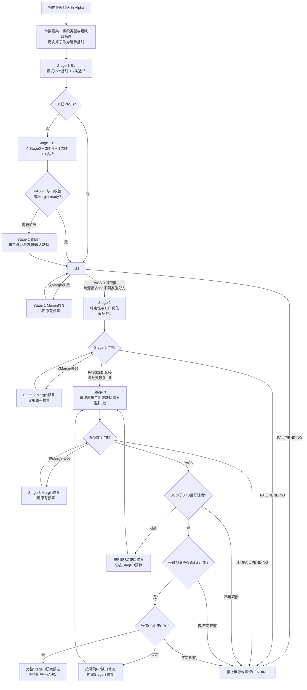
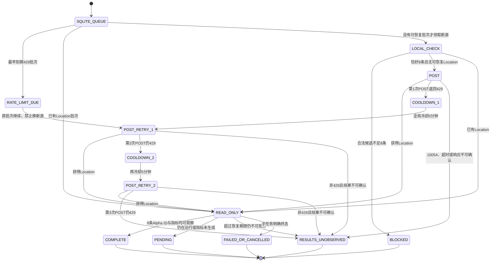

# 全自动爬山算法

本目录实现“宽进严出”的三阶段 Alpha 优化。兼容入口仍为
`../全自动爬山算法.py`，运行方式不变。算法只创建固定的
`1 个父 Multi-Simulation × 8 个子模拟`，不自动提交 Alpha，也不修改名称、颜色、标签或平台属性。

## 当前流程

1. 读取最近 30 天的未提交/失败 Alpha，按塔缺口、单数据集和字段类型筛选。源表达式的历史算子与复杂度作为继承基线，不反向拒绝。
2. Stage 1 自适应最多 4 批：首批“原表达式 P2Y 基线 + 7 条局部邻域”，第二批固定引入 Stage 0 简单经济信号，第三/四批才按有效改善或 Margin-ready 扩展。
3. 阶段预算为 `4 / 4 / 5` 个父批次。任一 Stage 1/2 批次出现 PASS 就立即交接下一阶段；40 条观察窗只用于报表和模板学习。
4. 当 Sharpe、Fitness、P2Y、Turnover 已通过而 Margin 未通过时，进入条件式 `MARGIN_REPAIR`。
5. Stage 3 的数字门槛全部通过后才获取 SC；平台检查、厂型和 PC 随后分别判断。
6. 最终仍要求 Stage 3 全门槛、平台检查 PASS、`SC < 0.40` 和数值 `PC < 0.70`。

### 三阶段数字门槛

| 阶段 | Sharpe | Fitness | P2Y | Margin | Turnover | SC |
|---|---:|---:|---:|---:|---:|---:|
| Stage 1 | >1.20 | >0.50 | >1.00 | >3bp | 3%–80% | <0.50 |
| Stage 2 | >1.40 | >0.75 | >1.30 | >6bp | 4%–50% | <0.45 |
| Stage 3 | >1.58 | >1.00 | >1.60 | >10bp | 5%–30% | <0.40 |

PENDING、429、10054、超时、空响应和缺指标不进入通过率分母。已有明确数字门槛失败时，`gate_status=FAIL`；缺 SC 只令 `score_status=PENDING_SC`，不能把 FAIL 改写成 PENDING。

P2Y 只读取平台返回的 `test.sharpe`。`train.sharpe` 不再回退为 P2Y；旧评分版本的 Stage 2/3 资格在加载时退回 Stage 1，重新建立真实 P2Y 基线。

## Margin 修复路由

`MARGIN_REPAIR` 不提高全局 Margin 权重。它只在当前阶段其余数字门槛均通过时工作，并按以下顺序选择候选：

1. 指标完整可观察；
2. 保留全部非 Margin 门槛和有效 Turnover；
3. Margin 跨过当前阶段门槛；
4. Margin 缺口减少量及 Margin bp；
5. 同层 Sharpe、Fitness、P2Y、Turnover 和已观察 SC。

每个 Margin 批次固定由 `2 局部窗口 + 2 收益/换手平衡 + 2 分布/集中度 + 2 经济关系` 组成。每阶段最多两批；第二批要求首批至少有一条安全候选使 Margin 提升 1bp 或直接跨门槛。详细规则见 [Margin 修复与模板](doc/01_margin_repair_and_templates.md)。

Stage 1 四批结构、Stage 0 注册边界、立即分支和缓存计数见 [Stage 1 四批与即时晋级](doc/03_stage1_four_batches_and_handoff.md)。

## 状态速查

源队列、批次断点和状态事件保存在 `Core/runtime_data/hill_climbing_source/source_state_v6.sqlite3`。首次启动会幂等导入旧 `state.json`；旧 JSON 仅作只读备份。SQLite 事务负责原子领取，调度顺序固定为：到期 429 批次 → 已有 Location 的只读对账 → 新源。

| 状态 | 含义 | 后续动作 |
|---|---|---|
| `COMPLETE/CACHE_HIT` | Alpha ID 与必需指标可观察 | 参与当前阶段评估 |
| `PENDING_STAGE_SCORE` | 必需指标仍缺失 | 只读恢复或等待，不算失败 |
| `PENDING_RATE_LIMIT` | 明确 429 且在全局冷却 | 5 分钟后重试，单批最多两次冷却重试 |
| `RESULTS_UNOBSERVED` | POST 结果、Location 或返回结构不可确认 | 不盲目重发，只读对账 |
| `BLOCKED_INCOMPLETE_BATCH` | 首个普通批次不足 8 条 | 不 POST，候选池变化后再检查 |
| `BLOCKED_INCOMPLETE_MARGIN_BATCH` | Margin 专用批次不足 8 条 | 不跨 Category、不用负优化模板补位 |
| `BUG_BLOCKED` | 确定的本地代码错误 | 代码版本变化后才重新激活 |

429 规则为“首次 POST + 最多两次五分钟冷却重试”，总计最多三次 POST。POST 遇到 10054、超时或无响应不自动重发；GET 最多首次加两次重试，并保留最小请求间隔。完整恢复与排障见 [运行与日志排障](doc/02_runtime_and_log_troubleshooting.md)。

## 模板学习

- 学习范围：`Region × Category × Stage`。
- 当前版本：`region-category-stage0-branches-v6`。
- 事件与摘要：`Core/runtime_data/template_usage/events_v5.jsonl`、`summary_v5.csv`。
- v4 及更早账本只读保留，不参与 v5 排序。
- 只有 `FORMAL_TEMPLATE` 的完整结果进入表现统计；PENDING、网络错误和重复生成不进入分母。
- 相同候选完整结果按稳定事件键去重；恢复不会重复追加同一结果。
- 当前只启用虎哥 Series 2 的残差波动和滞后 Beta 两个低复杂度关系模板。

## 优化路由与权限

`stable/smooth/template/stat/cross/cw/twin/basic` 是代码级优化路由，不是假想的平台算子。它们只映射到当前账户已验证可用、字段类型匹配的实际操作符。`robust_sharpe` 是 Stage 3 诊断与排序目标，不生成同名表达式。

| 路由 | 用途 | 状态 |
|---|---|---|
| `stable` | 邻近窗口、Backfill、缺失值稳定性 | 可用 |
| `smooth` | Decay、Hump、Turnover 调整 | 可用 |
| `template` | Core 经济语义模板 | 可用 |
| `stat/cross` | Rank、Zscore、Winsorize、合法分组处理 | 可用 |
| `cw` | 单一时间窗口轴邻近扫描 | 可用 |
| `twin` | 同数据集、语义相关且类型兼容的双字段关系 | 可用 |
| `robust_sharpe` | Stage 3 稳健性诊断与排序 | 仅诊断 |
| `filter/gvn/gvp/gvp_auto` | 当前账户无权限能力 | `UNAVAILABLE`，不生成、不报错重试 |
| AI 组合 | 自动组合表达式 | `DISABLED_BY_POLICY` |

新生成的表达式不得主动引入 `add/multiply/trade_when`，完整新表达式仍限制少于 6 个算子。基于源表达式的局部变体只检查新增算子，因此不会因源 Alpha 的历史遗留算子或复杂度被误拒。

## 主要文件

| 文件 | 职责 |
|---|---|
| `runtime.py` | 登录、信号与持续运行入口 |
| `optimizer.py` | 批次生成、状态机、Margin 路由、结果采用与报表 |
| `source_pipeline.py` | 源筛选、塔池与仅报表的40条观察窗 |
| `scoring.py` | 三阶段门槛、硬门槛距离和 Margin 专用排序 |
| `config.py` | 预算、阶段、重试与版本配置 |
| `routes.py` | 分阶段优化路由、缺口匹配与权限可用性 |
| `state_store.py` | SQLite 状态、幂等迁移、原子领取与批次恢复 |
| `Core/factor/template_usage.py` | Stage 0/经济模板注册、Region×Category 学习和 v5 账本 |

## 验证边界

本地语法检查、编译和单元测试不能证明平台字段单位、权限或真实性能。只有 8 个子结果均有 Alpha ID 和完整指标时才推进批次。任何最终提交均由用户手动完成。
