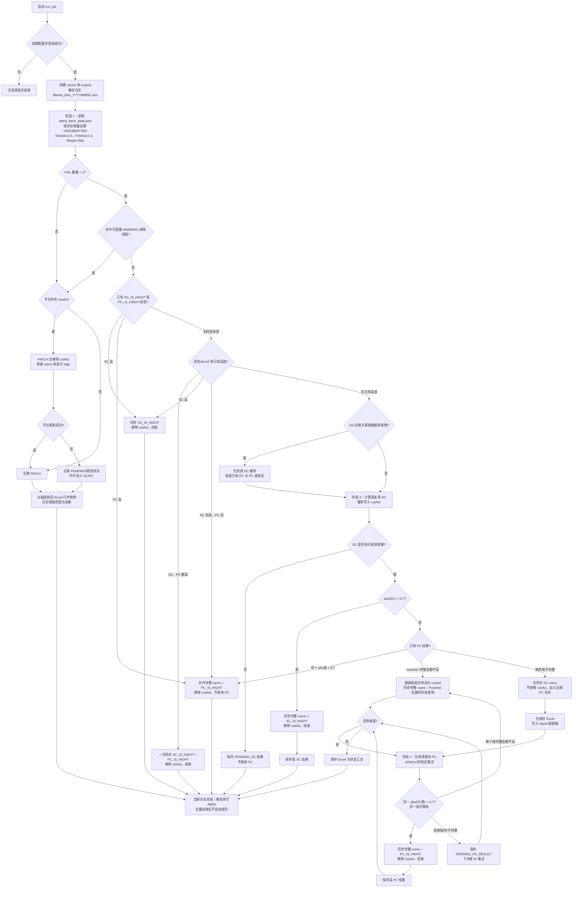
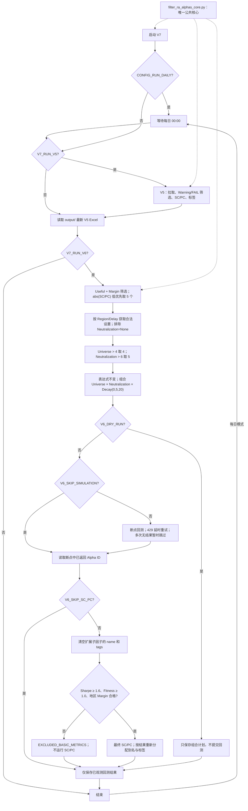

# RA 因子挖掘、筛选与自测自动化流水线

当前推荐使用 V5：`filter_ra_alphas_v5.py`。V5 的公共能力统一放在 `filter_ra_alphas_core.py`，V5 不再直接引用 V3/V4；V3、V4 作为独立历史版本保留，便于回退和对比。流程覆盖最近 30 个北京时间自然日的 RA 筛选、自相关性 (SC)、生产相关性 (PC)、实时 Pyramid Category 查询、Excel 断点恢复和平台属性标记。V5 会统一处理当天 Excel 断点和平台已有别名：先恢复已知 SC/PC，再按“SC 高优先、PC 后置”的顺序分流；高 SC 不进入 PC，高 PC 不再重复 PC。

V6 是最终扩展阶段：读取 `output/` 中最新 V5 文件，按 Margin 和 SC/PC 选 5 个 `Useful` 源因子，再保持表达式不变遍历地区合法设置。V7 只是依次启动 V5 和 V6，不再复制业务逻辑。

## 版本与文件职责

| 文件 | 职责 | 依赖关系 |
|---|---|---|
| `filter_ra_alphas_core.py` | 唯一公共核心：登录、Alpha 拉取、SC/PC、Excel、标签、别名、Activity/Pyramid 只读查询、V6 平台适配 | 不引用 V5/V6/V7；V6 网络请求复用同级 `Core/api` |
| `filter_ra_alphas_v5.py` | 当前操作流程：RA 筛选、SC/PC 分流、全量 Useful Pyramid/Submit 审计和输出 | 只引用 `filter_ra_alphas_core.py` |
| `filter_ra_alphas_v6.py` | 选 5 个 Useful 源因子、生成组合、断点回测和最终 SC/PC | 只引用 `filter_ra_alphas_core.py` |
| `filter_ra_alphas_v7.py` | 按开关依次运行 V5、V6 | 只引用 `filter_ra_alphas_core.py` |
| `filter_ra_alphas_v4.py` | V4 历史流程 | 独立运行 |
| `filter_ra_alphas_v3.py` | V3 历史流程和回退基线 | 独立运行 |
| `test_filter_ra_alphas_v5.py` | V5/Core 回归测试 | 测试公共核心和 V5 操作 |

运行 V5：

```powershell
python filter_ra_alphas_v5.py
```

V5 启动后会检查当天的 `output/filtered_RAs_YYYYMMDD.xlsx`，并读取平台返回的当前别名和标签。阶段 1 筛选并移除 Warning 因子后，V5 先恢复历史 SC/PC；可确认的高 SC/PC 会在进入普通 `Useful` 分流前完成终态同步。运行末尾会重新读取服务器全部 `Useful`，直接查询每个 Alpha 的 `MATCHES_PYRAMID`，并生成 `output/useful_pyramid_audit_YYYYMMDD.xlsx`。输出文件保持日期命名，不增加时分秒后缀。

筛选天数只由 `filter_ra_alphas_core.py` 中的 `CONFIG_DAYS_AGO` 控制，默认值为 `30`，可直接修改。日期按北京时间自然日计算，请求区间使用 UTC 半开边界：起始日 00:00（含）到结束日下一天 00:00（不含）。缓存签名包含天数，修改配置后不会误用旧窗口的查询状态。全量 Useful 的 Pyramid/Submit 审计不受该窗口限制。

凭据路径由 Core 统一处理：优先使用环境变量 `WQB_CONFIG`；未设置时，从 `filter_ra_alphas_core.py` 所在目录开始，向上最多三层寻找 `Password/config.yaml`。不再依赖当前 PowerShell 工作目录，也不读取三层以上的目录。

运行日志写入 `output/filter_ra_alphas_v5_YYYYMMDD.log`，控制台阶段信息和本地日志均带 `YYYY-MM-DD HH:MM:SS` 时间戳。每天的日志文件通过 `run_id=YYYYMMDD-HHMMSS` 分隔不同运行，避免同一天多次运行无法区分。V5 在 SC 开始前先保存阶段性 Excel 快照，因此 SC 长时间运行时也能看到当天的 `filtered_RAs_YYYYMMDD.xlsx`。SC 完成每个 Alpha 后会打印 ID、序号、SC 数值或失败原因，平台标签/别名更新也会打印成功或失败结果。

Excel 保留 `alpha_id_raw`，并增加 `Platform_Update_Status`：`NOT_ATTEMPTED` 表示尚未更新，`SYNCED` 表示别名和标签同步成功，`SYNCED_ALIAS_ONLY` 表示仅别名成功，`PENDING_PLATFORM_UPDATE` 表示平台更新失败，`PENDING_PLATFORM_RATE_LIMIT` 表示平台触发 429 熔断、后续可按 Alpha ID 重试，`PENDING_MISSING_ALPHA_ID` 表示断点行缺少有效 ID。`SC_Status`/`PC_Status` 的数值判定与平台标签、别名回写是两个独立状态；出现 `PENDING_*` 时，只能确认本地数值结果，不能据此确认平台属性已经同步。

平台别名或标签更新最多尝试 3 次；每次平台更新前固定等待 1.5 秒，网络异常和 5xx 按退避时间重试。单个 Alpha 的 429 仍尝试 3 次；确认平台级 429 后，本次运行进入 300 秒熔断，后续 Alpha 只记录 `PENDING_PLATFORM_RATE_LIMIT`，不再重复阻塞 PC 计算。

V5 的初筛不再执行独立的 RA/PPA 分类阶段；直接统计 Alpha checks 中 `result=FAIL` 的数量，仅保留 `FAIL 数量 < 1`（即 FAIL 数量为 0）的 Alpha。
FAIL 数量不合格和 Warning 命中的所有排除因子，都会检查平台标签；存在 `Useful` 时移除 `Useful` 和随附的 `Submit`，其它标签保留。

## V5 Warning 排除规则

在检查已有 `SC_IS_HIGHT` 或 `PC_IS_HIGHT` 标签后，V5 还会检查 Alpha checks 中的 `WARNING`。命中可配置规则的因子会直接从本次候选中剔除，不进入 SC/PC，也不写入 Excel；排除前会检查并移除平台上的 `Useful` 标签，如果当天断点文件中已经存在同一个 Alpha，V5 会同步移除旧行。为方便后续排查，日志会记录 Alpha ID、排除原因、Useful 是否存在及移除结果，不新增 Warning 专用 Excel 列。

当前已排除：

```text
Weight is too strongly concentrated or too few instruments are assigned weight.
[2 year Sharpe] ... is below cutoff of ...
IS ladder Sharpe ... is below cutoff of ...
```

当前规则同时支持按平台返回的 `check_name` 精确匹配和 Warning 文本 `contains` 匹配，因为平台有时只返回 Warning 名称和数值，不返回完整描述。精确 `check_name` 优先于文本兜底，避免同一条 Warning 被重复记录。例如 `CONCENTRATED_WEIGHT`、`LOW_2Y_SHARPE` 和 `IS_LADDER_SHARPE` 对应的因子（示例 `P0ObaGdp`）命中后都不会出现在输出 Excel 中。后续新增排除条件时，只需在 `filter_ra_alphas_core.py` 的 `CONFIG_WARNING_EXCLUSION_RULES` 中追加 `code`、`check_name`、`contains` 和 `reason`，不需要修改 V5 主流程。

## V5 性能优化与中间文件记录

### 2026-08-11 运行记录

历史日志显示：曾有一次 PC 阶段共有 311 个候选，达到当时的 `CONFIG_PC_MAX_COUNT=150` 后停止；未处理候选保留在当天 Excel 中，下一次同日启动时继续。运行过程中平台属性更新发生 429 并进入 300 秒运行级熔断；PC 数值仍可写入 Excel，但对应标签或别名回写会记录为 `PENDING_PLATFORM_RATE_LIMIT`，不能把这类行当作平台已同步。

### 阶段 1：Alpha 列表增量读取

V5 使用 `cache/alpha_fetch_state.json` 保存阶段 1 状态：

- `records`：最近 `CONFIG_DAYS_AGO` 天的 Alpha 数据，按 Alpha ID 去重。
- `watermark_utc`：上次完整读取成功的时间水位。
- `active_query`：当前未完成的查询区间、时间切片和已完成分页。
- `signature`：天数、筛选条件和重叠时间，配置变化后自动建立新缓存。

首次运行读取完整时间范围；后续运行只读取水位之后的新增区间，并默认回查 `CONFIG_FETCH_OVERLAP_HOURS` 小时。查询区间按 `CONFIG_FETCH_SLICE_HOURS` 切片，避免单个请求的 offset 超过平台 1000 条上限。分页成功后立即写入中间文件，程序中断后只重试缺失分页。中间文件使用临时文件替换写入，避免中断时损坏。

### SC：结果增量缓存

目标 Alpha PnL 继续保存在 `cache/target_alpha_pnls.pickle`；SC 数值另保存在 `cache/sc_results.json`，按 Alpha ID 和 Region 命中。SC 每完成 `CONFIG_SC_RESULT_CHECKPOINT_INTERVAL` 个结果写一次缓存，重新运行时已缓存 Alpha 不再重复本地计算；底层 OS 数据新增时会自动失效，不需要手动删除 `sc_results.json`。

V5 先按高相关 tag 和 name 高值完成终态预过滤，再进入本地 SC。每次真正执行 SC 阶段时，才调用本地自相关性技能的增量下载，并比较下载前后的 `cache/os_alpha_ids.pickle`。如果 OS Alpha 集合新增因子，Core 会忽略仍需 SC 的候选历史 SC 缓存；已有高相关终态的 Alpha 已在此前跳过，已有 PC 数值也不会因此清空。没有新增 OS Alpha 时，SC 和 PC 均可按既有断点复用。

### Category：直接查询 Pyramid

V5 不再切割 Alpha 表达式、不提取字段，也不调用 `/data-fields` 推断 Category。运行末尾直接读取 `/alphas/{alpha_id}` 中 `is.checks[name="MATCHES_PYRAMID"].pyramids[].name`，因此一个 Alpha 的全部 Pyramid scope 都会保留。旧的 `cache/category_field_metadata.json` 不再读取；程序不会主动删除已有缓存文件。

断点 Excel 恢复时会把需要回写 Alpha ID、平台标签、别名和处理状态的列统一转换为可写类型，避免空列被 pandas 识别为 `float64` 后写入字符串失败。

### PC：移除无条件批次休息

PC 查询成功后不再每 5 个固定休息 60 秒；成功间隔由 `CONFIG_PC_SUCCESS_DELAY_SECONDS` 控制，默认是 0。单次运行最多处理 `CONFIG_PC_MAX_COUNT` 个 PC 候选，达到上限后未处理行保留为待续跑状态。PC 接口本身遇到空响应、429、5xx 或网络异常时，仍按 `CONFIG_PC_MAX_WAIT_SECONDS` 进行内部退避等待；单个 Alpha 最多尝试 `CONFIG_PC_MAX_RETRIES` 次，超过后保留 Alpha ID 并写入 `PENDING_PC_RESULT`，避免因平台空响应无限等待。

### 平台属性：429 熔断

平台别名和标签更新仍保留每个 Alpha 最多 3 次尝试，并保持 1.5 秒请求前延时。连续 429 被视为平台级限流：当前 Alpha 完成 3 次尝试后开启 300 秒运行级熔断，后续更新不再发送 PATCH，只在 Excel 中保留 Alpha ID 和 `PENDING_PLATFORM_RATE_LIMIT`，下一次运行再处理。若 PC 两个值中任一值满足 `abs(PC) > 0.7`，本地状态仍应为 `PC_IS_HIGHT`，但只有 PATCH 成功后平台标签和别名才算完成；下一次运行读取到缓存 PC 时不重复查询 PC，而是复用同一套 PC 状态处理逻辑重试平台同步。

以上优化不改变 SC/PC 判定阈值或人工提交边界。`Submit` 只是候选标签，程序不会调用 Alpha 提交接口。

## V5 运行状态与断点规则

V5 将已经确认的 SC/PC 数值持久化到当天 Excel，同时也从平台别名恢复符合格式的历史数值，把数值结果、平台同步和处理进度分开记录，避免断点恢复时把“本地已有数值”误认为“平台属性已完成”。SC 和 PC 是串行分流，不是并列计算：

- 首次取得 `SC` 且 `abs(SC) > 0.7` 时，立即把数值写入 Excel，给 Alpha 增加 `SC_IS_HIGHT` 标签，并将别名更新为 `SC 0.xxx`。
- 仅当 SC 有结果且 `abs(SC) <= 0.7` 时才继续请求 PC；此时只同步 SC name，不新增 `Useful`。PC 有两个值，任一值满足 `abs(PC) > 0.7` 即视为高 PC；首次取得高 PC 时，立即把两个值写入 Excel，给 Alpha 增加 `PC_IS_HIGHT` 标签，并将别名更新为 `PC 0.xxx`。
- 只有 SC 不高、PC 的 max/min 两个原始值都存在且都不高时，才写最终 `Useful`。`Useful` 由共享常量 `USEFUL_TAG` 统一定义，V5/V6 不再分别硬编码。
- 下一次运行时，先检查平台返回的标签和别名。带 `SC_IS_HIGHT` 或 `PC_IS_HIGHT` 的 Alpha 都直接跳过 SC/PC；别名中恢复出高 SC/PC 的 Alpha 也按同样规则处理，并同步缺失标签。
- SC/PC 一旦成功获取，无论是否超过 0.7，都会写入完整 Excel；高相关只影响后续请求和平台标记，不会导致该行从 Excel 消失。
- 阈值按绝对值和严格大于判断：`abs(0.700)` 本身不属于高相关，只有 `abs(value) > 0.700` 才打高相关标签。
- Alpha 列表请求遇到代理断连、连接超时、429 或 5xx 时会自动退避重试；重试耗尽或响应结构不完整时不会再崩溃，而是写入 `PENDING_ALPHA_FETCH` 或 `PENDING_PARTIAL_FETCH`，不得把缺失切片视为完整结果。
- 阶段 1 会打印增量区间、缓存命中页、实际拉取页、累计数与失败分页；阶段 1、2、3 结束时分别打印剩余量和淘汰量。
- PC 对每个 Alpha 打印开始/完成进度、百分比、状态、单条耗时、累计耗时和 ETA。网络断开时自动重新登录；空响应、429、5xx 和可恢复网络错误按 `CONFIG_PC_MAX_RETRIES` 次重试，单次等待最长 180 秒。

Excel 新增 `alpha_id_raw` 和 `Processing_Status`。前者用于跨天可靠恢复历史结果，后者用于区分 `SC_IS_HIGHT_SKIPPED`、`PC_IS_HIGHT_SKIPPED`、`SC_IS_HIGHT`、`PC_IS_HIGHT`、`READY_FOR_PC`、`COMPLETE` 与各类 `PENDING` 状态。对于历史高相关 Alpha，V5 优先从历史 Excel 和平台别名恢复数值；符合格式的高 SC/PC 别名会作为本次运行的已知结果，跳过重复 SC/PC 计算，并补同步缺失标签。若只有低 PC 别名且缺少完整 PC 结果，仍会重新请求 PC；无法恢复时保留为空，不把缺失值当作通过。

- 当天 Excel 或平台别名已有 SC 数值时，V5 不重复计算 SC；如果 SC 已高于阈值，先同步 `SC_IS_HIGHT`、移除 `Useful`，然后结束该 Alpha，不进入 PC。
- 只有 SC 未超过阈值时，V5 才检查或请求 PC；已有高 PC 数值时同步 `PC_IS_HIGHT`、移除 `Useful`，然后跳过 PC 请求。低 PC 别名但缺少可确认的完整结果时，不把它当作 PC 终态。
- 如果历史别名/Excel 已同时确认 SC 和 PC 都高，V5 一次平台更新同时补齐 `SC_IS_HIGHT`、`PC_IS_HIGHT`，并移除 `Useful`；这不是先算 SC 再继续算 PC，而是对已知终态做一次同步。
- `PC_Status=PENDING_PC` 或 `Processing_Status=READY_FOR_PC` 表示 PC 尚未取得；`PC_Status=PASS`、`PC_Status=PC_IS_HIGHT` 才表示 PC 数值已经完成本地判定。
- `PC_Status=PC_IS_HIGHT` 与 `Platform_Update_Status=PENDING_PLATFORM_RATE_LIMIT` 可以同时出现：前者是本地 PC 结论，后者表示平台标签/别名仍待重试。
- 基础 OS 数据发生变化时只失效 SC 缓存；历史 PC 保留。已有高 PC 直接同步 tag/name，已有完整低 PC 继续作为完成结果，只有 PC 缺失或不完整时才重新请求。

---

## V5 Pyramid Category 与 Submit 同步规则

Category 和塔状态来自两个实时 GET 接口，代码在当前目录内独立实现，不导入 `代码/优化代码/Core`：

- `/alphas/{alpha_id}`：直接读取 `MATCHES_PYRAMID.pyramids[].name` 作为完整 `Matched_Categories`。
- `/users/self/activities/diversity`：读取每个 Region、Delay、Category 的 `dataDiversity.check` 和平台 `limit`。

匹配键固定为 `Region + Delay + Category`。同名 Category 不能跨 Region 或 Delay 借用 PASS；`PV` 与 `Price Volume` 作为同一平台 Category 兼容。一个 Alpha 关联多个 scope 时，任意一个 scope 未 PASS 都属于 `HAS_GAP`。

每次 V5 运行末尾重新审计服务器全部 `Useful`：

- `HAS_GAP`：保留其它标签并添加 `Submit`。
- `ALL_PASS`：塔已刷新并全部点亮，仅删除旧 `Submit`。
- `PENDING`：接口失败、响应不完整或 scope 无法解析；保持现有 `Submit` 不变，不发送 PATCH。
- 目标标签与当前标签相同：记录 `UNCHANGED`，不发送重复 PATCH。
- Alpha 被高相关或基础规则排除并删除 `Useful` 时，同时删除 `Submit`。

审计结果写入 `useful_pyramid_audit_YYYYMMDD.xlsx`，字段包括 Alpha ID、完整 Categories、`Pyramid_Status`、`Unlit_Pyramid_Scopes`、每个 scope 的 check/limit 证据、原标签、目标标签和平台更新状态。当天主筛选 Excel 中重合的 Alpha 会同步写回 `Matched_Categories`、`Pyramid_Status`、`Unlit_Pyramid_Scopes` 和证据。

429 会冷却 300 秒后只做一次只读对账；仍不可观测时保持 `PENDING`。`Submit` 只表示“Useful 且存在未点亮关联塔”，不会自动提交 Alpha。

## 1. PPA 与 RA 的简单区别

在 WorldQuant BRAIN 平台上，我们通常将因子分为两类：
- **RA (Regular Alpha, 常规因子)**：普通的 Alpha 因子，只需通过基础的各项硬性门槛（如 Sharpe、Fitness、Turnover 等）和基本的生产相关性 (PROD_CORRELATION) 检查即可提交。
- **PPA (Power Pool Alpha, 能量池因子)**：除了满足常规要求外，还必须拥有 `POWER_POOL_CORRELATION` (PPAC) 检查项，需要通过更严格的自相关性与特定的池内相关性测试。

**为什么要区分？**
PPA 因子的优化与提交策略与常规 RA 因子存在显著差异。本流水线的核心目的就是**精准过滤掉混入的 PPA 因子（即存在 `POWER_POOL_CORRELATION` 检查项的因子），只保留“纯 RA”因子**，从而针对纯 RA 因子进行高效的批量自相关性 (SC) 和生产相关性 (PC) 自测与打标。

---

## 2. 核心业务流程图 (Flowchart)

核对口径：SC 只有一个值；PC 原始结果有 `max`、`min` 两个值。判断时使用绝对值：`abs(SC)>0.7` 为高 SC，`abs(PC_max)>0.7` 或 `abs(PC_min)>0.7` 为高 PC。Excel 保留 PC 两个原始值；平台别名只保存一个 PC 值，即 `max(abs(PC_max), abs(PC_min))`。PC 低只有两个原始值都存在且都低于阈值时，才算完整通过。



## 3. 核心架构与功能特性

### 2.1 破除平台 1000 条分页锁死
当拉取天数跨度内命中因子超过 1000 个时，平台 API 会强制报错拦截。
**解决方案**：使用 `cache/alpha_fetch_state.json` 保存水位、查询区间和分页结果。首次运行读取完整时间范围，后续只读取水位后的新增区间，并回查最近 24 小时；中断后只重试未完成分页。时间区间仍使用半开边界（`dateCreated>=...` 与 `dateCreated<...`）避免重复计数。

### 2.2 SC 技能库自动动态挂载
不再硬编码固定路径。代码利用 Python `importlib.util` 扫描当前虚拟环境，自动定位到 `cnhkmcp` 库的位置，动态加载底层的 `brain-calculate-alpha-selfcorrQuick` 脚本。将生成的 `.pickle` 缓存数据完美收纳至 `cache/` 目录。

### 2.3 SC/PC 高相关终态与智能分流
在获取到本地计算的 SC (Self-Correlation) 后进行严格分流：
- **`abs(SC) <= 0.7`**：只同步 SC name 并放行进入 PC，不新增 `Useful`；原本已有的 `Useful` 暂时保留。
- **`abs(SC) <= 0.7` 的别名更新**：只更新 `SC 0.xxx`，保留已有的 `PC 0.xxx`，不会因为 SC 更新而删除 PC 值。
- **`abs(SC) > 0.7`**：打上 `SC_IS_HIGHT` 标签，别名设为 `SC 0.xxx`，不再请求 PC，但该行及 SC 数值仍保存到 Excel。
- **PC 两个值都存在且绝对值均 <= 0.7**：更新完整 `SC 0.xxx PC 0.xxx`，确认双低后才写最终 `Useful`。
- **PC 任一值的绝对值 > 0.7**：打上 `PC_IS_HIGHT` 标签，别名只保存 `max(abs(PC_max), abs(PC_min))`，保留已有的 `SC 0.xxx`；PC 两个原始值仍保存到 Excel，另一值缺失也不阻止高 PC 终态；若平台回写受限，则保留待重试状态。
- **SC/PC 均未超过阈值**：保留常规别名 `SC 0.xxx PC 0.xxx`，并把 SC、PC 两个值写入 Excel。
- **别名同步**：每次平台别名更新成功后，立即刷新 Excel 快照中的 `Platform_Name`。
- **PC 顺序与停止**：PC 按 SC 从低到高计算；默认最多计算 300 个（`CONFIG_PC_MAX_COUNT`）。可设置 `CONFIG_PC_LOW_TARGET_COUNT=Y`，当两个 PC 值均满足绝对值 `< CONFIG_PC_LOW_STOP_THRESHOLD` 的数量达到 Y 时立即停止，该条件优先于 300 个上限；达到上限后下一次同日启动继续处理剩余候选。
- **标签互斥**：高相关终态与 `Useful` 是替换关系，不是追加关系。打 `SC_IS_HIGHT` 或 `PC_IS_HIGHT` 时移除 `Useful` 和 `Submit`；最终双低写 `Useful` 时移除旧高相关标签；其它无关标签保持不变。
- **历史高相关标签**：带 `SC_IS_HIGHT` 或 `PC_IS_HIGHT` 的 Alpha 在下一次运行时直接跳过 SC/PC 刷新，同时继续出现在 Excel 中。
- **同日断点续跑**：`run_job` 每次启动都会读取当天的 `output/filtered_RAs_YYYYMMDD.xlsx`，恢复其中已有的 SC、PC、别名和处理状态；已保存的 SC/PC 不再重复计算，但平台同步失败的标签/别名会继续重试。跨到下一天后创建新日期文件，但仍可从平台 name/tag 和本地 SC 缓存恢复已知终态；已有高 PC 不重复查询，只有缺失或不完整 PC 才进入远程队列。
- **SC 缺失或技能库不可用**：保存为待处理结果，不把缺失值当作通过，也不继续请求 PC。
- **排除因子标签清理**：FAIL 数量不合格和可配置 WARNING 命中的所有排除因子，都会先检查平台标签；若存在 `Useful`，移除 `Useful` 和 `Submit` 并保留其它标签。平台更新失败会记录 `PENDING_PLATFORM_UPDATE`，排除因子仍不会进入 SC/PC，排除证据写入本地日志。

### 2.4 PC 高可用策略 (Anti-429)
PC 计算极易触发 `429 Too Many Requests`。我们部署了严密的防护网：
- **查询重试与退避**：空响应、429、5xx 和可恢复网络错误按 `CONFIG_PC_MAX_RETRIES` 重试，单次等待受 `CONFIG_PC_MAX_WAIT_SECONDS` 限制。
- **PC 数值与平台回写分离**：PC 数值成功后先保存本地状态；标签或别名 PATCH 失败不会抹掉 PC 结果，而是写入对应的 `PENDING_PLATFORM_*` 状态。
- **运行级熔断**：平台属性更新确认 429 后进入 `CONFIG_PLATFORM_429_COOLDOWN_SECONDS` 熔断，避免继续发送无效 PATCH；下一次启动从当天 Excel 断点重试。

### 2.5 极致的目录收纳与 Excel 体验
- **文件收纳**：SC 的 pickle 缓存写入 `cache/`；结果写入 `output/filtered_RAs_YYYYMMDD.xlsx`。同一天重复运行会更新同名结果文件，代码本身不创建 `archive/`。
- **一键触达**：Excel 产物中的 `alpha_id` 被魔改为 `=HYPERLINK` 公式，直接点击即可在浏览器跳转对应因子的详情页。

### 2.6 SC 性能建议

当前 `cnhkmcp` SC 库使用 `ThreadPoolExecutor`，但每个待测 Alpha 仍需读取平台详情和 PnL，因此耗时主要来自网络 I/O，不是本地相关系数矩阵本身。V3 将外层线程数改为 `CONFIG_SC_MAX_WORKERS`，默认从 5 提升到 10。建议：

V5 已优化这一段：直接使用 Alpha 列表中已有的 `Region`，不再为每个待测 Alpha 串行请求详情确认区域；目标 Alpha PnL 先批量加载，再进入本地相关系数计算。目标 Alpha PnL 会保存到 `cache/target_alpha_pnls.pickle`，后续运行按 Alpha ID 增量获取，已缓存的 Alpha 不再重复下载。若仍然缓慢，应优先查看 `output/filter_ra_alphas_v5_YYYYMMDD.log` 中的 `[SC]` 时间分段，区分基础数据下载、缓存加载、目标 PnL 下载和本地计算。

- 平台稳定时使用 `10`，相较原 5 线程通常能明显缩短耗时。
- 若出现较多 429、代理断连或 PnL 请求失败，降到 `8`；不建议直接提高到 20 以上。
- 高相关终态标签会在后续运行前置过滤，随着 `SC_IS_HIGHT` / `PC_IS_HIGHT` 的积累，需要重新计算 SC 的数量会自然下降。
- 更进一步的优化需要给目标 Alpha 的 PnL 增加增量缓存，或改造 SC 库以复用已知 Region、减少详情接口请求；这会涉及第三方库算法层，不在 V3 当前安全改动范围内。

---

## 4. 全局配置与定时任务

V5 只需修改 `filter_ra_alphas_core.py` 头部的核心参数，即可控制策略：

```python
CONFIG_RUN_DAILY = False        # 设为 True，脚本将静默后台，每天 00:00 准时苏醒跑批
CONFIG_PC_SUCCESS_DELAY_SECONDS = 0  # PC 查询成功后的间隔(秒)，默认不无条件休息
CONFIG_PC_MAX_COUNT = 300       # 单次运行最多处理的 PC 候选数；达到后同日续跑
CONFIG_DAYS_AGO = 30            # 最近多少个北京时间自然日；可直接修改
CONFIG_FETCH_OVERLAP_HOURS = 24 # 阶段1水位前的重叠回查时间(小时)
CONFIG_FETCH_SLICE_HOURS = 24   # 阶段1时间切片大小(小时)，避免 offset 超过平台上限
CONFIG_SC_MAX_WORKERS = 10      # SC 外层线程数；平台不稳定时建议降到 8
CONFIG_SC_RESULT_CHECKPOINT_INTERVAL = 25 # SC 结果中间文件写入间隔
CONFIG_PC_MAX_WAIT_SECONDS = 180 # PC 空响应/重连单次等待上限
CONFIG_PC_MAX_RETRIES = 8         # 单个 Alpha 的 PC 远程查询最大尝试次数
CONFIG_PLATFORM_429_COOLDOWN_SECONDS = 300 # 平台429后的运行级熔断时间(秒)
# Warning 排除规则在 Core 的 CONFIG_WARNING_EXCLUSION_RULES 中维护
```

Excel 输出依赖 `openpyxl`。若当前解释器尚未安装，请执行：

```powershell
<当前 Python> -m pip install openpyxl
```

## V6 / V7 精简流程



V5、V6、V7 彼此不 import，全部只关联 `filter_ra_alphas_core.py`。`CONFIG_RUN_DAILY=True` 时，V5 单独运行会每日执行 V5；V7 运行会每日完整执行 `V5 → V6`。V6 单独运行仍保留组合、断点、429 和最终 SC/PC 阶段。

选中的 5 个原始 Useful 源因子保持原有 `name` 和 `tags`，不会清空。V6 只清空回测返回的扩展子因子，并且发生在最终筛选之前；清空失败的子因子标记为 `PENDING_CLEAR`。清空后先检查 Sharpe、Fitness 和地区 Margin，未通过则标记 `EXCLUDED_BASIC_METRICS`，不运行 SC/PC，也不打 `Useful`。通过后才运行 SC/PC 并分配名称和标签。

V6 断点使用“源 Alpha ID + 源表达式 + Region/Universe/Delay/Neutralization/Decay”识别组合；同日 V5 文件内容变化时不会误用旧子因子。断点还保存 `properties_cleared` 和 `label_complete`：已清空但待处理的子因子不会重复清空，最终标签已完成的子因子不会重复更新。清空和最终标签写入遇到 429 都等待 300 秒后重试。预演、未返回 Alpha ID 或跳过 SC/PC 时不会清空任何因子。

### 2026-09-01 V6 启动修复

服务器旧日志中的错误 `email-validator is not installed` 不是邮件发送失败。旧版 V6 导入 `cnhkmcp.untracked.platform_functions` 时，该包用 Pydantic 的 `EmailStr` 校验登录账号，间接要求安装 `email-validator`，因此尚未读取 Region/Delay 就提前进入 `PENDING`。

当前 V6 已移除对该平台模块的依赖，平台设置、2–8 条批量回测、子任务轮询、SC/PC 查询和属性更新全部通过项目已有的 `代码/优化代码/Core/api` 请求层完成。登录配置中的 `username` 只是 BRAIN 登录账号；本项目没有 SMTP、邮件发送或邮件通知功能，也不需要安装 `email-validator`。V5 的本地 SC 计算仍会动态查找 `cnhkmcp` 的 SC 技能脚本，这与 V6 的旧平台模块及邮箱校验无关。

同步代码不会启动、停止或重启服务器进程。代码替换后，已经启动的 Python 进程仍可能持有旧模块；由操作者自行停止并重新启动后，新逻辑才会完整生效。重新启动后，V6 正常日志应依次出现：

```text
[V6] 开始认证并读取平台 Region/Delay 设置
[登录] 认证成功
[V6] 平台设置读取完成：... 个 Region/Delay 组合
[V6] 模拟阶段开始：...
```

若平台返回空结果、429、5xx、缺少 `Location`、缺少 children 或缺少 Alpha ID，V6 保存断点并标记 `PENDING/RESULTS_UNOBSERVED`，不会把缺失结果当作通过，也不会在 POST 结果不可观测时盲目重发。程序不会自动提交 Alpha。

V5 的 PC 接口返回 HTTP 200 但内容为空时，等待改为指数退避：`20、40、80、160、180、180...` 秒（180 秒封顶），不再使用 `20、30、40...` 的线性累加。

V6 顶部只用 `True/False` 控制预演、是否继续回测、是否运行最终 SC/PC。首次创建 V6 回测时使用：

```python
V6_DRY_RUN = False
V6_SKIP_SIMULATION = False
V6_SKIP_SC_PC = False
```

已有完整 V6 断点、只想继续 SC/PC 时，才把 `V6_SKIP_SIMULATION` 改为 `True`。如果断点中没有已观测的 Alpha ID，跳过模拟不会凭空产生 V6 结果。

V7 顶部只有两个开关：

```python
V7_RUN_V5 = False  # 否：直接使用 output/ 中最新 V5 文件
V7_RUN_V6 = True
```

```powershell
python filter_ra_alphas_v7.py
```

要每日单独运行 V5：`python filter_ra_alphas_v5.py`。只运行最终阶段：`python filter_ra_alphas_v6.py`。串联运行：`python filter_ra_alphas_v7.py`。

### 2026-10-12：输入保护、持续检测与日回测计数

V5 分页失败时可能导出只有 `PENDING_ALPHA_FETCH` 的占位行。导出现在保留下一阶段所需表头；V6 遇到空表或缺列只记录无候选/PENDING，保留输入文件，不回测、不改属性，避免 `KeyError: Platform_Tags`。

RA不调用模板轮动。该功能已全部转到 `爬山代码/hill_climbing` 及共享 `Core/factor/templates`。此前单批验证记录只读归档到爬山目录，不重复创建，不删除历史Alpha或证据。

V7常驻执行V5检测及V6设置扩展，每30分钟刷新源候选，每5分钟从断点继续。单轮异常保留PENDING并继续运行。每日目标为10个完整八条批次；只统计八个不同Alpha ID且四项基础指标均有限的COMPLETE批次，按北京时间完成日去重。PENDING、预演、语法错误、旧已观测待标记项不算达标。状态与心跳写入 `output/ra_runtime_health.json`。

V6每批固定8条，先检查实际表达式总算子、禁用算子、1–2字段及单数据集实时元数据，正式字段/数据集淘汰登记也会阻断创建。POST前落盘chunk指纹；保存Location后冷却5分钟只读恢复一次，429/超时/不完整结果不重POST。按详情表达式匹配结果，不能将乱序子任务误归因。输入损坏、不兼容断点和未达8源时保守PENDING。`V7_DAILY_MIN_BATCHES`、`V7_RETRY_SECONDS`、`V7_SCAN_SECONDS` 控制日目标及重试频率。

持续运行不等于每天必然达标：认证、平台额度、字段范围或足够Useful源不满足时必须如实记录未达标，不能制造虚假完成次数。Alpha提交仍由用户手动完成。
