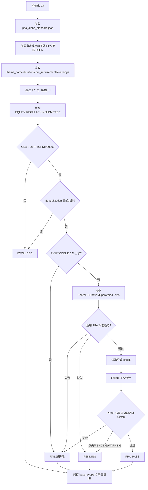

# PPA Alpha 筛选与只读检查 v2

本目录是重新生成的首版实现，旧的 `代码/ppa_submit/` 不属于本工具范围。

默认读取 `PPA 范围/` 中当前有效的 JSON；多个主题同时有效时必须显式传入 `--scope`。
工具按平台 `Date Created (EST/EDT)` 时区筛选最近一个月创建、未提交的
`EQUITY / REGULAR` Alpha。主题规则优先于通用 PPA 标准；缺少平台实时检查时
只能输出 `PENDING`，不会猜测为通过。

API 查询参数会写入 `screening_records.json` 的 `api_query`，包括时区、半开日期边界和全部身份条件，便于和平台列表逐项核对；Sharpe 查询边界与页面的 `>1` 一致。
这里的本地 JSON 只是范围配置和测试输入；Alpha 事实与 PPA 检查结果以平台实时
响应为准。最近一个月是已确认的首版口径，不是原先“附近两个月”建议的默认值。
`--query-only` 只保存 `api_query.json` 和 `api_candidates.json`，不会读取详情、字段或检查。
`PPA_PASS` 只代表技术筛选通过，不代表奖项 Description、月度额度或人工提交资格。

## 使用

```powershell
python 代码/ppa_screening_v2/ppa_screen.py
python 代码/ppa_screening_v2/ppa_screen.py --scope "PPA 范围/20260727_0809_GLB_Power_Pool_Aug26_Rules.json"
python 代码/ppa_screening_v2/ppa_screen.py --start-date 2026-07-01 --end-date 2026-07-31
python 代码/ppa_screening_v2/ppa_screen.py --dry-run --input fixture.json
python 代码/ppa_screening_v2/ppa_screen.py --query-only --output 总结/ppa_api_query
```

实时运行默认读取 `Password/config.yaml` 的 `username`、`password`，也可以使用
环境变量 `WQB_EMAIL`、`WQB_PASSWORD`，或传入只包含 `email`、`password` 的 JSON/YAML。
工具只调用 `filter_alphas`、`locate_alpha`、`locate_field` 和
`check`，不会调用 simulate、submit 或 patch properties。

## 分类

`pass/` 是 `PPA_PASS`，`fail/` 是明确失败，`pending/` 是实时结果不足，
`conflict/` 是规则冲突，`excluded/` 是基础设置不匹配或已提交/隐藏项。

## 当前主题的明确基础范围

以下值全部来自
`PPA 范围/20260727_0809_GLB_Power_Pool_Aug26_Rules.json`：

| JSON Pointer | 当前值 | 筛选含义 |
|---|---|---|
| `/theme_name` | `GLB/D1 Power Pool Aug\`26` | 当前主题名称，仅用于报告标识 |
| `/duration/start_date` | `2026-07-27` | 主题开始日，包含当天 |
| `/duration/end_date` | `2026-08-09` | 主题结束日，包含当天 |
| `/multiplier` | `1X` | 奖励倍率说明，不是 Alpha 技术门槛 |
| `/core_requirements/region` | `GLB` | Alpha settings.region 必须精确为 GLB |
| `/core_requirements/delay` | `1` | Alpha settings.delay 必须精确为 1 |
| `/core_requirements/universe` | `TOPDIV3000` | 必须精确为 TOPDIV3000，不能用 TOP3000 替代 |
| `/core_requirements/neutralization` | `Slow Factors`、`Fast Factors`、`Slow + Fast Factors`、`Crowding Factors`、`RAM` | Settings 必须显式选择其中之一；平台枚举先映射再比较 |
| `/core_requirements/forbidden_datasets` | `PV1`、`MODEL110` | 禁止使用这些 Dataset；support fields 按主题 warning 单独核对 |
| `/warnings/universe_warning` | 禁止混用 TOP3000 | 不是近似匹配，TOP3000 直接排除 |
| `/warnings/neutralization_warning` | 不得为 NONE 并依赖 group_neutralize | 代码表达式内的 group_neutralize 不能替代 Settings 中的主题中性化 |
| `/warnings/dataset_warning` | 禁用 Dataset 不包含 support fields | support fields 需要从字段来源证据单独判断，不能仅看 Dataset 名称 |

此外，前筛选固定要求 `EQUITY / REGULAR / UNSUBMITTED`；它们是平台候选查询的身份条件，
不是当前主题 JSON 的额外放宽项。

## 流程图

完整的前筛选、PPAC 检查、后分类和 PPA 范围 JSON 表示见
[`筛选流程与规则.md`](./筛选流程与规则.md)。窗口配置见
命令行的 `--start-date` 和 `--end-date` 参数；两个月兼容配置已删除。



## Linear stage outputs

The run prints one line per stage and writes the human-readable `filter_steps.txt`. Detailed candidate/check/field lineage is saved in `screening_records.json`.

1. query `region + delay + universe + sharpe_min` within the date window;
2. exclude non-allowed neutralization and out-of-range turnover;
3. exclude rows with platform errors or failed PPA checks;
4. exclude forbidden datasets, with support-field evidence handled separately;
5. check `power_pool_self_correlation_max` (PPAC);
6. check `unique_data_fields_max_excluding_support_fields` and `operators_max`.

`final_table.md` contains all factors surviving the PPAC stage, including later `FAIL` and `PENDING` rows; it is not limited to `PPA_PASS`. Missing platform evidence remains `PENDING`.

Create the detailed workbook after a real run:

```powershell
python 代码/ppa_screening_v2/build_ppa_excel.py `
  总结/ppa_screening_real_20260731_pv1_fix/screening_records.json `
  总结/ppa_screening_real_20260731_pv1_fix/ppa_screening_detailed.xlsx
```

The workbook includes `概览`, `全部候选`, `PPAC后全部因子`, `检查明细`, `字段归属`, and `规则与来源` sheets. Expression fields are resolved with read-only `locate_field`; for example, `close` is recorded as `pv1`.

## RA 线性筛选

`ra_screen.py` 复用本目录的解析逻辑，读取 `不同阿尔法标准/ra_alpha_standard.json`，默认不限制 Region，只筛选 `EQUITY / REGULAR / delay=1 / maxTrade=OFF / UNSUBMITTED`，并检查 Sharpe、Fitness、2Y Sharpe、Margin、严格 Turnover、算子数、字段数、单 Dataset 和 `Failed RA`。默认停在 PC/SC 之前：

```powershell
python 代码/ra_screening_v1/ra_screen.py --output 总结/ra_screening_20260731
python 代码/ra_screening_v1/ra_screen.py --max-candidates 500 --output 总结/ra_screening_20260731_fuller
python 代码/ra_screening_v1/ra_screen.py --run-sc --output 总结/ra_screening_20260731_sc
python 代码/ra_screening_v1/ra_screen.py --dry-run --input fixture.json
```

输出 `ra_screening_records.json`、`filter_steps.txt`、`final_table.md` 和分类目录。`--run-sc` 只对本地 RA 通过项做最后的 SC 读取；PC 永不在此脚本中自动运行，`RA_PASS_PRE_CORR` 也不等于 `READY_TO_SUBMIT`。

Platform neutralization enum mapping is explicit: `RAM` → `REVERSION_AND_MOMENTUM`, `SLOW` → `SLOW_FACTORS`, `SLOW_AND_FAST` → `SLOW_AND_FAST_FACTORS`; the scope labels `Slow Factors`, `Slow + Fast Factors`, `Fast Factors`, `Crowding Factors` are mapped before comparison.
