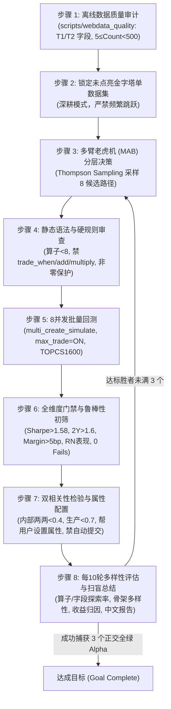

# 多臂老虎机自主因子挖掘与实战通关 Skill

> **定位**：完全独立、自包含（Self-Contained）、生产级 WorldQuant BRAIN 因子挖掘工作流。  
> **算法驱动**：贝叶斯汤普森采样（Thompson Sampling）+ 层次化上下文多臂老虎机（HCB）。  
> **知识底座**：严格继承并强制执行 `doc/总结` 归纳的十条量化铁律与全量门禁实证经验（冲突时以 `doc/总结` 为绝对准绳）。  
> **数据底座**：内嵌 `scripts/webdata_quality/` 离线数据质量先验分析工具。  
> **触发指令**：用户输入 `/goal` 或指定定制目标参数触发执行。

---

## 1. 触发指令标准模板 (Trigger Instruction)

本 Skill 支持用户通过标准 `/goal` 命令一键启动长时间（如跨夜）无监督自主挖掘：

```text
/goal 挖掘region=eur 探索不同的universe delay=D1 max_trade=ON REGULAR类型的alpha sharpe>1.58 fitness>1 2ysharpe>1.6 margin>5bp，turnover>5%,turnover<30%，risk neutralization表现要好sharpe>1,fitness>0.7,margin>5bp，操作符数量<8，ra_failed_count=0，挑选未点亮的金字塔的1个数据集，不要频繁切换数据集除非alpha模板多样性已穷尽并且查阅论坛还是无计可施，使用1-2个字段，直到找到3个满足提交要求的不同数据集的完全不同策略风格的单数据集的未提交的alpha,这些alpha彼此之间的相关性<0.4，去点亮更多的金字塔,否则不要停下来，生产相关性结果没有出来或生产相关性>0.7的alpha不符合提交要求，不要提交，不要提交，记住了吗，我想自己手动提交。回测使用multi_create_simulate 8个并发，不要使用create_simulate，每找到一个就test robust和进行严格的过拟合测试,then pass帮我设置好属性。不要使用trade_when\add\multiply，不要创建自动化任务, 可以参考论坛模板与idea文章,每10轮回测进行alpha表达式多样性评估，包括操作符探索率，字段探索率，模板骨架多样性，风格多样性，预处理，收益来源归因，失效风险等进行总结和扫盲，中文回答
```

完整指令参数规范与状态机详见：[goal_protocol.md](goal_protocol.md)。

---

## 2. 不可逾越的核心硬性纪律 (Ironclad Rules)

在整个挖掘生命周期中，必须 100% 遵守以下规则，若与开源矿机默认逻辑冲突，以此为准：

1. **绝对禁止自动提交 Alpha**：任何情况下严禁调用 `submit_alpha`。系统仅负责门禁初筛、过拟合核查、属性标记；最终提交必须由研究员在平台上人工逐一核验后手动点击提交。
2. **绝对禁止使用违规算子**：**严禁使用 `trade_when`、`add`、`multiply`**！算子总数严格控制在 **`< 8`** 个以内。
3. **强制 8 并发批次回测**：必须使用 `multi_create_simulate`（8 任务批次并发），严禁单任务 `create_simulate` 阻塞回测。
4. **单票集中度硬防线**：优先使用纯净单字段或同源双字段比率；算术融合前必须经 `ts_decay_linear` 平滑并套全局 `rank() - 0.5`。
5. **深耕未点亮金字塔单数据集**：严禁频繁切换数据集，必须在选定的 1 个数据集内穷尽不同策略风格（动量、均值回归、标准化、目标换手衰减等）。
6. **双重严苛相关性过滤**：
   - 3 个达标 Alpha 之间两两相关性 **`< 0.40`**（且必须来自 3 个不同的数据集）；
   - 平台生产相关性 **`PROD_CORRELATION < 0.70`**（若相关性未出结果或超标，坚决不予列入待提交清单）。

---

## 3. 标准作业程序 (SOP: 8 步闭环流水线)



### 步骤 1：金字塔状态勘测与离线数据质量审计 (`cnhkmcp` + `webdata_quality`)
- **在线金字塔勘测**：调用 `cnhkmcp` 的 `get_pyramid_alphas` 与 `get_pyramid_multipliers`，扫描用户当前在各大金字塔类目下的 Alpha 覆盖分布，锁定当前点亮数为 0、乘数最高的“未点亮金字塔”分类；
- **离线质量预检**：运行内嵌工具 `scripts/webdata_quality/webdata_quality.py`，设定 `--region EUR --delay 1 --universe TOPCS1600 --field-tiers "T1,T2" --count-min 5 --count-max 500`，剔除物理稀疏与社区过载特征。

### 步骤 2：锁定未点亮金字塔单数据集 (`cnhkmcp: get_datasets, get_datafields`)
- 从未点亮金字塔清单中锁定 1 个具备优质 T1/T2 字段的候选数据集（如 `analyst4`, `model16`, `model51` 等）；
- 调用 `cnhkmcp` 的 `get_datasets` 与 `get_datafields` 做在线活性核验，识别字段类型（`MATRIX`/`VECTOR`/`GROUP`），防止入参类型倒置；
- 严守深耕纪律，在该数据集内连续探索多种完全不同的表达式拓扑，严禁频繁跳跃。

### 步骤 3：多臂老虎机 (MAB) 贝叶斯分层决策
- 调用 `scripts/mab_core.py` 中的 `HierarchicalContextualBandit`；
- 依次自顶向下进行四层贝叶斯抽样：
  $$\text{Dataset} \longrightarrow \text{Strategy Style} \longrightarrow \text{Skeleton Template} \longrightarrow \text{Parameter Grid}$$
- 若在当前数据集内探索陷入僵局，调用 `cnhkmcp` 的 `search_forum_posts` 检索官方资深顾问的发帖思路以打破瓶颈。

### 步骤 4：静态语法与硬规则前置拦截
- 检查算子总数：必须 `< 8`；
- 正则匹配审查：严禁出现 `trade_when(`、`add(`、`multiply(`；
- 结构性检查：检查括号配对，剔除 `EUR.` 等大区前缀，检查除法非零防护。

### 步骤 5：8 并发批量仿真回测 (`cnhkmcp: create_multi_simulation`)
- 组织 8 个合法候选 Alpha 载荷，调用 `cnhkmcp` 的原生批量接口 `create_multi_simulation`；
- 统一配置：`region="EUR"`, `universe="TOPCS1600"` (备选 `TOP2500`), `delay=1`, `decay=5`, `neutralization="SUBINDUSTRY"`, `truncation=0.08`, `max_trade="ON"`, `language="FASTEXPR"`；
- 等待 8+ 分钟直至全部子任务完成；若部分子任务报错，调用 `lookINTO_SimError_message` 提取精确原因反哺 MAB 修复库。

### 步骤 6：全量门禁与鲁棒性硬核体检 (`cnhkmcp: get_alpha_details, get_alpha_yearly_stats, get_submission_check`)
对回测回传指标执行逐项一票否决制：
- **基础门禁**：调用 `get_alpha_details`，验证 Sharpe > 1.58, Fitness > 1.00, Margin > 5.0 bps (0.0005)；
- **换手率走廊**：Turnover 必须严格处于 `5.0% ~ 30.0%`；
- **2 年阶梯夏普**：调用 `get_alpha_yearly_stats`，逐年审查 PnL 与夏普比率，验证 **2Y Sharpe > 1.60**，防止近期雪崩；
- **平台风控硬体检**：调用 `get_submission_check` 穿透核查，确保 `CONCENTRATED_WEIGHT`、`IS_LADDER_SHARPE`、`SUB_UNIVERSE_SHARPE` 全部为 `PASS`，且 **`ra_failed_count == 0`**。

### 步骤 7：双重相关性审查与胜者属性登记 (`cnhkmcp: check_correlation, set_alpha_properties`)
- **相关性检验**：调用 `cnhkmcp` 的 `check_correlation`：
  1. 内部两两相关性：候选因子与胜者池已有因子相关性必须 **`< 0.40`**（且来自不同数据集）；
  2. 生产相关性：**`PROD_CORRELATION < 0.70`**（必须等待平台计算完毕，未出结果一律不得登记）；
- **属性配置**：调用 `cnhkmcp` 的 `set_alpha_properties` 为合格因子配置高辨识度色彩（Color）、标签（Tag，如 `EUR_TOPCS1600_UNLIT_PYRAMID`）、策略描述；
- **【严禁自动提交】**：**绝对禁止调用 `submit_alpha`**！提醒研究员人工在 Web 平台终审提交。

### 步骤 8：每 10 轮多样性评估与扫盲复盘
- 每完成 10 轮（即 80 个回测任务），调用 `scripts/diversity_evaluator.py`；
- 自动生成详尽的中文 Markdown 审计报告，涵盖算子探索率（$\ge 25\%$）、字段探索率（$\ge 15\%$）、模板骨架多样性（$\ge 40\%$）、风格分布、预处理渗透率、收益来源归因与量化扫盲建议。

---

## 4. 目录架构与独立组件索引

本 Skill 具备完整的独立性与自包含性，全部依赖资源均收拢在当前目录下：

```text
doc/多臂老虎机_挖掘总结Skill/
├── SKILL.md                                 # 本文件：Skill 核心标准定义与综合工作流
├── goal_protocol.md                         # /goal 触发指令专用交互协议与执行状态机
├── README.md                                # Skill 快速概览与使用说明
│
├── references/                              # 知识沉淀与理论手册 (不可或缺的量化先验)
│   ├── 01_mab_thompson_engine.md            # 贝叶斯汤普森采样数学原理与分层决策推导
│   ├── 02_wqb_hard_rules_and_antipatterns.md# WorldQuant BRAIN 十条铁律与避坑指南
│   ├── 03_eur_market_mastery.md             # 欧洲市场深度复盘 (TOPCS1600 89.6%胜率秘诀)
│   ├── 04_gold_expression_templates.md      # 六大风格、小于8算子的殿堂级工业模板库
│   ├── 05_webdata_quality_guide.md          # WebDataScope 离线质量先验与金字塔点亮指南
│   └── 06_cnhkmcp_tool_handbook.md          # cnhkmcp 平台工具链实战全景与辅助决策手册
│
└── scripts/                                 # 可独立执行的脚本库
    ├── webdata_quality/                     # 因子数据源工具链 (完整自包含)
    │   ├── webdata_quality.py               # 主筛选入口
    │   ├── webdata_loader.py                # 离线快照加载器
    │   ├── webdata_classifier.py            # 字段档位 (T1-T4) 与风险分类器
    │   ├── webdata_exporter.py              # XLSX 导出与校验器
    │   ├── tier_rules.json                  # 分档阈值配置
    │   └── WebData_20260219_V0.10.9.zip     # 离线数据底座
    │
    ├── mab_core.py                          # 汤普森采样臂、分层老虎机与严格门禁校验器
    ├── diversity_evaluator.py               # 每 10 轮多样性审计与扫盲分析生成器
    └── run_mab_miner.py                     # 自主挖掘总控编排器 (集成 8 并发回测与目标监听)
```

---

## 5. 停机判定准则 (Goal Completion Criteria)

本 Skill 在无监督自动化运行下，**仅在同时满足以下全部条件时方可宣布任务完成**：
1. 成功锁定了 **3 个不同数据集** 的单数据集 Alpha；
2. 3 个 Alpha 分别代表 **完全不同的策略风格**（如预期修订、子行业组内标准化、动态目标换手衰减）；
3. 3 个 Alpha **均通过全量硬指标门禁**（Sharpe > 1.58, Fitness > 1.0, 2Y Sharpe > 1.6, Margin > 5bp, Turnover 5%~30%, RN 达标, 0 Checks Fail）；
4. 3 个 Alpha 彼此之间的 **内部两两相关性 `< 0.40`**；
5. 3 个 Alpha 的 **生产相关性 `PROD_CORRELATION < 0.70`**（且结果已确认生成）；
6. 已帮用户在平台设置好相关属性，**且未触发任何自动提交**；
7. 任务完成并输出最终胜者汇总表与 `<!-- GOAL_COMPLETE -->` 标识。
