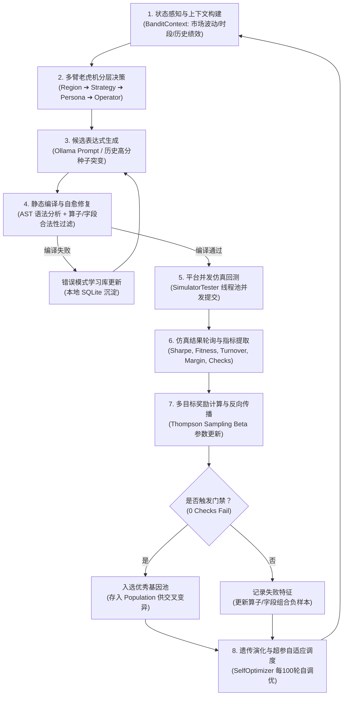

# WorldQuant Miner 因子挖掘系统全景架构与工作流总结

> **归档位置**：`src/多臂老虎机总结/01_系统全景架构与挖掘工作流.md`  
> **研究对象**：`src/worldquant-miner`（涵盖 Generation One 与 Generation Two 完整体系）  
> **核心主题**：自主进化、多臂老虎机决策、AI 模板生成、AST 编译与自愈验证、全天候闭环挖掘流水线

---

## 1. 系统演进脉络：Generation One 到 Generation Two

`src/worldquant-miner` 是一个针对 WorldQuant BRAIN 平台自动化 Alpha 挖掘的开源量化挖掘机器人体系。该系统经历了两代核心架构演进：

```
┌─────────────────────────────────────────────────────────────────────────────┐
│                           Generation One (初代体系)                          │
│ - 核心驱动：单层 Epsilon-Greedy 老虎机 + 本地 Ollama (DeepSeek/Qwen)        │
│ - 变异机制：基础字符串正则替换、算子增删、参数随机微调                      │
│ - 仿真模式：单任务依次提交、单点轮询与阻塞式等待                            │
│ - 架构特征：单体脚本为主 (adaptive_alpha_miner.py, enhanced_generator_v2) │
└──────────────────────────────────────┬──────────────────────────────────────┘
                                       │ 进化重构
                                       ▼
┌─────────────────────────────────────────────────────────────────────────────┐
│                           Generation Two (二代工业体系)                      │
│ - 核心驱动：分层上下文老虎机 (Hierarchical Contextual Bandit) + Thompson 采样 │
│ - 进化机制：神经角色演化 (Neural Persona Evolution) + 锦标赛选择遗传算法    │
│ - 编译自愈：AST 抽象语法树解析、操作符类型校验、基于报错数据库的自愈学习    │
│ - 仿真模式：线程池并发回测 (SimulatorTester) + 槽位并发控制                 │
│ - 架构特征：模块化分层、事件驱动、Cyberpunk 桌面 GUI、自适应参数调度器      │
└─────────────────────────────────────────────────────────────────────────────┘
```

---

## 2. Generation Two 核心模块拓扑结构

Generation Two 采用了清晰的关注点分离（Separation of Concerns）模块化设计，主要划分为以下核心子系统：

```
generation_two/
├── core/                                # 核心生成与编排中枢
│   ├── enhanced_template_generator_v3.py# 总协调器 (Orchestrator)
│   ├── template_generator.py            # AI 表达式生成器 (对接 Ollama / DeepSeek)
│   ├── simulator_tester.py              # 仿真任务提交、并发监控与限速治理
│   ├── template_validator.py            # AST 静态校验与错误自愈修复引擎
│   ├── expression_compiler.py           # 词法/语法/IR中间表示/目标代码编译管线
│   └── mining/                          # 24/7 自动化挖掘协调器
│
├── evolution/                           # 算法进化与老虎机核心
│   ├── advanced_bandits.py              # 层次化上下文老虎机、汤普森采样、元学习选择器
│   ├── alpha_evolution_engine.py        # 基因重组、锦标赛选择、树状变异
│   ├── self_optimizer.py                # 依据每 100 轮模拟绩效的自适应超参调优
│   └── alpha_quality_monitor.py         # 因子夏普衰减监控与健康度评分
│
├── data_fetcher/                        # 数据与元数据获取
│   ├── operator_fetcher.py              # operatorRAW.json 算子库加载
│   ├── data_field_fetcher.py            # 平台字段元数据缓存与拉取
│   └── smart_search.py                  # 语义化字段智能检索引擎
│
└── storage/                             # 本地状态与历史沉淀
    ├── backtest_storage.py              # SQLite 仿真数据库持久化
    ├── regroup.py                       # 仿真结果聚类与多维分组
    └── retrospect.py                    # 历史优化轨迹复盘
```

---

## 3. 全生命周期闭环工作流 (Mining Lifecycle)

整个系统的运转遵循闭环流水线（Closed-Loop Pipeline），从“灵感生成”到“回测验证”，再到“经验反馈与自进化”：



---

## 4. 关键交互机制解析

### 4.1 探索与利用的动态平衡 (Exploration vs. Exploitation)
在挖掘初期或当前策略出现性能瓶颈时，系统通过 `AdaptiveExplorationScheduler` 调高探索率（Exploration Rate），主动探索冷门算子与未知字段；当找到具备正向收益特征的骨架时，自动下调探索率，启动局部参数爬山与交叉变异（Exploitation）。

### 4.2 角色化挖掘 (Persona System)
系统内嵌了拟人化的“研究员角色（Personas）”，例如：
- `Conservative`（稳健型）：偏好长窗均线、高截断值、低换手时序算子；
- `Aggressive`（激进型）：探索短周期动量、高频差分与复合震荡；
- `Innovative`（创新型）：大量尝试跨数据类别特征（新闻、分析师、ESG与基本面混合）；
- `Systematic`（系统型）：严谨执行多重时序衰减与全截面行业对冲。
角色本身具备基因编码（如风险偏好、复杂度偏好、算子多样性倾向），并通过遗传算法进行世代演化（Neural Persona Evolution）。

### 4.3 故障容忍与自愈机制
当平台返回报错（如字段不支持 Delay 0、算子参数缺失、括号不闭合）时，系统不仅进行单次正则自愈重试，还会将 `(错误类型, 错误表达式, 修复建议)` 记录入本地 SQLite 知识库，使下一次生成的表达式在进入网络前即完成本地拦截与清洗。
