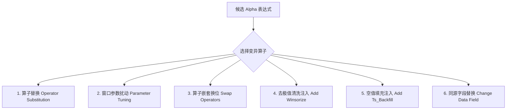

# 遗传进化算法与模板变异拓扑

> **归档位置**：`src/多臂老虎机总结/04_遗传进化算法与模板变异拓扑.md`  
> **研究对象**：`generation_one/adaptive_alpha_miner.py` 与 `generation_two/evolution/alpha_evolution_engine.py`  
> **核心主题**：锦标赛选择、精英保留、表达式交叉重组、时序拓扑变异、角色基因进化

---

## 1. 种群结构与进化总览

在 `src/worldquant-miner` 中，Alpha 表达式的持续迭代融合了遗传算法（Genetic Algorithm, GA）的框架：

```
当前种群 Population (N = 30 ~ 50)
   │
   ├── 1. 适应度评估与排序 (基于 Sharpe, Fitness, Turnover)
   │
   ├── 2. 精英保留 (Elitism): 复制前 10% ~ 20% 最优个体直接入选下一代
   │
   ├── 3. 锦标赛选择 (Tournament Selection): 从剩余个体中按概率选取双亲
   │
   ├── 4. 交叉重组 (Crossover, 概率 0.70 ~ 0.80): 生成子代骨架
   │
   └── 5. 拓扑变异 (Mutation, 概率 0.10 ~ 0.15): 注入多样性扰动
```

---

## 2. 选择与重组机制

### 2.1 锦标赛选择 (Tournament Selection)
为克服轮盘赌选择（Roulette Wheel）对超高夏普个体的过度聚焦与早熟收敛，系统采用规模为 $k = 3$ 的锦标赛选择：
1. 随机从当前种群中无放回抽取 3 个个体；
2. 比较三者的综合适应度评分 $\text{FitnessScore}$；
3. 选拔最高者作为亲本（Parent）。

### 2.2 交叉机制 (Crossover)

#### (1) Generation One：基于括号切分的字符串交叉（反模式）
```python
# Gen 1 中的脆弱实现
parts1 = parent1.split('(')
parts2 = parent2.split('(')
if len(parts1) > 1 and len(parts2) > 1:
    if random.random() < 0.5:
        return parts1[0] + '(' + parts2[1]
    else:
        return parts2[0] + '(' + parts1[1]
```
**严重缺陷**：这种粗暴的字符串切分严重破坏了括号配对完整性与操作符入参签名，导致约 45% 的交叉子代产生非法语法（Syntax Error）。

#### (2) Generation Two：基于 AST 子树的结构化交叉
在 Gen 2 中，交叉操作迁移至抽象语法树（AST）层面：
1. 将两亲本分别编译为语法树 $T_A$ 与 $T_B$；
2. 识别双方等价深度的非终结符节点（如时序算子节点或特征字段节点）；
3. 互换对应子树并执行参数类型重核验，彻底杜绝了语法错误。

---

## 3. 变异拓扑算子库 (Mutation Operators)

系统定义了 6 大核心变异算子，按均匀分布随机触发：



### 3.1 算子替换 (`_swap_operators` / `_change_operator`)
在同类型算子集合内进行等价替换：
- 时序统计替换：`ts_rank` $\leftrightarrow$ `ts_zscore` $\leftrightarrow$ `ts_mean`
- 极值相关替换：`ts_argmax` $\leftrightarrow$ `ts_argmin`
- 截面标准化替换：`rank` $\leftrightarrow$ `scale`

### 3.2 窗口参数扰动 (`_change_parameter`)
提取表达式中的整型常数，施加局部高斯或步长扰动：
$$
d_{\text{new}} = \max(3, d_{\text{old}} + \Delta d), \quad \Delta d \in \{-10, -5, -2, +2, +5, +10\}
$$

### 3.3 稳健性预处理包裹 (`_add_winsorize` & `_add_ts_backfill`)
针对金融数据的长尾离群值与缺失停牌，自动在字段外层注入预处理算子：
- `winsorize(field, std=3.0)`：将 3 倍标准差以外的异常尖峰拉平；
- `ts_backfill(field, 5)`：向前回填 5 日内的缺失与停牌数据。

---

## 4. 神经角色进化 (Neural Persona Evolution)

Gen 2 独创性地将“研究员偏好”形式化为基因特征向量：

$$
\mathbf{g} = \big(g_{\text{creativity}}, g_{\text{risk}}, g_{\text{complexity}}, g_{\text{op\_div}}, g_{\text{field\_div}}\big) \in [0, 1]^5
$$

### 4.1 角色基因对表达式生成的直接约束
- **$g_{\text{complexity}}$ (复杂度偏好)**：控制 AST 语法树的最大深度（Depth: 2 ~ 6）与算子总数；
- **$g_{\text{op\_div}}$ (算子多样性)**：强制避免单算子重复嵌套（如拒绝 `rank(rank(x))`）；
- **$g_{\text{risk}}$ (风险承受度)**：决定是否尝试高换手的一阶差分算子。

### 4.2 角色世代演化
每 50 轮评估各角色所产出 Alpha 的平均夏普与通关率，使用包含高斯微扰的高阶遗传变异更新角色种群：
$$
g_i \leftarrow \text{clip}\big(g_i + \mathcal{N}(0, 0.1^2), 0.0, 1.0\big)
$$
促使系统在长时间挖掘中自发沉淀出最契合当前市场大区的“超级量化研究员角色”。
