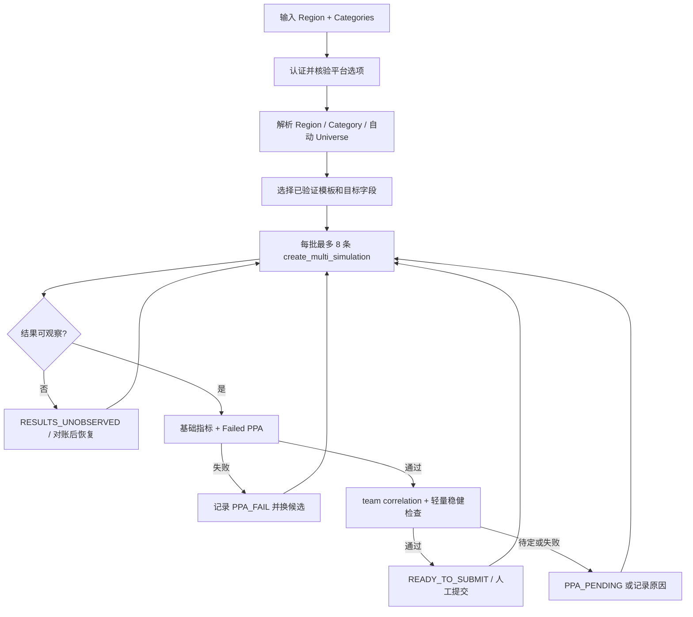

# Goal：PPA 普通因子持续挖掘（v1）

状态：可执行；达到 10 个 PPA 或用户明确停止时结束  
版本：v1  
更新时间：2026-07-29

## 目标

用户只提供：

```text
TARGET_REGION      = <平台支持的地区>
TARGET_CATEGORIES  = <一个或多个 Category>
```

在固定 `EQUITY / delay=1 / REGULAR / max_trade=OFF` 下，持续寻找 10 个符合 PPA 条件的未提交 Alpha。Universe、dataset、字段、模板和回测批次由助手按平台实时选取并记录；用户更新 Region 或 Categories 时，从最近断点继续，不清空已有结果。

本 Goal 不调用 `submit_alpha`，不把改名或预检称为正式提交。通过全部门槛的候选只标记 `READY_TO_SUBMIT`，由用户手动提交。

## PPA 口径与唯一来源

PPA 规则唯一来自 `$wq-top-advisors-skill` 的黄金顾问知识与 cnhkmcp 的实时结果。禁止使用其他外部文件、旧脚本、旧缓存或本地推断替代这两个来源。

1. 每轮开始先调用 `$wq-top-advisors-skill`，提取本轮适用的 PPA 研究、筛选、稳健性和相关性规则，并在运行记录中注明使用的 skill 规则主题。
2. 使用 cnhkmcp 获取 PPA team、候选详情、指标、相关性、检查状态和提交前检查；team、Category、Region 或门槛没有实时证据时，不得猜测。
3. 候选只有在 `$wq-top-advisors-skill` 要求的全部 PPA 条件与 cnhkmcp 返回的全部对应检查均通过后，才计为 `PPA_PASS`。
4. skill 未明确给出的数值门槛不得自行补充；cnhkmcp 缺少对应结果时标记 `PPA_PENDING`，不能用其他文件中的旧阈值代替。
5. 相关性缺失、team 未核验、PPA 结果不可见或检查结果不完整，均不能计入 10 个目标。

## 固定规则

- `TARGET_REGION` 必须先解析为平台返回的精确 Region；别名不能直接发给平台。
- `TARGET_CATEGORIES` 必须映射到平台真实 Category；未匹配时报告可选值，不猜测。
- Universe 不要求用户输入：使用 cnhkmcp 获取该 Region 下的合法选项，选择并记录依据；找不到合法值就暂停当前 Category，但 Goal 保持活动。
- 每个 Alpha 只使用一个精确 `dataset_id`、一个 Universe 和已核验字段；字段必须来自目标 Category。
- 每批最多 8 个表达式，固定 settings；不复制表达式凑批次。
- 禁用 `trade_when`、`add`、`multiply`；算子和字段必须先由 MCP 核验。
- 保留失败候选、失败原因和恢复位置；不得用空结果、超时或请求参数推断成功。
- 只排除明显不可用项：已提交、重复表达式、隐藏项、字段/设置不合法、`Failed PPA > 0` 或明确失败项。接近门槛项保留为观察候选。

## 执行流程



### 1. 初始化

使用 cnhkmcp `authenticate`，然后按顺序核验 `get_platform_setting_options`、`get_datasets`、`get_datafields`、`get_operators` 和 `get_user_alphas`。凭据来源可复用现有配置，但不得输出秘密。

首次运行获取 PPA team 标识、名称、Region/Category 适用范围和获取时间；后续运行优先复用缓存，定期或发现 team 结果异常时刷新。PPA team 不能从本地缓存单独推断。

### 2. 候选与回测

按目标 Category 使用 `$wq-top-advisors-skill` 提供的研究方向生成少量结构不同的表达式；每条记录经济假设、字段、dataset、Universe、settings 和父候选。只使用 cnhkmcp `create_multi_simulation`，外层返回成功但没有 Alpha ID 或详情时标记 `RESULTS_UNOBSERVED`，用 cnhkmcp 对账，禁止重复盲重试。

### 3. PPA 检查

基础结果出现后：


1. 按 skill 规则读取 cnhkmcp 返回的检查、指标和 PPA team 结果，列出每个失败项的名称、限制和值；
2. 使用 cnhkmcp 获取实时 PPA team correlation 或等价 PPA 结果；
3. 按 skill 要求补充稳健性、yearly stats、PnL、turnover、margin 和集中风险；
4. 仅在 skill 要求的全部条件和 cnhkmcp 对应结果全部通过时标记 `PPA_PASS`；
5. 调用 cnhkmcp `get_submission_check`，明确 PASS 后才追加 `READY_TO_SUBMIT`，保留已有 tags，不修改 color/category/osmosis points。

## 状态与断点

候选状态：

`DISCOVERED` → `SIMULATED` → `PPA_PENDING` → `PPA_PASS` → `READY_TO_SUBMIT`

异常状态：`BASE_FAIL`、`PPA_FAIL`、`RESULTS_UNOBSERVED`、`SUBMISSION_BLOCKED`、`PAUSED_SERVER_ERROR`。

每批记录：`run_id`、时间、目标 Region/Categories、精确 Universe、dataset、表达式、batch_id、结果可观察性、PPA team 标识、PPA correlation、Failed PPA 明细、状态和恢复位置。

记录只写入：

`D:\code\WorldQuant Brain\consultant\gui\doc\goal\总结\ppa\`

- `{alpha_id}.md`：候选详情和状态追加记录；
- `批次总结.md`：每 10 批追加一次简短总结；
- `运行状态.md`：当前输入、team 缓存时间、已完成批次、待处理位置和下一步。

## 持续运行与异常

- 用户说“继续”“换 Region”“换 Category”是更新参数并续跑，不是完成或停止。
- 只有达到 10 个 `READY_TO_SUBMIT` 的 PPA 候选，或用户明确说“停止/结束/取消”，才设置 Goal 结束状态并保留断点。
- 认证、权限、429、5xx、网络或 MCP 超时：记录真实错误，状态 `PAUSED_SERVER_ERROR`，按原批次和位置恢复；不把暂停写成成功。
- 只因当前字段/表达式明确无效时淘汰当前候选，继续下一个候选；其他错误、暂停、无候选和结果待定都不是停止条件。
- 达到 10 个 `READY_TO_SUBMIT` 的 PPA 候选后才结束；在此之前本 Goal 不因批次失败、服务器错误、Category 暂无候选或 `PPA_PENDING` 而停止。

最终报告必须包含：10 个目标的完成数量、PPA_PASS/READY_TO_SUBMIT 数量、skill 规则主题、team 证据时间、失败条件、未观察结果、人工提交状态和未解决风险，并明确声明未调用 `submit_alpha`。
