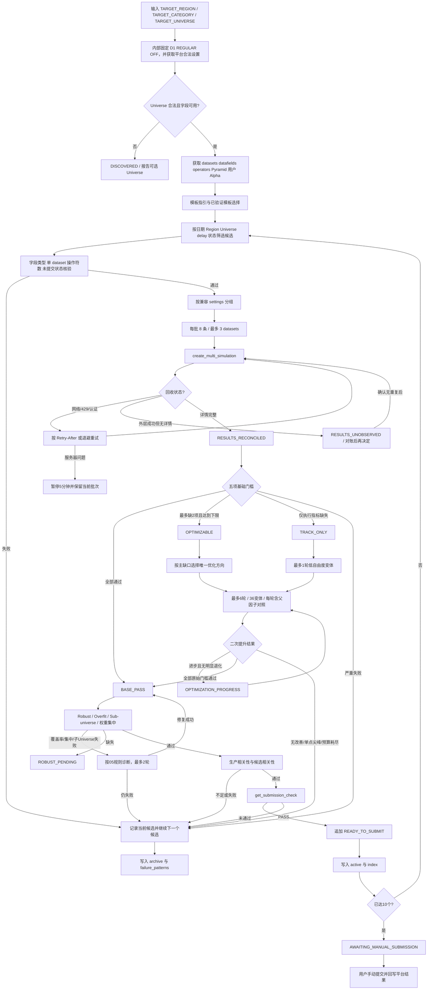

# Goal：可配置 Region/Universe 的 D1 REGULAR Alpha 挖掘与近门槛提升（v3）

状态：可执行；仅用户停止或达成目标时结束
版本：v3，独立执行规范  
更新时间：2026-07-28

## 目标

默认在 `EQUITY / delay=1 / REGULAR / max_trade=OFF` 下运行；执行前只允许输入地区、Category 和 Universe，挖掘并定向提升最多 10 个可供用户人工提交的 Alpha：

- 每个 Alpha 未提交，来自不同的精确 `dataset_id`；
- 每个 Alpha 使用 1 个 dataset、1 个 Universe、1–2 个唯一字段，操作符数量 `< 6`；
- 通过基础指标、风险中性化、稳健性、过拟合、相关性和平台预检；
- 对接近门槛但暂未通过的候选进行有限次数、可解释的二次提升；
- 只有全部原始硬门槛重新通过，才追加 `READY_TO_SUBMIT`；
- 禁止调用 `create_simulation`、`submit_alpha`；禁止使用 `trade_when`、`add`、`multiply`；禁止创建自动化任务、修改项目代码或修改 `reference/`。

## 唯一执行输入

### Update Alpha mining target 对话协议

- 用户更新地区、Category 或 Universe，只是更新运行参数并从最近断点继续，不是停止指令；
- 只有用户明确说“停止/结束/取消任务”等语义，才设置 `USER_STOP_REQUESTED` 并结束；“更新目标”“修改目标”“继续运行”不得解释为停止；
- 助手回复“目标已更新”“参数已保存”只代表参数变更成功，不代表 Goal 完成，不得写入 `COMPLETED` 或 `STOPPED`；
- 更新后必须重新核验这三个输入，并保留已完成批次、当前批次、父因子和恢复位置；不得因为更新目标而清空进度或重复提交已确认成功的批次；
- 服务器错误、MCP 超时或结果暂不可见时，对话保持活动状态，使用 `PAUSED_SERVER_ERROR` 等待 5 分钟后继续，不得结束对话或创建新的 Goal。

执行前必须明确填写：

```text
TARGET_REGION   = GLB
TARGET_CATEGORY = <用户输入的 Category>
TARGET_UNIVERSE = AUTO_LARGEST_LIQUID
```

- `TARGET_REGION`：唯一的地区输入，必须与平台返回的 Region 精确匹配；
- `TARGET_CATEGORY`：唯一的策略类别输入，只用于筛选模板、字段族和候选；未输入时不得擅自猜测；
- `TARGET_UNIVERSE`：唯一的 Universe 输入，可直接输入合法值，也可输入 `AUTO_LARGEST_LIQUID`；
- 以下值是内部固定值，不是用户输入：`DELAY=1`、`ALPHA_TYPE=REGULAR`、`MAX_TRADE=OFF`；
- `AUTO_LARGEST_LIQUID`：先用 `get_platform_setting_options` 获取该区域合法 Universe，再优先选择规模较大且流动性可用的 TOP Universe；不把近似名称当成同一 Universe；
- 用户明确输入的 Universe 优先于自动选择，但仍必须经过平台合法性和字段可用性核验；
- 若目标 Universe 不合法、不可用或字段覆盖不足，当前候选停留在 `DISCOVERED`，报告问题后继续检查其他可恢复候选；不得结束 Goal，也不得擅自替换。

### Region/Universe 选择偏好

以下只是初始偏好，不是平台事实；每次执行必须以 MCP 返回为准：

| Region 类型 | 首选 | 备选 | 选择理由 |
|---|---|---|---|
| USA、GLB | 最大合法 TOP Universe，通常优先 TOP3000 | TOP2000、TOP1000 | 覆盖更广，便于减少尾部集中 |
| EUR | 最大合法 TOP Universe，通常优先 TOP2500 | TOP1200、TOP800 | 在覆盖与流动性之间平衡 |
| CHN | 最大合法 TOP Universe，通常优先 TOP2000U | 平台返回的 TOP1000 或相邻合法 Universe | 避免直接假设 USA 命名规则 |
| ASI 或流动性敏感区域 | 平台推荐的流动性 Universe | 最大合法 TOP Universe | 先保证可交易性，再追求覆盖 |
| 其他 Region | MCP 返回的最大合法 TOP Universe | 次大合法 Universe | 不凭经验硬编码名称 |

Universe 选择后必须记录：用户输入值、平台合法值、最终采用值、备选值、选择理由和核验时间。

## 最终硬门槛

以下标准不因“近门槛”而放宽：

- `Sharpe > 1.58`；
- `Fitness > 1`；
- 平台明确口径的 `2Y Sharpe > 1.6`；
- `Margin > 10bp`；
- `0.05 < Turnover < 0.30`；
- 未提交状态由 MCP 明确确认；
- 通过风险中性化、robust、过拟合、相关性和平台预检。

## 近门槛候选分层

详细规则见：

- [近门槛提升总则](./因子提升/near_pass_alpha_optimization.md)；
- [优化次数与预算](./因子提升/01_optimization_budget.md)；
- [缺口诊断与优化方向](./因子提升/02_gap_direction.md)；
- [参数矩阵与验收标准](./因子提升/03_parameter_matrix_and_acceptance.md)。

### `OPTIMIZABLE`

同时满足：

- 五项指标至少 3 项达标，未达标最多 2 项；
- `Sharpe >= 1.35`、`Fitness >= 0.75`、`2Y Sharpe >= 1.35`；
- `Margin >= 7bp`、`0.03 <= Turnover <= 0.50`；
- PnL 非空，覆盖率、long/short、集中度和数据质量无致命问题；
- 能为每个失败指标指定唯一主优化方向。

### `TRACK_ONLY`

核心逻辑尚可，但只允许低频观察或一轮低自由度尝试：

- 只有 Margin 或 Turnover 不达标；或
- 两项指标达标，且 `Sharpe >= 1.20`、`Fitness >= 0.60`；或
- 2Y 表现明显好于 IS，但近期样本不稳定。

### `REJECTED`

未达标超过 2 项、`Sharpe < 1.20`、`Fitness < 0.60`、`2Y Sharpe < 1.20`、`Margin < 5bp`、`Turnover > 0.60`、PnL 为空、数据质量失败，或连续两轮优化没有改善。

近门槛状态只允许保存、跟踪和优化，不能标记为提交成功。

## Mermaid 流程图



## 执行流程

### 1. 初始化与候选拉取

1. 使用 cnhkmcp `authenticate`，凭据从 `consultant_core/config.yaml` 读取，禁止输出密码。
2. 获取 `get_platform_setting_options`、`get_datasets`、`get_datafields`、`get_operators`。
3. 获取 `get_pyramid_alphas`、`get_pyramid_multipliers`，优先选择当前未点亮类别。
4. 使用 `get_user_alphas(stage="IS")` 作为排除线索；只有接口明确返回未提交状态时才据此排除。
5. 定期拉取未提交及 `IS_FAIL` 候选，建议每 14 天一次；记录拉取窗口和去重规则。
6. 每个 `dataset_id`、模板类别和策略风格最多保留 1–3 个最佳父因子，避免同一骨架重复优化。
7. 同一个 `parent_alpha_id` 的二次提升最多 6 轮、36 个变体；`TRACK_ONLY` 最多 1 轮、6 个变体。预算耗尽后只停止该父因子的继续优化，记录结果并继续 Goal。

候选拉取必须同时满足以下筛选条件，缺少任一条件就不进入提升池：

- 日期窗口：使用半开区间 `[start_date, end_date)`；常规跟踪取最近 14 天，首次回溯最多 90 天；所有日期统一记录为 UTC 原值，并显示 Asia/Shanghai 日期；
- Region：`settings.region == TARGET_REGION`；
- Universe：`settings.universe == TARGET_UNIVERSE`；只接受 `get_platform_setting_options` 返回的合法值，并要求精确匹配；不能把 TOP3000、TOP1000 等近似名称视为同一 Universe；
- delay：`settings.delay == DELAY`，默认 `1`；
- 类型：`type == "REGULAR"`，排除 `SUPER`；
- 状态：只拉取接口明确返回的 `UNSUBMITTED` 或 `IS_FAIL`；不能用 `stage="IS"` 单独推断状态；
- 可见性：排除 `hidden == true`；
- 交易设置：`max_trade == MAX_TRADE`，默认 `OFF`，并记录 neutralization、pasteurization 和 decay；
- 表达式：通过 `get_datafields` 确认单一 dataset、1–2 个唯一字段和操作符数量 `< 6`；
- 时间字段：未提交候选记录 `dateCreated`，已提交对账记录使用 `dateSubmitted`；两者不能混用。

每次拉取必须记录 `pull_id`、`start_date`、`end_date`、Region、Universe、delay、状态过滤、返回数量、去重数量和不可核验数量。

### 2. 模板与经济假设

严格遵循 [模板指引](./模板/模板指引.md)：

1. 先从 [已验证因子模板](./模板/已验证因子模板.md) 的 100 个模板中选起点；
2. 再读取对应分类文件，核对经济含义和变体；
3. [论坛高赞内容总结模板](./模板/论坛高赞内容总结模板.md) 仅作来源索引，不直接作为表达式来源；
4. 每个候选记录模板编号、经济机制、字段代理、预期方向、持有周期、换手和 Margin 预期。

分类文件由模板指引按研究方向选择，包括情绪/新闻、动量/反转、价值/盈利、风险/流动性、时间序列/截面、期权/宏观和通用结构；不在 v3 中重复维护分类清单。

模板中的 `trade_when`、`add`、`multiply` 仍受本 Goal 禁用规则约束；任何算子必须先由 `get_operators` 核验签名。

一次只替换一个字段、一个算子或一个窗口。同一骨架只换字段、窗口或正负号，不算新的策略风格。

### 3. 数据集与 Universe

1. 任意时刻只保留一个 `active_dataset` 和一个 `active_universe`。
2. 表达式全部字段必须由 `get_datafields` 确认为同一 dataset。
3. 目标 Region 有多个合法 Universe 时，至少核验目标 Universe 与一个相邻较小 Universe；单个 Alpha 只能使用一个 Universe。
4. 字段类型、Vector/标量关系、Region、Universe 或算子签名不明确时，停留在 `DISCOVERED`，不得回测。
5. 数据覆盖不足、缺失严重或字段族已耗尽时记录原因，不通过换名或猜测字段继续。

### 4. 批量回测与基础筛选

只使用 cnhkmcp `create_multi_simulation`：

- 标准批次固定为 8 个表达式；
- 每批最多包含 3 个不同 `dataset_id`，但每条表达式内部的全部字段仍必须属于同一个 dataset；
- 同批 Region、Universe、delay、neutralization、pasteurization、max_trade 和 expression type 必须一致；
- 异常恢复批次最多 4 条，定向优化批次 2–4 条，收尾批次 2–7 条；非上述情况不得主动使用小批次；
- 保存 `batch_id`、batch_size、dataset 列表、表达式、字段、模板编号、settings、原始结果和父因子 ID；
- 二次优化每轮最多 6 个变体，必须包含 1 个原始对照；
- 工具未返回 worker 数量时记录 `CONCURRENCY_UNOBSERVED`，不虚构并发信息。

批次装配和回收执行 [批次执行与回收规则](./因子提升/06_batch_execution_policy.md)。只有 `RESULTS_RECONCILED` 才计入有效批次；外层成功但结果不可见时标记 `RESULTS_UNOBSERVED`，不得立即重复提交同一批。

基础结果按五项指标分类为 `BASE_PASS`、`OPTIMIZABLE`、`TRACK_ONLY` 或 `REJECTED`。指标缺失、单位不明或只凭 `stage="IS"` 推断状态时不得晋级。

## 二次提升策略

### 1. 按缺口选择主方向

- Sharpe 和 Fitness 同时不足：回到字段/模板层，不做参数美容；
- Sharpe 通过、Fitness 不足：优先检查稳定性、回撤、异常值和换手；
- 2Y Sharpe 不足：优先测试较长窗口、适度 decay、历史覆盖和年份稳定性；
- 只有 Margin/Turnover 不足：优先改善无效换手和信号平滑，保留原始表达式对照；
- Turnover 过低：缩短窗口或减少平滑，不人为制造噪声。

### 2. 参数网格与次数限制

一次只改变一个维度：

1. 同模板同类型字段或正负方向；
2. 窗口 `5/10/20/60/120/252` 中选 3 个；
3. decay `0/3/6/10/15/20` 中选 3 个；
4. `NONE` 与一个合法非 `NONE` 中性化设置；
5. 一个当前 Goal 允许的换手控制参数。

每个优化阶段最多 2 轮，全部阶段合计最多 6 轮、36 个变体；每轮最多 6 个表达式且必须包含父因子对照。同一参数维度最多 2 轮。第 7 轮禁止开始；更换字段族、模板类别或经济假设时必须创建新的父因子 ID。不得一次同时改变字段、窗口、decay、中性化和换手控制。

### 3. 二次提升验收

`OPTIMIZATION_PROGRESS`：主缺口改善至少 10%，已通过指标退化不超过 5%，并且至少两个相邻参数值方向一致。

`OPTIMIZATION_PASS`：五项原始硬门槛全部通过，且重新通过风险中性化、robust、过拟合、相关性和平台预检；只有此状态可进入 `READY_TO_SUBMIT`。

`OPTIMIZATION_FAIL`：两轮无改善、出现孤立尖峰、核心指标退化超过 5%、新增集中风险，或需要多参数共同调节才能勉强通过。

## Robust、相关性与提交前检查

### Robust

基础通过或二次提升通过后，冻结表达式：

1. 测试 `decay=[0,3,6]`，平台不允许的值记录原因；
2. 检查合法非 `NONE` 风险中性化；
3. 风险中性化结果满足 `Sharpe > 1`、`Fitness > 0.7`、`Margin > 10bp`；
4. 检查 yearly stats、2Y 指标、PnL 连续性、覆盖率、drawdown、long/short 和集中风险；
5. 结果产生后不得再次调参；缺失为 `ROBUST_PENDING`，失败为 `ROBUST_FAIL`。
6. 出现 Sub-universe Sharpe 过低或 `Weight is too strongly concentrated or too few instruments are assigned weight` 时，先按 [Sub-universe/权重集中诊断规则](./因子提升/05_sub_universe_sharpe_weight_concentration.md) 检查覆盖率、NaN、极值、时间跳变、事件稀疏和中性化错配；不得直接进入相关性或 `READY_TO_SUBMIT`。
7. Sub-universe 修复属于稳定性/执行效率阶段，最多使用 2 轮、每轮最多 6 个表达式，并共享 v3 的父因子总预算；通过平台明确改善且核心指标退化不超过 5% 后，才可继续后续检查。

### 相关性与平台预检

1. `check_correlation` 的 production correlation 必须有结果且 `abs(corr) <= 0.7`；
2. 候选 PnL 共同有效观测至少 252 个交易日，且 `abs(corr) < 0.4`；不足记 `CORR_PENDING`，不得填 0；
3. `get_submission_check` 明确 PASS 后才可追加 `READY_TO_SUBMIT`；
4. 仅在 `BASE_PASS/OPTIMIZATION_PASS + RISK_NEUTRAL_PASS + ROBUST_PASS + OVERFIT_PASS + 两类相关性合格 + 未提交状态确认` 全部成立时调用 `set_alpha_properties`；
5. 保留原 tags，只追加 `READY_TO_SUBMIT`，不擅自修改 color、category 或 osmosis points。

## 输出与状态记录

研究记录按 [文件命名、分层写入与留存规则](./因子提升/04_file_naming_and_retention.md) 写入：

- 活跃候选：`doc\goal\总结\active\`；每个 `parent_alpha_id` 只保留一份主文件；
- 终态候选：`doc\goal\总结\archive\YYYY-MM\`；
- 批次和因子索引：`doc\goal\总结\index\`；
- 每 10 个批次的压缩总结：`doc\goal\总结\`。

文件名必须包含 `YYYYMMDD、REGION、D{delay}、Universe、purpose、status、id`。单个 Alpha 主文件必须记录 `TARGET_REGION`、用户输入的 Universe、最终采用的 Universe、Universe 核验时间、Alpha ID、父因子 ID、表达式、模板编号、dataset、字段、settings、创建日期、最后观察日期、五项指标、缺口、优化轮次、原始对照、剩余预算、状态证据和平台预检结果。

每次人工提交确认后追加：

- `有效操作`：1–3 句；
- `帮助不大`：1–3 句；
- `下次复用`：1–3 句。

每 10 个批次追加带周期和 Region 的总结，例如 `20260728__USA__D1__TOP3000__batch_summary__B001-B010.md`，记录模板/字段覆盖、近门槛数量、提升成功率、主要失败指标和下一轮方向，并增加请求批次/有效批次、平均 batch_size、不可对账比例、429/网络/认证失败次数和平均等待时间；不重复逐个 Alpha 详情。已有 [EUR 批量模拟历史总结](./总结/EUR批量模拟_优化与重试总结.md) 只作为历史经验和失败模式参考，不作为 USA 当前状态或实时批次依据。

## Goal 唯一停止条件

只有以下两种情况允许停止整个 Goal：

1. 达到目标：找到 10 个不同 dataset、覆盖不同策略风格且带 `READY_TO_SUBMIT` 的 Alpha，改为 `AWAITING_MANUAL_SUBMISSION`；
2. 用户明确要求停止。

以下情况都不是 Goal 停止条件，只能影响当前候选或当前批次：

- 候选不合格、字段不足、Category 暂无可用方向、优化预算耗尽、连续优化失败、批次结果缺失或 `INCOMPLETE_EXHAUSTED`：记录并继续寻找其他候选；
- `AWAITING_MANUAL_SUBMISSION` 只表示达到目标，不自动提交 Alpha；Goal 可在达到目标后结束，提交核验属于后续人工流程；
- 任何异常都必须保留当前批次、父因子、已完成位置和可恢复位置，禁止把“未查到结果”写成成功或停止。

## 服务器问题处理

服务器返回错误、429、5xx、认证/权限/额度响应、网络断开、请求超时或 MCP 等待超时：

1. 立即暂停“提交当前批次”5 分钟，状态记为 `PAUSED_SERVER_ERROR`，记录原始响应、批次、候选和恢复位置；
2. 5 分钟后从同一批次、同一候选、同一进度继续；不得重复提交已确认成功的请求；
3. 恢复后继续运行，不把暂停升级为 `FAILED`、`INCOMPLETE_EXHAUSTED` 或 Goal 完成；
4. 若错误明确属于当前表达式/字段本身不可用，只淘汰当前候选并继续下一个候选；若无法确认，则按服务器问题暂停 5 分钟后重试。

用户停止必须立即响应并保留断点；只有用户停止或达到目标才允许整个 Goal 结束。

最终报告必须包含：找到数量、近门槛数量、二次提升成功数量、dataset 与策略风格覆盖、各状态数量、提交记录状态、未解决风险，并明确声明未调用 `submit_alpha`。
