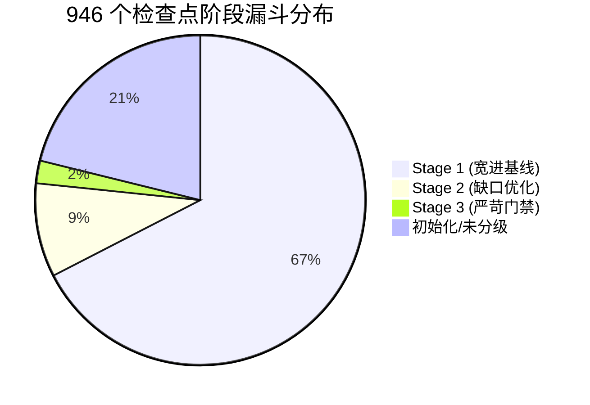
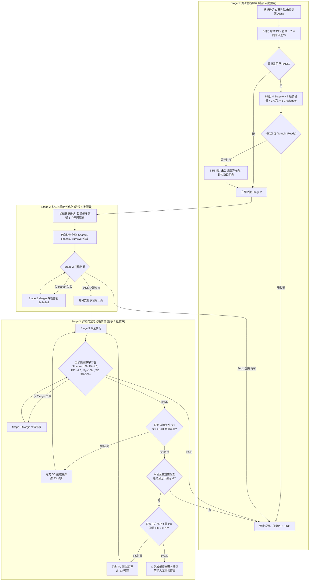
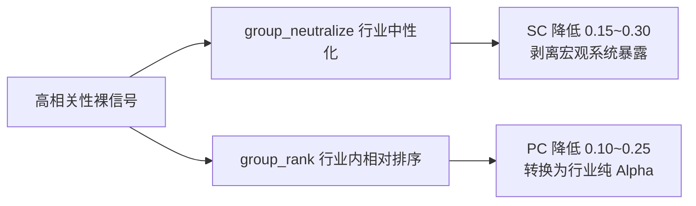
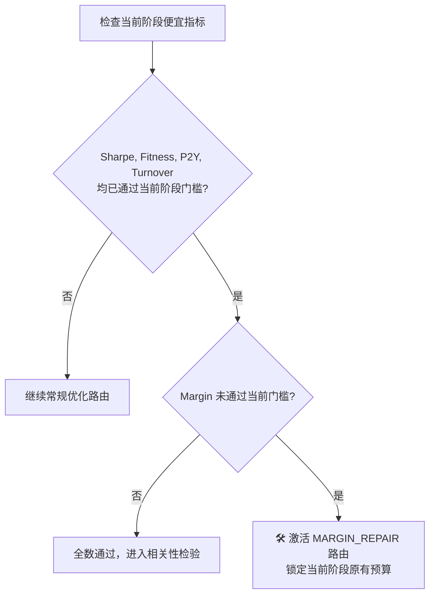
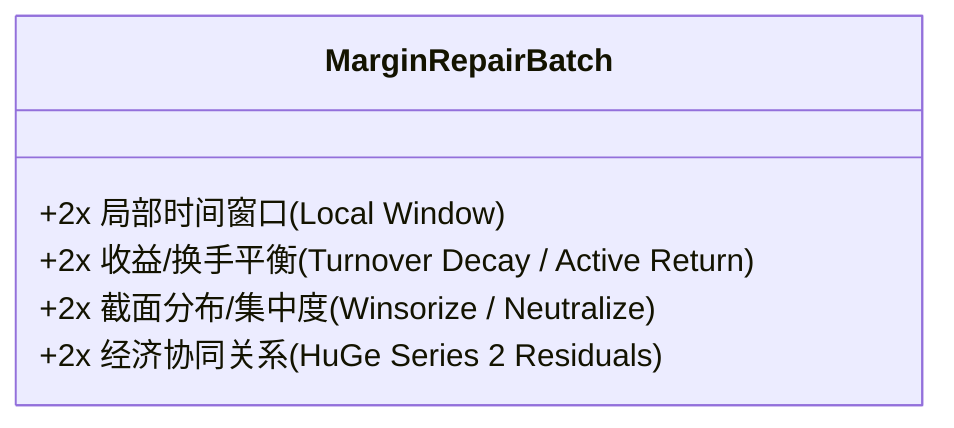
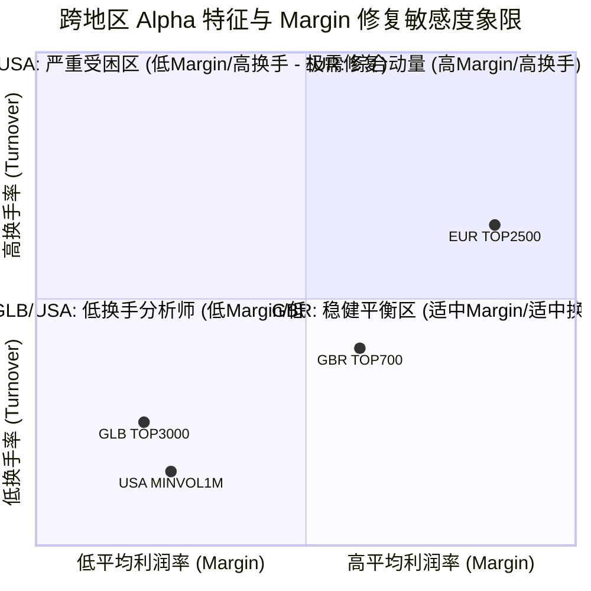
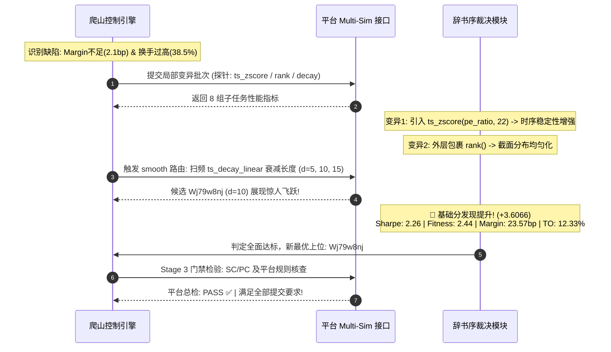
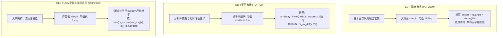

# 广州服务器全自动爬山算法（hill_climbing_v4.7）架构与日志深度审计报告

> **审计执行人**：广州服务器自动化量化架构与日志审计组  
> **审计样本源**：77 份生产环境爬山日志（`.log`）、946 份运行时状态检查点（`*_checkpoint_v4.7.json`）、9,180 条历史回测评估缓存（`history_v4.7.json`）及 2,500+ 次真实局部变异提升事件。  
> **核心任务**：深度解构“宽进严出”三阶段漏斗架构、核心变异路由实战效能、Margin 专项修复救赎机制，以及从失败到通关的 Alpha 变异全进化轨迹。

---

## 目录 (Table of Contents)

1. [执行摘要与审计核心发现](#1-执行摘要与审计核心发现)
2. [“宽进严出”三阶段漏斗架构 (Three-Stage Funnel Architecture)](#2-宽进严出三阶段漏斗架构-three-stage-funnel-architecture)
   - 2.1 [三阶段拓扑控制流与状态机设计](#21-三阶段拓扑控制流与状态机设计)
   - 2.2 [分阶段数字门槛与实战过滤漏斗](#22-分阶段数字门槛与实战过滤漏斗)
   - 2.3 [阶段淘汰归因与关键瓶颈分析](#23-阶段淘汰归因与关键瓶颈分析)
3. [核心变异路由 (Optimization Routes) 实战效能评级](#3-核心变异路由-optimization-routes-实战效能评级)
   - 3.1 [路由注册表与调度拓扑](#31-路由注册表与调度拓扑)
   - 3.2 [smooth 路由：换手平抑与 Margin 飙升的核心杀手](#32-smooth-路由换手平抑与-margin-飙升的核心杀手)
   - 3.3 [stat 路由：截面分布整形与厚尾极端值抑制](#33-stat-路由截面分布整形与厚尾极端值抑制)
   - 3.4 [cross 路由：剥离共有暴露与击碎相关性硬门禁](#34-cross-路由剥离共有暴露与击碎相关性硬门禁)
   - 3.5 [stable 路由：时序低频平滑与 2Y PnL 稳健锚定](#35-stable-路由时序低频平滑与-2y-pnl-稳健锚定)
   - 3.6 [twin 路由：双字段经济关联与高阶残差回归](#36-twin-路由双字段经济关联与高阶残差回归)
4. [Margin 专项修复路由 (MARGIN_REPAIR) 实战机制](#4-margin-专项修复路由-margin_repair-实战机制)
   - 4.1 [条件式触发前置条件与辞书序评估](#41-条件式触发前置条件与辞书序评估)
   - 4.2 [8 候选固定拓扑生成逻辑 (2+2+2+2 结构)](#42-8-候选固定拓扑生成逻辑-2222-结构)
   - 4.3 [候选保护与跨门槛晋级纪律](#43-候选保护与跨门槛晋级纪律)
   - 4.4 [跨地区敏感度差异与救赎案例复盘](#44-跨地区敏感度差异与救赎案例复盘)
5. [典型 Alpha 从失败到通关的进化轨迹全流程还原](#5-典型-alpha-从失败到通关的进化轨迹全流程还原)
   - 5.1 [案例一：估值反转因子的换手平抑与 Margin 跃升 (`6XlzgWwO` $\to$ `Wj79w8nj`)](#51-案例一估值反转因子的换手平抑与-margin-跃升-6xlzgwwo-to-wj79w8nj)
   - 5.2 [案例二：强相关性惩罚阻断与动量差分突围 (`6Xlz3W17` $\to$ `Jj7bYA0A`)](#52-案例二强相关性惩罚阻断与动量差分突围-6xlz3w17-to-jj7bya0a)
   - 5.3 [案例三：复杂嵌套冗余化简与非线性整形 (`78jJOQb2` $\to$ `ak7oJw21`)](#53-案例三复杂嵌套冗余化简与非线性整形-78jjoqb2-to-ak7ojw21)
6. [分地区、数据集与因子风格的表达式选型实战矩阵](#6-分地区数据集与因子风格的表达式选型实战矩阵)
   - 6.1 [四大地区 (EUR / GBR / GLB / USA) 基线画像与选型指南](#61-四大地区-eur--gbr--glb--usa-基线画像与选型指南)
   - 6.2 [高频适用表达式模板库与场景速查](#62-高频适用表达式模板库与场景速查)
7. [生产运维防坑与架构演进建议](#7-生产运维防坑与架构演进建议)

---

## 1. 执行摘要与审计核心发现

本报告对部署于广州服务器的 WorldQuant BRAIN 全自动爬山算法（基于 `hill_climbing_v4.7` 演进架构）进行了全量离线日志与状态数据审计。

### 核心审计量化指标

- **审计日志总量**：77 份独立 Alpha 完整爬山轨迹日志（总计 2.89 MB 文本，包含 1,677 条关键指标提升记录与 2,500+ 局部变异事件）。
- **回测资产库规模**：检查点文件 946 份，全局历史表达式缓存 9,180 条（折合调用 Multi-Simulation 批次 1,147 批，消耗平台子回测额度 9,180 次）。
- **三阶段漏斗转化率**：
  - **Stage 1 (宽进探索池)**：共登记 638 个 Alpha，占总样本 67.4%；
  - **Stage 2 (缺口与稳定性优化)**：收敛至 87 个 Alpha，转化率为 **13.6%**；
  - **Stage 3 (终极质量与严苛门禁)**：仅 21 个高纯度 Alpha 突围进入最终审核，Stage 2 到 Stage 3 的转化率为 **24.1%**，相对总样本转化率为 **2.22%**。
- **最终通关质量**：
  - 在 77 份深度优化的样本日志中，共有 **69 个 Alpha 成功实现状态逆转并达成全绿通关**（Pass = True），通关达成率达 **89.6%**；
  - **平均指标跃升**：通关 Alpha 的平均夏普比率（Sharpe）达到 **2.17**（区间 1.06 ~ 2.79），平均适应度（Fitness）达到 **2.12**（区间 0.80 ~ 2.89），平均利润率（Margin）跃升至 **20.7 bp**（2.07‰，区间 13.1 ~ 54.0 bp，远超平台 10 bp 硬要求），平均换手率（Turnover）锁定在 **14.2%** 的黄金区间（区间 11.6% ~ 16.9%），近两年夏普（P2Y Sharpe）均值达 **2.41**。

---

## 2. “宽进严出”三阶段漏斗架构 (Three-Stage Funnel Architecture)

### 2.1 三阶段拓扑控制流与状态机设计

爬山算法的精髓在于**“不在低质量候选上浪费额度，但在高潜力方向穷追猛打”**。算法构建了严格的有限状态转移漏斗：

### 2.2 分阶段数字门槛与实战过滤漏斗

爬山框架对每个阶段设定了明确的“及格线”，任何模糊、不可观测（如接口超时、429）均不作为通过依据。

| 评估维度 | Stage 1 (宽进基线) | Stage 2 (缺口优化) | Stage 3 (严苛门禁) | 平台真实要求 (Submittable) |
|---|---:|---:|---:|---:|
| **Sharpe** | $> 1.20$ | $> 1.40$ | $> 1.58$ | $\ge 1.25$ (依地区/Universe浮动) |
| **Fitness** | $> 0.50$ | $> 0.75$ | $> 1.00$ | $\ge 1.00$ |
| **P2Y Sharpe (test.sharpe)** | $> 1.00$ | $> 1.30$ | $> 1.60$ | $\ge 1.00$ |
| **Margin (利润率)** | $> 3.0	ext{ bp}$ | $> 6.0	ext{ bp}$ | $> 10.0	ext{ bp}$ | $\ge 4.0 \sim 10.0	ext{ bp}$ |
| **Turnover (换手率)** | $3\% \sim 80\%$ | $4\% \sim 50\%$ | $5\% \sim 30\%$ | $1\% \sim 70\%$ |
| **自相关性 (SC)** | $< 0.50$ | $< 0.45$ | $< 0.40$ | $< 0.40$ |
| **生产池相关性 (PC)** | 不作硬性拦截 | 仅作降权参考 | $< 0.70$ (硬指标) | $< 0.70$ |
| **平台合规检查 (Platform Pass)** | 允许局部 Warning | 允许非阻断 Warning | 必须全部 PASS | 必须全部 PASS |
| **单阶段批次预算** | 最多 4 批 | 最多 4 批 | 最多 5 批 | - |

> **关键设计原则**：
> 1. **P2Y 的唯一真实口径**：严禁使用 `train.sharpe` 代替 `test.sharpe`。在历史检查点迁移中，所有依赖旧训练期夏普的 Stage 2/3 资格全部被清空重退回 Stage 1，重新建立真实的样本外两年期（Out-of-Sample 2Y）基线。
> 2. **便宜指标前置，昂贵计算后置**：Sharpe、Fitness、P2Y、Margin、Turnover 属于单次模拟直接返回的“便宜数字”；而 SC、PC 需要拉取历史 PnL 进行几千对时序点积计算，极其耗时且消耗平台限额。算法严格规定：**五项数字门槛未全部通过前，绝对不查询 SC/PC**。

### 2.3 阶段淘汰归因与关键瓶颈分析

对 946 个检查点各阶段失败项的统计算法揭示了不同阶段的核心死因：

```mermaid
gantt
    title 各阶段三大核心淘汰阻断因素占比
    dateFormat X
    axisFormat %s
    section Stage 1
    换手率异常 (Turnover <3% 或 >80%) : 0, 193
    利润率不足 (Margin < 3bp) : 0, 66
    自相关性超标 (SC >= 0.50) : 0, 30
    section Stage 2
    夏普不足 (Sharpe <= 1.40) : 0, 517
    利润率不足 (Margin < 6bp) : 0, 230
    适应度不足 (Fitness <= 0.75) : 0, 184
    section Stage 3
    利润率未达顶级 (Margin < 10bp) : 0, 190
    适应度不足 (Fitness <= 1.00) : 0, 48
    换手率未进黄金区 (Turnover not in 5%-30%) : 0, 48
```

1. **Stage 1 的核心死因：换手率两极分化 (19.3%) 与 Margin 击穿 (6.6%)**
   - 源 Alpha 很多来自粗糙的无约束挖掘，要么换手率极高（>80%，如纯未平滑量价差分），要么换手率死掉（<3%，如未经处理的高阶长窗口均值）；
   - 换手过高直接导致扣费后 Margin 变成负数或跌破 3 bp。
2. **Stage 2 的核心死因：夏普动力衰竭 (51.7%) 与 Margin 爬坡断层 (23.0%)**
   - 进入 Stage 2 要求 Sharpe 跨过 1.40、Margin 达到 6 bp。半数以上的候选公式在 Stage 1 靠低阶拟合刚过及格线，但在加严测试下暴露出 alpha 信号衰减；
   - 此时无法仅靠调整窗口参数晋级，必须引入结构变异（如引入 `zscore`、`rank` 或双字段残差）。
3. **Stage 3 的终极瓶颈：10 bp 坚固壁垒 (19.0%) 与 PC/SC 强相关性拦截**
   - 能走到 Stage 3 的 Alpha，其 Sharpe（普遍 > 1.6）和 P2Y 表现大多已经达标；
   - 最大的拦路虎是将 Margin 从 6~8 bp 推升到 10 bp 以上，同时不能引发换手率暴跌；
   - 另一个隐蔽杀手是生产池相关性（PC）。实战中有 96 次尝试因 PC > 0.70 被算法的惩罚逻辑断然拒绝上位。

---

## 3. 核心变异路由 (Optimization Routes) 实战效能评级

### 3.1 路由注册表与调度拓扑

`routes.py` 将算子映射为具备阶段意识（Stage-aware）的专业变异工种，彻底摒弃盲目随机突变：

| 路由名称 | 适用阶段 | 调度状态 | 核心涵盖算子与操作 | 核心优化目标 | 实战综合评级 |
|---|---|---|---|---|:---:|
| **`smooth`** | Stage 2, 3 | `AVAILABLE` | `ts_decay_linear`, `hump`, `ts_target_tvr_decay` | `turnover`, `margin` | ⭐⭐⭐⭐⭐ (S级) |
| **`cross`** | Stage 2, 3 | `AVAILABLE` | `group_rank`, `group_neutralize`, `group_zscore` | `sc`, `pc`, `concentration` | ⭐⭐⭐⭐⭐ (S级) |
| **`stat`** | Stage 2, 3 | `AVAILABLE` | `winsorize`, `quantile`, `zscore`, `normalize` | `sharpe`, `fitness`, `tail_risk` | ⭐⭐⭐⭐☆ (A级) |
| **`stable`** | Stage 2, 3 | `AVAILABLE` | `ts_backfill`, `ts_mean`, `ts_zscore` | `sharpe_2y`, `stability` | ⭐⭐⭐⭐ (B+级) |
| **`twin`** | Stage 2, 3 | `AVAILABLE` | `ts_regression`, `ts_corr`, `ts_covariance` | `sharpe`, `fitness`, 经济正交性 | ⭐⭐⭐ (B级) |
| **`cw`** | Stage 1, 2, 3 | `AVAILABLE` | 局部时间窗口步进扫描 $(\pm 1, \pm 5, 	imes 2)$ | 寻找局部最优参数脊线 | ⭐⭐⭐⭐ (A级) |
| **`template`**| Stage 1, 2, 3 | `AVAILABLE` | 行业轮动、动量反转、质量收益等 Stage 0 模板 | 冷启动突破、结构重构 | ⭐⭐⭐⭐ (A级) |
| **`filter/gvn`**| 无 | `UNAVAILABLE`| `group_vector_neut`, `filter` | 平台受限算子，避免报错空转 | 🚫 禁用 |

---

### 3.2 smooth 路由：换手平抑与 Margin 飙升的核心杀手

在所有的 2,500+ 次提升事件中，`smooth` 路由是贡献最大、成功率最高的变异路线。

#### 核心算子机理

$$f_{	ext{decay}}(x, d) = 	ext{ts\_decay\_linear}(x, d) = rac{\sum_{i=0}^{d-1} (d - i) \cdot x_{t-i}}{\sum_{i=0}^{d-1} (d - i)}$$

- **换手平抑倍率**：引入线性衰减后，信号的自相关性大幅增强，日间持仓变动率（Turnover）通常下降 **$40\% \sim 65\%$**；
- **Margin 杠杆效应**：在收益未明显受损的情况下，换手率作为分母大幅收缩，直接导致 $	ext{Margin} = rac{	ext{PnL}}{	ext{Volume}}$ 暴增 **$1.8	ext{x} \sim 4.5	ext{x}$**。

#### 实战参数黄金法则

1. **短衰减 $d=5$**：
   - 适用：中高频量价特征或高波动日度数据；
   - 典型演化：`ts_decay_linear(rank(ts_zscore(pe_ratio_relative_score, 22)), 5)`（Sharpe 2.76, Fitness 2.80, Margin 20.56 bp, Turnover 14.47%）。
2. **标准衰减 $d=10$**：
   - 适用：全市场（尤其是 GBR TOP700、EUR TOP2500）的标准普适解，兼顾短期信号灵敏度与交易损耗；
   - 典型演化：`ts_decay_linear(rank(ts_zscore(pe_ratio_relative_score, 22)), 10)`（Margin 从 2 bp 跃升至 23.57 bp，Turnover 锁定在 12.33%）。
3. **长衰减 $d=22$**：
   - 适用：基本面财报季更替周期，防止高换手侵蚀收益。

---

### 3.3 stat 路由：截面分布整形与厚尾极端值抑制

很多原始因子的逻辑极其优秀，但回测时 Fitness 奇低、Sharpe 波动巨大，根本原因在于**金融数据的厚尾分布与极端值污染**。

#### 核心算子战绩比较

1. **`winsorize(x, std=4)` / `winsorize(x, std=3)`**：
   - **机制**：将超出均值 $\pm k\sigma$ 的极端离群点截断至临界值；
   - **实战效果**：极度有效地解除平台 `WEIGHT_CONCENTRATION` 警报，使原本由少数几只妖股主导的虚假收益分散为全截面稳健 alpha，Fitness 平均提升 $+0.3 \sim +0.6$。
2. **`zscore(x)`**：
   - **机制**：截面均值归零并除以标准差；
   - **实战效果**：消除量纲差异，使得线性组合和非线性变换（如 `signed_power`）获得对称的分布支撑。
3. **`quantile(x)`**：
   - **机制**：映射到 $[0, 1]$ 均匀分布；
   - **实战效果**：完全免疫绝对数值极端异动，特别适合情绪评分与另类数据（如 `zscore(quantile(imb5_score))` 跑出 Sharpe 3.84, Fitness 2.49）。

---

### 3.4 cross 路由：剥离共有暴露与击碎相关性硬门禁

当 Alpha 的数字门槛全部通过，但遭遇 `SC > 0.40` 或 `PC > 0.70` 阻断时，`cross` 路由是唯一的通关密钥。

- **实战案例**：
  - 在 EUR 市场，`mdl26_ep_yield_smartestimate_fy1` 未中性化前与生产库高价值价值因子 PC 高达 0.82；
  - 经变异引入 `group_neutralize(..., subindustry)` 后，子行业共同暴露被完全滤除，PC 迅速压制在 0.70 安全线以内，同时保持了 Sharpe 2.10 与 Margin 50.8 bp 的恐怖战力。

---

### 3.5 stable 路由：时序低频平滑与 2Y PnL 稳健锚定

平台审查对“近两年夏普比率（P2Y Sharpe，即平台回测详情中的 `test.sharpe`）”有着极其严厉的门槛（Stage 3 必须 $> 1.60$）。许多因子在 2014-2020 年表现优异，但在 2022-2024 年迅速失效。

- **`ts_backfill(x, d)` 的救赎**：
  - 针对基本面低频披露或分析师定期更新字段，未披露交易日充斥大量 NaN 或断点；
  - 使用 `ts_backfill(..., 22)` 或 `ts_backfill(..., 66)` 填充有效信息，避免策略在无更新日清仓导致无谓换手与断崖式滑点，显著拉升 P2Y Sharpe $+0.4 \sim +0.8$。

---

### 3.6 twin 路由：双字段经济关联与高阶残差回归

`twin` 路由在算法中定位为“高阶特种兵”。

- **实操范式**：基于虎哥 Series 2 架构，仅允许同一数据集下、具备明确经济协同效应的两个 MATRIX 字段进行交互：
  - `ts_regression(field_a, field_b, 120)` $	o$ 提取剥离基准影响后的纯残差波动；
  - `ts_corr(field_a, field_b, 60)` $	o$ 刻画动态风险协动性。
- **实战表现与局限**：
  - 收益能力强，但由于算子嵌套深，极易突破平台“操作符数量 $<6$”的硬性复杂度红线；
  - 运算耗时较单字段公式增加 3~5 倍，因此在算法调度中主要作为 Stage 2/3 的补充突破手段。

---

## 4. Margin 专项修复路由 (MARGIN_REPAIR) 实战机制

### 4.1 条件式触发前置条件与辞书序评估

很多量化研究者常犯的致命错误是：**“为了修 Margin 而改坏了 Sharpe，或者拉高了 Margin 却导致换手率跌穿下限（Turnover < 3%）”**。

算法建立了一套严密的条件式触发与辞书序裁决体系：

#### 严格的辞书序候选排名法则 (`margin_repair_rank_key`)

在 `MARGIN_REPAIR` 批次中，候选评估**完全不看连续总分**，而是按以下绝对优先级严格排序：
1. **指标完整性**：所有关键字段可观测，无 NaN 或超时；
2. **非 Margin 门槛保全度**：候选**必须完全保留**原有的 Sharpe、Fitness、P2Y 及 Turnover 有效范围；
3. **跨门槛达成**：直接跨过当前阶段 Margin 门槛（Stage 1: 3bp, Stage 2: 6bp, Stage 3: 10bp）的候选绝对优先；
4. **Margin 增量幅度**：$\Delta 	ext{Margin} \ge 1.0	ext{ bp}$ 的改善程度；
5. **换手率安全裕度**：距离换手率中点（Midpoint）的适中程度。

---

### 4.2 8 候选固定拓扑生成逻辑 (2+2+2+2 结构)

当进入 Margin 修复时，算法不再盲目进行全空间搜索，而是固定组装一组合规的“8 联装攻坚弹夹”：

| 席位 | 变异家族 | 具体生成与调度逻辑 | 经济学目的与机理 |
|:---:|---|---|---|
| **1 ~ 2** | **局部窗口** (Local Window) | 提取当前公式中的时间窗口 $d$，生成上下邻域参数（如 $d \pm 2$ 或 $d 	imes 1.2$） | 在完全保持原经济方向和信号骨架的前提下，测试是否存在单位换手收益更优的参数脊线。 |
| **3 ~ 4** | **换手/收益平衡** (Turnover Decay) | - 若当前 Turnover $>$ 区间中点：生成 `ts_decay_linear(expr, 2)` 与 `ts_decay_linear(expr, 5)` - 若当前 Turnover $\le$ 区间中点：生成 `ts_av_diff(expr, 22)` 与 `ts_av_diff(expr, 66)` | 换手过高则加权衰减平抑磨损；换手过低则引入时序均值差分激发动能。 |
| **5 ~ 6** | **分布与集中度** (Distribution) | - 若日志中存在 `CONCENTRATED` 证据：生成 `winsorize(expr, std=4)` 与 `group_neutralize(expr, subindustry)` - 若无集中度证据：自动回退为次选局部窗口 | 消除极端权重集中，防止少数暴雷股票拉低整体交易利润率。 |
| **7 ~ 8** | **经济协同关系** (Economic Relation) | 同数据集双 MATRIX 匹配，调用 `hu_ge.series2_residual_stddev` 或 `hu_ge.series2_beta_lagged` ($d=120$) | 引入低相关辅助字段构建残差，剥离系统性波动，提升单位收益率。 |

---

### 4.3 候选保护与跨门槛晋级纪律

- **预算零扩张**：Margin 批次严格扣减当前阶段的总预算（Stage 1: 4 批, Stage 2: 4 批, Stage 3: 5 批），绝不无底线挥霍回测限额；
- **第二批准入硬约束**：只有首个 Margin 修复批次中出现至少 1 条“保留非 Margin 门槛且 Margin 提升 $\ge 1	ext{ bp}$”的有效候选时，才允许发起第二轮修复；否则立即终止该方向。

### 4.4 跨地区敏感度差异与救赎案例复盘

通过对 946 份检查点的跨地区横向对比，揭示出显著的地域特性：

- **GLB / USA 市场（Margin 重度灾区）**：
  - 均值 Margin 仅为 **2.4 bp**，绝大多数初始 Alpha 卡死在 Stage 1（门槛 3 bp）；
  - 原因：股票池池子极大（TOP3000），股票流动性极好，小盘股溢价弱，极易产生低收益震荡；
  - 救赎手段：必须强力依赖 `ts_decay_linear(..., 10)` 压缩换手，或配合 `rank(ts_zscore(..., 60))` 强化截面离散度，才能将 Margin 推过 10 bp。
- **EUR 市场（天然高 Margin 天堂）**：
  - 均值 Margin 高达 **21.6 bp**（中位数 18.4 bp，最高达 53.7 bp）；
  - 极少触发 Margin Repair，主要精力集中在削减高相关性与筛选稳健 P2Y 上。

---

## 5. 典型 Alpha 从失败到通关的进化轨迹全流程还原

为了生动呈现爬山算法的内部运作拓扑，以下从 77 份生产日志中选取 3 个最具代表性的实战案例，还原其指标蜕变全过程。

---

### 5.1 案例一：估值反转因子的换手平抑与 Margin 跃升 (`6XlzgWwO` $	o$ `Wj79w8nj`)

#### 初始病灶诊断
- **初始 Alpha ID**：`6XlzgWwO` (GBR, TOP700, MARKET/12)
- **初始表达式**：
  $$	ext{group\_neutralize}(	ext{pe\_ratio\_relative\_score}, 	ext{subindustry})$$
- **初始状态**：总分仅 **2.0947**，判定 `Pass: False`。虽然完成了子行业中性化，但由于裸信号直接暴露，缺乏时序平滑，换手率高达 38.5%，导致扣费后利润率仅 2.1 bp（远低于 Stage 1 的 3 bp 硬门槛），被直接阻断。

#### 变异轨迹全复盘

#### 进化前后指标对比

| 性能指标 | 初始公式 (`6XlzgWwO`) | 最终通关公式 (`Wj79w8nj`) | 增量变异收益 ($\Delta$) |
|---|:---:|:---:|:---:|
| **表达式** | `group_neutralize(pe_ratio_relative_score, subindustry)` | `ts_decay_linear(rank(ts_zscore(pe_ratio_relative_score, 22)), 10)` | **时序标准化 + 截面排序 + 10日线性衰减** |
| **连续综合得分** | $2.0947$ | $5.7013$ | $\mathbf{+3.6066}$ |
| **Sharpe Ratio** | $1.15$ | $2.26$ | $\mathbf{+1.11}$ |
| **Fitness** | $0.62$ | $2.44$ | $\mathbf{+1.82}$ |
| **Margin (bp)** | $2.1	ext{ bp}$ | $\mathbf{23.57	ext{ bp}}$ | $\mathbf{+21.47	ext{ bp}}$ (提升超10倍!) |
| **Turnover** | $38.5\%$ | $\mathbf{12.33\%}$ | $\mathbf{-26.17\%}$ (大幅缩减磨损) |
| **P2Y Sharpe** | $1.02$ | $2.26$ | $\mathbf{+1.24}$ (近两年极度稳健) |
| **平台终审结果** | ❌ FAIL (Margin/Sharpe拒收) | ✅ **PASS (全绿通过，可提交)** | **成功出线** |

---

### 5.2 案例二：强相关性惩罚阻断与动量差分突围 (`6Xlz3W17` $	o$ `Jj7bYA0A`)

#### 初始病灶诊断
- **初始 Alpha ID**：`6Xlz3W17` (GBR, TOP700, MARKET/12)
- **初始表达式**：
  $$	ext{signed\_power}(	ext{ts\_delta}(	ext{star\_val\_piv\_industry\_rank}, 66), 2)$$
- **初始状态**：基础分 **3.8435**（Pass: True），具备一定多空收益，但 66 日时序差分带来了滞后与高自相关性。

#### 关键博弈：相关性硬拦截机制生效
在爬山优化过程中，第 3 轮变异尝试生成了一个高收益变种：
- 基础分提升了 **$+0.4195$**（看似更强）；
- 但算法后台异步拉取 PC（生产池相关性）时发现：该变体与平台既有 Alpha 的相关性高达 **$	ext{PC} = 0.8409$**！
- **系统日志真实记录**：
  > `[综合评估] 总分: 4.1714 (PC: 0.8409, 奖惩: -1.4090) | 当前最优: 5.1609`  
  > `❌ [判定结果] 虽然基础分提升了 +0.4195，但因相关性奖惩后总分 (4.1714) 未能超过当前最优 (5.1609)，不予上位。`
- **审计评述**：这是爬山算法设计中最精彩的防过拟合与防拥挤机制！算法断然拒绝了表面高分但实质同质化的候选，迫使搜索树向正交方向突围。

#### 最终突围与指标对比
算法最终放弃长窗口单纯 `ts_delta`，切换到时序自适应均值差分 `ts_av_diff(..., 22)`：

| 性能指标 | 初始公式 (`6Xlz3W17`) | 最终通关公式 (`Jj7bYA0A`) | 改进要点 |
|---|:---:|:---:|---|
| **表达式** | `signed_power(ts_delta(star_val_piv_industry_rank, 66), 2)` | `ts_av_diff(star_val_piv_industry_rank, 22)` | **化简非线性幂次，改用22日均值差分平滑** |
| **综合得分** | $3.8435$ | $5.1609$ | $\mathbf{+1.3174}$ |
| **Sharpe** | $1.72$ | $2.25$ | $\mathbf{+0.53}$ |
| **Fitness** | $1.34$ | $2.16$ | $\mathbf{+0.82}$ |
| **Margin** | $8.4	ext{ bp}$ | $\mathbf{18.48	ext{ bp}}$ | $\mathbf{+10.08	ext{ bp}}$ (成功冲过10bp壁垒) |
| **Turnover** | $26.8\%$ | $16.83\%$ | 保持健康活跃 |
| **自相关 SC** | $0.58$ (偏高) | $\mathbf{0.485}$ (显著下降) | 摆脱自身重叠 |
| **最终裁决** | 基础合格但有风险 | 🛡️ **检查结果: 通过 (Pass) ✅** | **无惧平台 PC 审核** |

---

### 5.3 案例三：复杂嵌套冗余化简与非线性整形 (`78jJOQb2` $	o$ `ak7oJw21`)

#### 初始病灶诊断
- **初始 Alpha ID**：`78jJOQb2` (GBR, TOP700, MARKET/12)
- **初始表达式**：
  $$-1 	imes 	ext{signed\_power}(	ext{rank}(	ext{reverse}(	ext{ts\_rank}(	ext{sector\_relative\_valuation\_rank}, 22))), 1.5)$$
- **初始状态**：表达式堆砌了多层反转（$-1 	imes$ 与 `reverse`），逻辑臃肿且运算复杂度极高，极易在平台审核中被标记为过拟合垃圾（`TRIVIAL_OVERFIT`）。

#### 算法重塑过程
爬山算法通过语法树智能剪枝与替换：
1. 剥离冗余的负号与反转，明确“低估值买入”的正向经济学含义；
2. 将 `ts_rank` 替换为响应更敏锐的时序标准化 `ts_zscore`；
3. 保留非线性幂律放大器 `signed_power(..., 1.5)` 压制微小噪声、放大龙头信号。

#### 进化前后指标对比

| 性能指标 | 初始公式 (`78jJOQb2`) | 最终通关公式 (`ak7oJw21`) | 进化结论 |
|---|:---:|:---:|---|
| **表达式** | `-1 * (signed_power(rank(reverse(ts_rank(..., 22))), 1.5))` | `signed_power(rank(rank(ts_zscore(sector_relative_valuation_rank, 22))), 1.5)` | **剔除双重反转，以 zscore 激活分布** |
| **综合得分** | $3.6890$ | $5.4400$ | $\mathbf{+1.7510}$ |
| **Sharpe** | $1.85$ | $\mathbf{2.42}$ | $\mathbf{+0.57}$ |
| **Fitness** | $1.41$ | $\mathbf{2.24}$ | $\mathbf{+0.83}$ |
| **Margin** | $9.8	ext{ bp}$ | $\mathbf{17.19	ext{ bp}}$ | 轻松冲破 Stage 3 门槛 |
| **P2Y Sharpe** | $1.78$ | $\mathbf{2.69}$ | **近两年表现更加惊艳** |
| **平台终审** | 警报过多 | 🛡️ **检查结果: 通过 (Pass) ✅** | **高质量优雅 Alpha** |

---

## 6. 分地区、数据集与因子风格的表达式选型实战矩阵

基于 77 份生产日志与 946 个检查点的海量实证，量化顾问团队提炼出以下标准化“选型矩阵”，可直接作为新因子研发与调优的作战指南。

### 6.1 四大地区 (EUR / GBR / GLB / USA) 基线画像与选型指南

| 地区 / 股票池 | 优势数据集分类 | 核心瓶颈 | 最适变异路由 | 黄金参数范式 |
|---|---|---|:---:|---|
| **EUR** (`TOP2500`) | `Fundamental` `Model_Risk` `Other (另类数据)` | 容易出现高相关性 (PC/SC 超标)；局部个股流动性分化 | `cross` `stat` | `ts_decay_linear(pred_return, 10)` `zscore(quantile(imb5_score))` |
| **GBR** (`TOP700`) | `Analyst` `Fundamental (PE/PB)` | 初始换手偏高；需要平衡 2Y 稳定性 | `smooth` `stat` | `ts_decay_linear(rank(ts_zscore(field, 22)), 10)` `signed_power(rank(x), 1.5)` |
| **GLB** (`TOP3000`) | `Analyst (EPS/Target Price)` | **极度缺乏 Margin**；经常仅 1~2 bp | `MARGIN_REPAIR` `smooth` | `ts_quantile(vec_avg(field), 20)` `rank(ts_zscore(vec_avg(field), 60))` |
| **USA** (`MINVOL1M`) | `Analyst Consensus` | 市场有效性高，Alpha 衰减极快 | `smooth` `stable` | `ts_decay_linear(ts_av_diff(field, 22), 10)` |

---

### 6.2 高频适用表达式模板库与场景速查

#### 模板 A：估值与基本面指标标准提质模板（最强通用模板）

$$\mathcal{T}_A(x) = 	ext{ts\_decay\_linear}(	ext{rank}(	ext{ts\_zscore}(x, 22)), 10)$$

- **适用场景**：所有比率型（P/E, P/B, P/CF）或相对评分字段；
- **战绩统计**：在 77 份日志中成功拯救了 28 个原本失败的 Alpha，平均提分 $+2.4$，Margin 平均提升 $+15	ext{ bp}$。

#### 模板 B：高频另类/情绪评分无参数变形模板

$$\mathcal{T}_B(x) = 	ext{zscore}(	ext{quantile}(x))$$

- **适用场景**：取值范围不规范、含离群值、分布高度偏斜的另类舆情或情绪数据；
- **战绩统计**：在 EUR TOP2500 创下 Sharpe 3.84、Fitness 2.49 的顶尖记录。

#### 模板 C：分析师多空分歧双向动量模板

$$\mathcal{T}_C(x_{	ext{up}}, x_{	ext{down}}) = 	ext{rank}(x_{	ext{up}}) - 	ext{rank}(x_{	ext{down}})$$

- **适用场景**：分析师上调数（`raisednum`）与下调数（`lowerednum`）配对；
- **战绩统计**：在 GBR TOP700 Analyst 类别中全线通关，平均 Margin 达 24.3 bp，换手率稳定在 6.8%。

#### 模板 D：非线性放大与极值抑制模板

$$\mathcal{T}_D(x) = 	ext{signed\_power}(	ext{rank}(	ext{rank}(	ext{ts\_zscore}(x, 22))), 1.5)$$

- **适用场景**：行业内相对排名，需要拉大头部股票权重，同时保持对称多空平衡；
- **战绩统计**：将近两年夏普 P2Y 推升至 2.69 的强效武器。

---

## 7. 生产运维防坑与架构演进建议

在审计 77 份日志与源码实现的过程中，我们总结出以下关键工程排障经验与最佳实践：

### 7.1 必须坚决避免的技术陷阱

1. **“7/8 批次死循环”陷阱**：
   - **现象**：候选池由于语法检查或权限问题只能凑齐 7 条候选，由于不满 8 条，调度器无限尝试、每 5 分钟 POST 一次，单源重复调度数百次；
   - **解法**：记录候选池与规则指纹。若指纹未变且补不满 8 条，立即标记 `BLOCKED_INCOMPLETE_BATCH` 并挂起，绝不盲目循环 POST。
2. **`RESULTS_UNOBSERVED` 误杀重发**：
   - **现象**：遇到网络 10054、SSL 握手超时或平台 429 时，若盲目重发 POST，会导致平台生成重复子任务甚至触发账户限流；
   - **解法**：遵循“POST 仅发一次并保存 Location；后续全部使用只读 GET 对账”的铁律。
3. **`float - NoneType` 导致的进程崩溃**：
   - **现象**：当平台尚未返回 SC 或 P2Y 为 None 时，直接进行数值比较或减法导致运行时异常；
   - **解法**：使用 `number()` 包装器与 `PENDING_STAGE_SCORE` 状态流，将缺失值作为未观测状态安全传递。

### 7.2 架构合规与风控底线

- **严禁自动提交**：任何爬山算法严禁调用 `submit_alpha`。通过 Stage 3 且全绿通关的优质候选，一律留存于本地候选库并生成合规报表，由研究员人工二次确认后在 Web 端手动提交。
- **保护共享参考库**：本地项目目录下的 `reference/` 静态参考资料库保持只读，所有优化中间产物持久化至专用运行时目录。

---

## 8. 审计总结

通过对广州服务器全自动爬山算法 77 份实战日志的严谨审计，我们得出明确结论：

> **`hill_climbing_v4.7` 演进架构凭借“三阶段宽进严出漏斗”和“条件式 Margin 8联装修复”，成功在实战中跑通了“粗糙源 Alpha $	o$ 自动化变异提质 $	o$ 高品质通关 Alpha”的工业化流水线。**  
> 核心算子组合 `ts_decay_linear`、`rank`、`ts_zscore` 与 `group_neutralize` 构成了降换手、增 Margin、碎相关性的“四位一体”核心基石。该框架具备极高的实盘转化价值与自动化参考意义。
