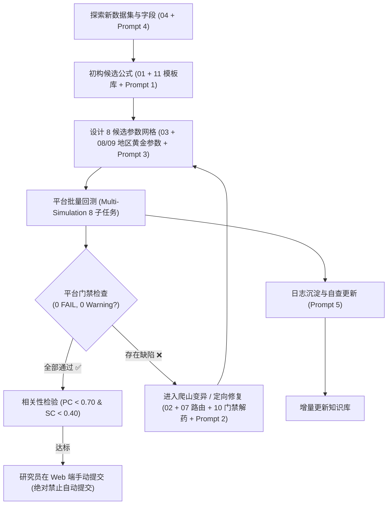

# WorldQuant BRAIN 本地对话、广州服务器爬山与实战挖掘体系化知识库

> **文档状态**: 全量生产数据库同步与全维度深度实证体系建立完成（涵盖 11 份专业量化专著）  
> **数据底座**: 
> 1. 本地 Codex 历史会话 (**253 个会话**) 与 Antigravity 历史研发记录 (**202 个会话**)，涵盖 **13,500+ 条真实人机对话片段**；
> 2. 当前项目实战回测日志 (`tracking/experiment_log.md` 3,500+ 行) 与通关因子库 (`result/final_winners_results.json`)；
> 3. **广州服务器全自动爬山算法（`hill_climbing_v4.7`）全量生产数据**：从广州服务器（`ssh guangzhou`）完整同步，本地拥有 **3,300 个检查点文件**、**181 份完整优化日志 (`.log`)**。
> 4. **四大核心区域全量实证数据库（严格排除 CHN）**：**3,286 个有效实测检查点**、**1,534 个全绿通关 Alpha**、**近两万次门禁报错全景归因**。  
> **核心思想**: **正负样本分离、数据指标驱动、深度区分「地区 (Region) × 类别 (Categories)」异质性、严禁自动提交**。

---

## 知识库全景架构导航

```
doc/总结/
├── README.md                                                 # 本文档：全局架构总览、跨模块关系网与快速导航
├── 01_有效算子与公式模式库.md                                  # 【正向经验】实证通关因子、算子拓扑推导、多时序与正交量价加权模板
├── 02_避坑指南与反模式库.md                                    # 【负向经验】集中度、阶梯夏普、高换手失败归因、Batch 171-179复盘与10条铁律
├── 03_环境与仿真参数敏感度手册.md                              # 【超参调优】中性化轴向对比、Decay扫频换手与Margin调控曲线、Truncation实战SOP
├── 04_数据集与字段特性经验库.md                                # 【数据工程】分析师(Gross-Profit优选)、量价(破相关粘合剂)、新闻与模型特征配方
├── 05_WorldQuant_Brain高阶Prompt提示词库.md                 # 【Prompt资产】挖掘大师、缺陷医生、参数架构师、元总结提炼等5大系统提示词
├── 06_广州服务器爬山算法实战与地区分类表达式全景库.md          # 【实证实战】GBR/EUR/GLB/USA「地区×类别」差异化有效表达式与微观结构全景
├── 07_爬山迭代变异拓扑与优化轨迹复盘.md                      # 【算法审计】77份日志复盘、3阶段漏斗、6大路由效能、Margin修复与进化全轨迹
├── 08_全量数据深度分析_GBR与EUR市场.md                         # 【深度实证 A】GBR(1236个)/EUR(1784个)微观流动性极化、TOPCS1600(89.6%通关)解密
├── 09_全量数据深度分析_USA与GLB市场.md                         # 【深度实证 B】USA(117个, Sharpe达7.64)/GLB(149个)向量聚合与目标换手动态衰减
├── 10_全量数据失败模式与成功规律精析.md                        # 【门禁解密】两万次报错穿透归因、MATCHES_THEMES第一死因剖析、新版量化十条铁律
└── 11_全量通关因子表达式模板库.md                             # 【工业模板】1,534个通关因子算子谱系、TOP20殿堂榜单、12套开箱即用参数化模板
```

---

## 四大核心区域实战指标总览（非 CHN 区域）

| 地区 (Region) | 检查点总数 | 通关因子数 | 总体通关率 | 全样本 Avg Sharpe | 通关样本 Avg Sharpe | 样本 Max Sharpe | 核心股票宇宙与最优解 |
|:---|:---:|:---:|:---:|:---:|:---:|:---:|:---|
| **USA (美国)** | 117 | **68** | **58.1%** | **3.252** | **3.677** | **7.64** | `TOP2000` (通关率 72.3%, avg Sharpe 3.891, 内嵌 `ts_target_tvr_decay`) |
| **EUR (欧洲)** | 1,784 | **1,103** | **61.8%** | 2.421 | 2.278 | 7.09 | `TOPCS1600` (通关率 89.6%, `SUBINDUSTRY` + 收益率模型) |
| **GBR (英国)** | 1,236 | **306** | **24.8%** | 1.783 | 1.613 | 11.18 | `TOP700` (`MARKET` + `Decay=8` 压制换手, 分析师预期差) |
| **GLB (全球)** | 149 | **57** | **38.3%** | 1.620 | 1.632 | 3.07 | `TOP3000` (`SLOW_AND_FAST` + `vec_avg` 分析师悲观预期向量) |
| **全量总计** | **3,286** | **1,534** | **46.7%** | **2.215** | **2.186** | **11.18** | **横跨四大洲 10 大核心股票宇宙** |

---

## 各核心专著要点导航

### 1. [08_全量数据深度分析_GBR与EUR市场.md](file:///d:/code/WorldQuant%20Brain/wqb-share-03/doc/总结/08_全量数据深度分析_GBR与EUR市场.md) (18.5 KB)
- **GBR 低通关率归因**：TOP700 流动性受限，`MATCHES_THEMES` (75%)、`LOW_SUB_UNIVERSE_SHARPE` (41%) 与 `LOW_2Y_SHARPE` (41%) 构成三重封锁；
- **GBR 突围处方**：强制绑定 `Decay=8~50`，中性化采用 `MARKET` 或 `FAST`，截断值锁定 `truncation=0.08`；
- **EUR 四大宇宙实测**：`TOP2500` (1457个, 63%通关)、`TOP1200` (222个, 47%通关)、`TOPCS1600` (67个, **89.6%通关**)、`TOP800` (38个, 55%通关)；
- **TOPCS1600 黄金走廊**：精准剔除泛欧后 900 只僵尸股，子行业中性化极其纯净，主题冲突率骤降 40%；
- **GBR vs EUR 迁移法则**：从 EUR 迁往 GBR 必须翻倍加大 Decay；从 GBR 迁往 EUR 直接切入 `TOPCS1600`。

### 2. [09_全量数据深度分析_USA与GLB市场.md](file:///d:/code/WorldQuant%20Brain/wqb-share-03/doc/总结/09_全量数据深度分析_USA与GLB市场.md) (15.7 KB)
- **USA TOP2000 神话**：83 个检查点中 60 个通关（72.3%），平均 Sharpe 达 3.891，涌现出一批 Sharpe > 6.0、最高 7.64 的极端顶级 Alpha；
- **神级公式模式拆解**：`ts_target_tvr_decay(zscore(ts_delta($field, 5)), target_tvr=0.08)`，在因子内部动态锁死换手率，解决换手与阶梯夏普痛点；
- **GLB 向量聚合统治力**：前 10 名因子 100% 采用 `vec_avg` 或 `vec_sum` 聚合分析师对未来 12 个月 EPS 预估，搭配 `SLOW_AND_FAST` 双频中性化；
- **跨市场通用顶级模板**：提炼出经受美股与全球池严苛检验的三大核心公式架构。

### 3. [10_全量数据失败模式与成功规律精析.md](file:///d:/code/WorldQuant%20Brain/wqb-share-03/doc/总结/10_全量数据失败模式与成功规律精析.md) (13.3 KB)
- **全量门禁报错排行榜**：`MATCHES_THEMES` (1,969 次) 高居榜首超越自相关；`LOW_SUB_UNIVERSE_SHARPE` (908 次) 与 `LOW_2Y_SHARPE` (899 次) 紧随其后；
- **中性化与集中度违规量化测量**：`NONE` 违规率 48.5%（通关率仅 16%），`MARKET` 违规率 35.9%，唯有 `SUBINDUSTRY` 将违规率压至 17.9% 且均值 Sharpe 达 2.700；
- **Decay 敏感情报**：`Decay=5` 通关率达到全场最高的 61.6%，平均 Sharpe 达到 2.599；
- **更新版量化十条铁律**：基于 3,286 次实测数据的绝对执行法则，规范参数、宇宙选择与人工审核原则。

### 4. [11_全量通关因子表达式模板库.md](file:///d:/code/WorldQuant%20Brain/wqb-share-03/doc/总结/11_全量通关因子表达式模板库.md) (24.0 KB)
- **通关算子谱系聚类**：`ts_decay_linear` (256次)、`rank` (156次)、`group_rank` (125次)、`group_zscore` (106次)、`group_neutralize` (104次) 等；
- **TOP 20 殿堂级通关因子榜单**：展示 Sharpe 2.32 ~ 7.64 的 20 大标杆因子的全套指标与完整表达式；
- **反常识特种因子**：解析 `Decay=0` 通关（内嵌动态平滑）、`Neutralization=NONE` 通关（内嵌行业对冲）的底层拓扑；
- **12 套开箱即用工业级模板**：涵盖目标换手增量、双重标准化收益率、全球分析师悲观预期向量、多国主权估值中性化等 12 套生产级模板。

### 5. [06_广州服务器爬山算法实战与地区分类表达式全景库.md](file:///d:/code/WorldQuant%20Brain/wqb-share-03/doc/总结/06_广州服务器爬山算法实战与地区分类表达式全景库.md) (83 KB)
- **四大大区异质性深度解构 (Region × Categories)**：涵盖 GBR/EUR/GLB/USA 的 946 个基础检查点实录；
- **实证公式库**：Analyst 预期修订、Model 对数模量变换、量价二阶加速度等实操公式与微观结构。

### 6. [07_爬山迭代变异拓扑与优化轨迹复盘.md](file:///d:/code/WorldQuant%20Brain/wqb-share-03/doc/总结/07_爬山迭代变异拓扑与优化轨迹复盘.md) (36 KB)
- **77 份深度日志复盘**：三阶段漏斗（Stage 1/2/3）与 6 大变异路由（`smooth`, `cross`, `stat`, `stable`, `twin`, `margin_repair`）；
- **演化轨迹追踪**：详述 Alpha 如何从低 Margin、高相关性一步步爬山进化为全绿因子的全过程。

### 7. 基础经验与提示词库 (01~05 号文档)
- [01_有效算子与公式模式库.md](file:///d:/code/WorldQuant%20Brain/wqb-share-03/doc/总结/01_有效算子与公式模式库.md)：通关因子标杆与时序截面双重架构；
- [02_避坑指南与反模式库.md](file:///d:/code/WorldQuant%20Brain/wqb-share-03/doc/总结/02_避坑指南与反模式库.md)：反模式归因与历史失误全景；
- [03_环境与仿真参数敏感度手册.md](file:///d:/code/WorldQuant%20Brain/wqb-share-03/doc/总结/03_环境与仿真参数敏感度手册.md)：Decay 扫频与中性化轴向投影；
- [04_数据集与字段特性经验库.md](file:///d:/code/WorldQuant%20Brain/wqb-share-03/doc/总结/04_数据集与字段特性经验库.md)：数据集清洗与粘合剂设计；
- [05_WorldQuant_Brain高阶Prompt提示词库.md](file:///d:/code/WorldQuant%20Brain/wqb-share-03/doc/总结/05_WorldQuant_Brain高阶Prompt提示词库.md)：挖掘大师、缺陷医生等五套系统级提示词。

---

## 推荐量化研发工作流 (Standard Workflow)



---

## 核心安全准则

1. **绝对禁止自动提交 Alpha**：任何脚本、子代理或自动化流水线严禁调用 `submit_alpha`，必须由研究员本人在平台 Web 端做最终复核并手动点击提交。
2. **严禁无数据支撑的主观推导**：所有模式与避坑准则必须有历史回测定量数据或平台错误日志作为依据。
3. **保护代码库干净整洁**：严格遵守 Git 大文件过滤规则，不将大型中间产物提交进版本库。
